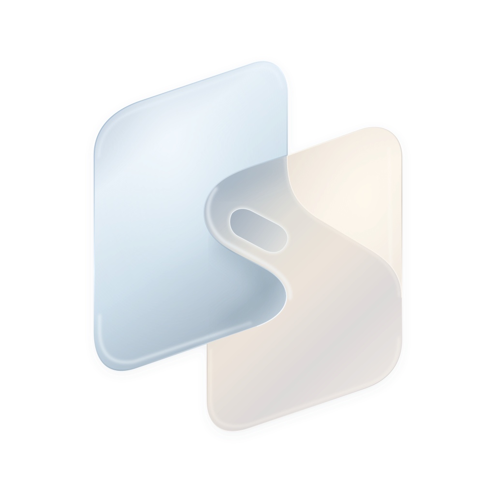

# Chordesk

English · [简体中文](README.zh-CN.md)

**Play a chord. Control your desktop.**

An iPhone remote desktop client and a Mac host. Use your thumbs for touch and typing, and Duo's rear screen for chord-like mode switches. Other iPhones use on-screen controls.

[Website & demo](https://stland-admin.github.io/Chordesk-site/) · [Operation guide](docs/user/OPERATION-GUIDE.md) · [Roadmap](docs/developer/ROADMAP.md)

## Install

| Platform | Public release |
| --- | --- |
| iPhone / iPhone Duo | [TestFlight public beta](https://testflight.apple.com/join/WZDXKgvg) |
| Apple Silicon Mac · macOS 15.2+ | [Mac 0.28.0 · signed & notarized](https://github.com/STLAND-admin/Chordesk/releases/tag/mac-v0.28.0) |

Open the Mac DMG and drag Chordesk into Applications. The app and installer are **Developer ID signed and Apple notarized**. Approve screen recording and Mac control separately; after each permission, reopen the app if macOS asks. Start service once both are effective. For updates, quit and replace the app at the same location. [Installation details](docs/user/MAC-PEER-TEST.txt).

Scan the Mac QR code once, then reconnect from your paired computers. LAN needs no account. For cross-network use, sign in to the same personal Tailscale network inside both Chordesk apps; no separate Tailscale app is required. Multiple Macs can be remembered. [Network setup and limits](docs/user/TAILSCALE.md).

## Controls

| Gesture | Mac action |
| --- | --- |
| Front tap / hold and drag | Click / select text |
| One rear finger + two front fingers up/down | Open/close Mission Control |
| One rear finger + two front fingers left/right | Next/previous Space |
| Two rear fingers held | Temporarily switch to trackpad; lift to restore |
| Right-side buttons | Menu, mode, display, overview and keyboard |

Spaces require optional System Events permission and enabled macOS Control + arrow shortcuts. Native and third-party iPhone keyboards are supported. [Full guide](docs/user/OPERATION-GUIDE.md).

## Latest update

**Mac 0.28.0 (43) is released; iOS 1.31 (40) is now available through TestFlight.** On November 3, 2026, Beta App Review approval was verified, testing was enabled and existing testers were notified. Mac 0.28 follows local IP changes without restarting the service, preserves pairing and Tailscale sessions, and withdraws stale endpoints. Stable signing/notarization and the Help-menu uninstaller remain. iOS 1.31 adds immediate rear-contact defaults, independent 480p–2160p / 15–120 fps / target bitrate controls, HEVC defaults with fallback and bounded connection recommendations. Screen capture runs only while an authenticated viewer is connected. Use the same invitation link to install or update to 1.31. Existing 1.30 clients can connect to the new Mac host.

Audio is disabled. Closed-lid/system-sleep wake is not guaranteed. IPv4/IPv6 pairing is supported; IPv6-only/NAT64 hardware, ordinary-iPhone hardware and broader networks still need testing. Actual FPS/bitrate depends on hardware and content; HUD RTT is not end-to-end interaction latency. Duo rear input uses Apple's camera accessory API, with camera frames discarded. App Store review remains separate from TestFlight.

## Develop and contribute

[Documentation](docs/README.md): [user guides](docs/README.md#users) · [developer guides](docs/README.md#developers).

[Project layout](docs/developer/PROJECT-LAYOUT.md) · [Xcode / Go / Mac build](docs/developer/DEVELOPMENT.md) · [Coding guidelines](docs/developer/AGENTS.md)

Build the iOS client from `ProjectFiles/Chordesk.xcodeproj` using your own Team. Read the coding guidelines before making code changes. Keep the original app identity when updating an existing installation. The concept website is maintained separately in [Chordesk-site](https://github.com/STLAND-admin/Chordesk-site).

Project-owned code, documentation and artwork: **[CC BY-NC-SA 4.0](LICENSE)**. Commercial use is not granted. Third-party licenses remain applicable; see [NOTICE](NOTICE.md). Privacy: [English](https://stland-admin.github.io/Chordesk-site/privacy.html?lang=en) · [中文](https://stland-admin.github.io/Chordesk-site/privacy.html?lang=zh). Feedback: styj@zju.edu.cn.
