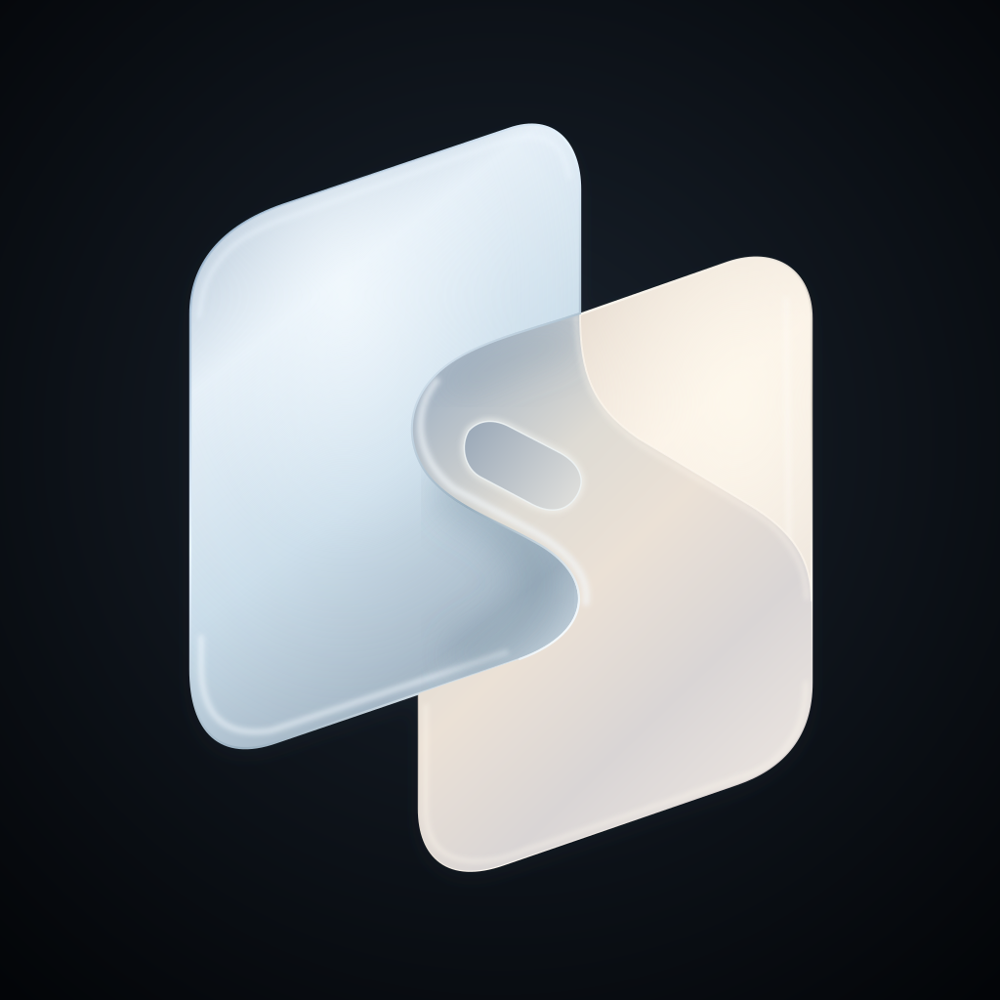

# Chordesk

**前后协作，像按和弦一样控制。**

为 iPhone Duo 设计的远程桌面：正面拇指触控和输入，背面手指像按和弦一样切换操作模式。包含 **iOS 控制端** 和 **Mac 主机端**。

[概念与 3D 演示](https://stland-admin.github.io/Chordesk-site/) · [操作指南](OPERATION-GUIDE.md) · [开发计划](ROADMAP.md)

## 安装

### Mac

下载 [Mac 0.18.1 试用 Release](https://github.com/STLAND-admin/Chordesk/releases/tag/mac-v0.18.1-test)，打开 DMG，把 Chordesk 拖入“应用程序”。

- Apple Silicon，macOS 15.2 或更新。测试包未公证，首次打开需由接收者按系统提示允许；[安装说明](docs/MAC-PEER-TEST.txt)。
- 首次点“开始服务”，按引导完成屏幕录制和控制两项权限；检查完整后自动重启 App 一次，默认开启内置屏服务。关闭窗口后保留菜单栏后台运行。
- 本仓库与试用 Release 公开，可把下载链接直接发给测试者。历史私有仓库独立保留，公开提交不包含原作者的私人邮箱。

### iPhone Duo

当前使用 **Xcode 本地编译安装**，尚无 TestFlight 下载链接。

1. 安装 Xcode 27.1 或更新，打开 `iPhoneDuoDemo.xcodeproj`。
2. 选择 `iPhoneDuoDemo` target，在 Signing & Capabilities 中选择自己的 Team，并使用自己可签名的 Bundle Identifier。
3. USB 连接 Duo、按系统要求开启开发者模式并信任 Mac，选择真机后运行。Xcode 免费个人团队可自测，但需要定期重新签名。

已有安装更新时保持原 Bundle Identifier 和 Team。开发者会员与审核准备完成后，通过 **TestFlight** 分发；[分发准备](docs/DISTRIBUTION.md)。

## 怎么用

两端连接同一局域网，首次扫描 Mac 二维码，之后从手机的已配对列表选择电脑。可保存多台 Mac，每次连接一台；IP 变化暂需重新扫码更新地址。

| 操作 | 效果 |
| --- | --- |
| 正面单指操作 | 默认直接触控；长按拖动选字 |
| 背面一指＋正面双指上下滑 | 打开／退出 Mac 窗口总览 |
| 背面一指＋正面双指左／右滑 | 下一个／上一个 Mac 桌面（Spaces） |
| 背面双指长按 | 临时切到正面触控板，松开恢复 |
| 右侧灰色按钮 | 菜单、模式、切屏和键盘，排列在同一列 |

左右切桌面还需在 Mac「设置 → 桌面切换」允许 **System Events 自动化**，并启用系统 Control＋左右方向键；这是独立的可选权限，不影响普通远控。

背面有效区可自由移动和缩放；文字输入支持 iPhone 系统／第三方输入法。非 Duo 有按钮切换入口，但尚未针对其他机型验证。

## 后续开发

- [ ] **优先优化键盘遮挡**：评估键盘上方的 Liquid Glass 输入预览，让 Codex 等远端输入框的内容保持可见。
- [ ] **评估 RDP 与客户端渲染**：验证 Mac 主机可行性及清晰度、带宽、延迟收益，再决定是否替换当前画面传输。
- [ ] **公网与非 Duo 测试**：验证外网连接、换网重连，以及普通 iPhone 的按钮／菜单操作与布局。

以上均为待办，具体任务和验收条件见[公开开发计划](ROADMAP.md)。

## 当前范围

- iOS **1.21 / build 25**，Mac **0.18.1 / build 26**；用户已真机确认手机菜单与背面组合手势均可切换 Spaces，iOS 1.21 无需重装。其他设备及新 Mac 首次授权流程的验证范围见记录。[验证记录](docs/VALIDATION-0.18.1.md)
- 当前仅局域网，TLS 配对；公网、账号与中继尚未实现。[公网规划](PUBLIC-NETWORK-PLAN.md)
- 显示模式默认目标 1600×900，使用系统现有安全模式；部分自定义 HiDPI 仍需可选 BetterDisplay 回退。[依赖说明](docs/DEPENDENCIES.md)
- 麦克风默认关闭。当前 Duo → Mac 会议输入需要虚拟音频设备；自研集成驱动尚未实现。[音频说明](docs/REMOTE-MICROPHONE.md)
- 背面实验使用相机辅助 API；相机帧不显示、不保存、不传输，不代表已获得通用外屏接口或上架许可。

[开发与构建](docs/DEVELOPMENT.md) · [开发历史](docs/DEVELOPMENT-HISTORY.md) · [品牌素材](Branding/README.md)

STLAND 出品
