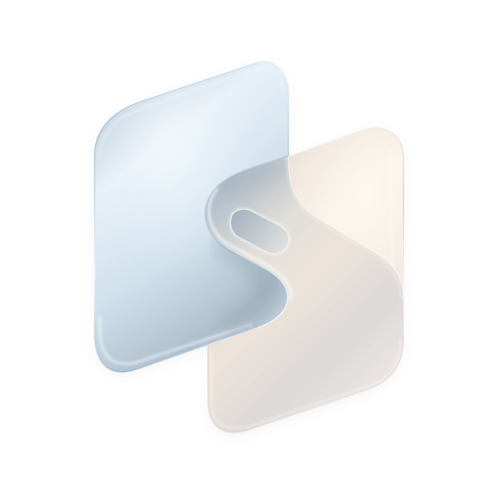

# Chordesk

English · [简体中文](README.zh-CN.md)

**Play a chord. Control your desktop.**

A remote desktop app designed for iPhone Duo. Use your thumbs for touch and typing on the front, while fingers on the back switch interaction modes like holding a chord. Includes an **iOS client** and a **Mac host**.

[Concept & 3D demo](https://stland-admin.github.io/Chordesk-site/) · [Operation guide](OPERATION-GUIDE.md) · [Roadmap](ROADMAP.md)

The website supports Chinese and English. Detailed operation guides are currently in Chinese.

## Install

### Mac

Download the [Mac 0.18.1 test release](https://github.com/STLAND-admin/Chordesk/releases/tag/mac-v0.18.1-test), open the DMG, and drag Chordesk into Applications.

- Apple Silicon, macOS 15.2 or later. This test build is **not notarized**; follow macOS prompts to allow it on first launch. [Installation guide](docs/MAC-PEER-TEST.txt).
- Click **Start service (开始服务)** and follow the screen recording and control permission setup. Once permission checks pass, the app restarts once and starts sharing the built-in display by default. Closing the window keeps the service running in the menu bar.
- The source repository and test releases are public. You can share the download link directly with testers.

### iPhone / iPhone Duo

[Install the TestFlight beta](https://testflight.apple.com/join/WZDXKgvg). Install TestFlight on your iPhone, then open the invitation. Use the Mac host above on the same local network. Regular iPhones use on-screen mode controls; Duo adds rear chords. Availability and device conditions are shown by Apple.

Building from source is also available:

1. Install Xcode 27.1 or later and Go 1.27.1+. Run `./scripts/build-tailnet.sh`, then open `iPhoneDuoDemo.xcodeproj` ([build details](docs/DEVELOPMENT.md)).
2. Select the `iPhoneDuoDemo` target. Under Signing & Capabilities, choose your own Team and a Bundle Identifier you can sign.
3. Connect Duo over USB, enable Developer Mode and trust the Mac as prompted, then select the device and run. A free Personal Team can be used for testing, but requires periodic re-signing.

Keep the same Bundle Identifier and Team when updating a source-built installation. iOS **1.22.1 / build 28** has passed external TestFlight Beta App Review; this is not an App Store release. [Release record](docs/IOS-RELEASE-1.22.md).

## How it works

Connect both devices to the same local network. Scan the Mac's QR code once, then reconnect from the saved computer list on your phone. Multiple Macs can be remembered, with one connected at a time. If a Mac's IP address changes, scan its QR code again to update the address.

| Gesture or control | Action |
| --- | --- |
| One finger on the front | Direct touch by default; hold and drag to select text |
| Hold one finger on the back + swipe two fingers up/down on the front | Open/close Mission Control |
| Hold one finger on the back + swipe two fingers left/right on the front | Next/previous Mac desktop (Space) |
| Hold two fingers on the back | Temporarily switch the front to trackpad mode; release to return |
| Gray buttons along the right edge | Menu, interaction mode, display selection, and keyboard in one column |

Switching Spaces also requires **System Events automation permission** in the Mac host's Settings → Desktop switching (设置 → 桌面切换), plus the macOS Control + Left/Right shortcuts. This optional permission is separate from basic remote control.

The rear activation area can be moved and resized. Text entry supports the iPhone's system and third-party keyboards. Other iPhones use the on-screen mode switch. Two targeted UI checks passed on an iPhone 18 Pro / iOS 27.0 simulator; regular-iPhone hardware compatibility remains under initial testing.

## Roadmap

- [x] **Cross-network remote control — solved, awaiting release:** embedded Tailscale connects both devices through the user’s private network, without an extra app or a self-hosted server. Picture and touch control over cellular are confirmed on the current device pair. The new Mac Release and iOS TestFlight build are not published yet.
- [ ] **P1 — Background energy:** measure capture, JPEG encoding and keep-alive work without a viewer; capture on demand while keeping a low-cost listener available.
- [ ] **Keyboard visibility:** explore a Liquid Glass preview so remote input fields remain visible while typing.
- [ ] **RDP and client-side rendering:** validate Mac current-session feasibility and compare clarity, bandwidth and latency.
- [ ] **Regular-iPhone hardware testing:** validate on-screen controls, keyboards, layouts and reconnection.

See the [public roadmap](ROADMAP.md) for completed work, remaining tests and release preparation. The next iOS distribution target is App Store review; another TestFlight release is optional.

## Current scope

- iOS **1.22.1 / build 28** separates Forget from Connect, pins rear-contact lights above the desktop, and adds bounded capture recovery. The idle rear-control fix still needs device confirmation. The complete guide and default iPhone keyboard remain. Mac stays **0.18.1 / build 26**. [Current validation](docs/VALIDATION-1.22.1.md); [guide recording plan](docs/GUIDE-RECORDING.md).
- **Published builds are LAN-only.** Development versions iOS **1.24 / build 33** and Mac **0.20.0 / build 29** include embedded Tailscale: LAN needs no login; cross-network mode uses each owner’s private Tailscale account. No additional Tailscale app or system VPN is installed. The user confirmed picture and touch control over cellular with 1.23.2 / 0.19.0. Broader network and long-session testing remain; the new Mac Release and iOS TestFlight build are unpublished. [Setup and limits](docs/TAILSCALE.md).
- Direct-touch and trackpad scrolling share adjustable momentum in development builds: **Settings → Unified scroll inertia**, from **0 (off) to 2**, default **1**. A new touch stops momentum; both ends need the update. [Implementation and validation](docs/VALIDATION-1.24.md).
- Development-source default quality is **Efficient · 15 fps**: up to 1280 pixels on the longest edge and JPEG quality 65%. Saved quality choices are retained. This is a frame-rate ceiling, not a fixed Mbps rate; bandwidth varies with the desktop content.
- Development Mac builds request first-run permissions in sequence from one button, then restart once and start the built-in display service. macOS permission confirmations still require the owner.
- Display scaling targets **1600 × 900 logical resolution**, using existing safe display modes. Some custom HiDPI modes still need the optional BetterDisplay fallback. [Dependencies](docs/DEPENDENCIES.md).
- Microphone forwarding is off by default. Using Duo as a microphone for Mac apps currently requires a virtual audio device; an integrated driver is not implemented. [Audio details](docs/REMOTE-MICROPHONE.md).
- Rear-screen interaction uses the experimental camera accessory path. Camera frames are not displayed, saved, or transmitted. This does not establish a general-purpose rear-screen API or App Store approval.

[Development & builds](docs/DEVELOPMENT.md) · [Development history](docs/DEVELOPMENT-HISTORY.md) · [Brand assets](Branding/README.md)

## License

[CC BY-NC-SA 4.0](LICENSE): attribution, noncommercial use, and ShareAlike. Applies to project-owned code, docs and assets; third-party licenses remain unchanged. [Scope](NOTICE.md).

Made by STLAND
