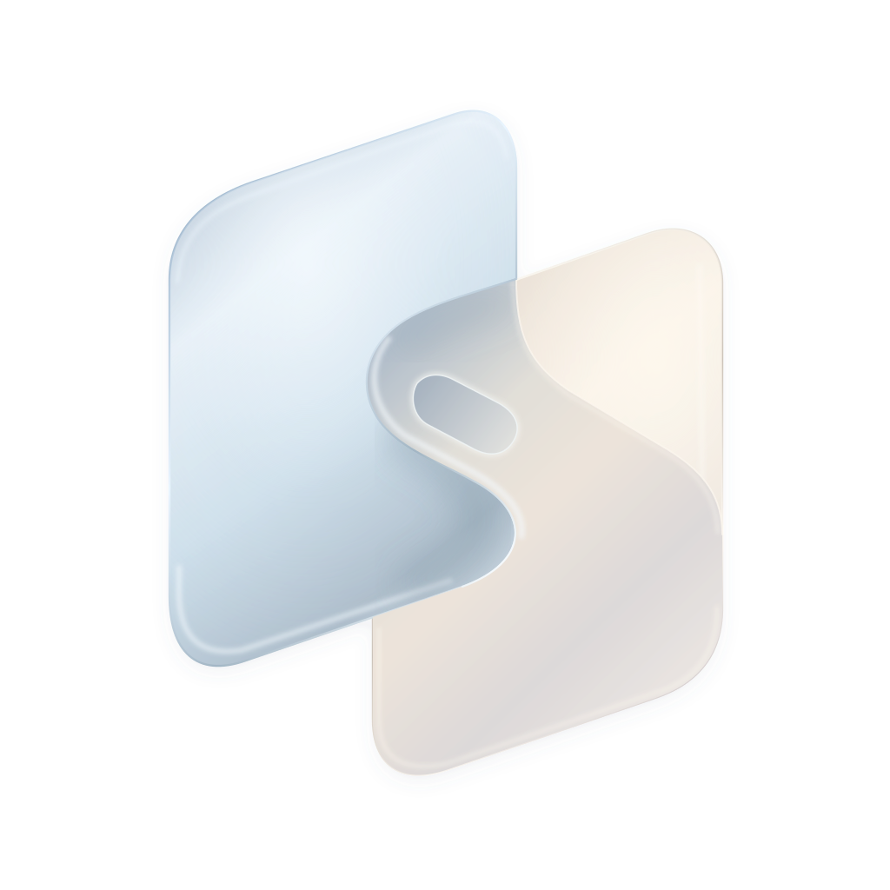

# Chordesk

[English](README.md) · 简体中文

**指间和弦，掌控桌面。**

iPhone 远程桌面客户端与 Mac 主机。拇指负责正面触控和输入，Duo 背屏像和弦一样切换模式；普通 iPhone 使用屏幕按钮。

[官网与演示](https://stland-admin.github.io/Chordesk-site/?lang=zh) · [操作指南](docs/user/OPERATION-GUIDE.md) · [开发计划](docs/developer/ROADMAP.md)

## 安装

| 平台 | 当前公开版本 |
| --- | --- |
| iPhone / iPhone Duo | [TestFlight 公开测试](https://testflight.apple.com/join/WZDXKgvg) |
| Apple Silicon Mac · macOS 15.2+ | [Mac 0.27.1 · 已签名公证](https://github.com/STLAND-admin/Chordesk/releases/tag/mac-v0.27.1) |

打开 Mac DMG，将 Chordesk 拖进 Applications。App 和安装包均已 **Developer ID 签名、Apple 公证**。分别允许屏幕录制、控制 Mac，每项完成后按系统提示重开 App；两项生效后开启服务。普通升级请先退出，再替换同一位置的 App。[安装说明](docs/user/MAC-PEER-TEST.txt)。

手机首次扫码绑定，以后点已配对电脑重连。局域网免账号；跨网时在两端 Chordesk 内登录同一 Tailscale 私人网络，无需另装 Tailscale。可记忆多台 Mac。[网络设置与边界](docs/user/TAILSCALE.md)。

## 操作速查

| 手势 | Mac 操作 |
| --- | --- |
| 正面轻点／长按后拖动 | 点击／选择文字 |
| 背面一指＋正面双指上／下滑 | 打开／退出窗口总览 |
| 背面一指＋正面双指左／右滑 | 下一个／上一个桌面 |
| 背面双指按住 | 临时触控板，抬起恢复 |
| 右侧按钮 | 菜单、模式、显示器、总览与键盘 |

切换桌面需要可选 System Events 权限与 macOS Control＋方向键快捷键。支持原生／第三方 iPhone 输入法。[完整手册](docs/user/OPERATION-GUIDE.md)。

## 最新进度

**Mac 0.27.1（42）已发布；iOS 1.31（40）已开放 TestFlight 测试。** 2026 年 11 月 3 日已核实 Beta 审核通过、启用测试并通知现有测试员，原邀请链接不变。Mac 新增稳定签名与公证、三态权限检查、钥匙串恢复及修复后的 Help 内嵌卸载。iOS 1.31 提供背面双指接触立即切换、独立分辨率／帧率／码率、默认 HEVC 与回退、限量测速推荐；仅认证手机观看时采屏。可在 TestFlight 安装／更新至 1.31，原 1.30 客户端仍可连接新版 Mac。

音频已关闭；不保证合盖／系统睡眠唤醒。支持 IPv4／IPv6 配对，纯 IPv6／NAT64、普通 iPhone 真机与更多网络仍需验证。帧率、码率受硬件与画面影响；HUD RTT 不等于操作到显示的完整延迟。Duo 背屏依赖相机辅助 API，相机帧丢弃。TestFlight 通过不等于正式 App Store 上架。

## 开发与贡献

[文档索引](docs/README.md)：[用户指南](docs/README.md#users) · [开发者文档](docs/README.md#developers)。

[工程目录](docs/developer/PROJECT-LAYOUT.md) · [开发构建](docs/developer/DEVELOPMENT.md) · [编码规范](docs/developer/AGENTS.md)

iOS 从 `ProjectFiles/Chordesk.xcodeproj` 选择自己的 Team 编译；修改代码前请阅读编码规范，覆盖安装保持原应用身份。概念网站独立维护于 [Chordesk-site](https://github.com/STLAND-admin/Chordesk-site)。

自有代码、文档、品牌适用 **[CC BY-NC-SA 4.0](LICENSE)**，未授予自由商用；第三方依赖保留原许可，见 [NOTICE](NOTICE.md)。[隐私政策](https://stland-admin.github.io/Chordesk-site/privacy.html?lang=zh)。反馈：styj@zju.edu.cn。
