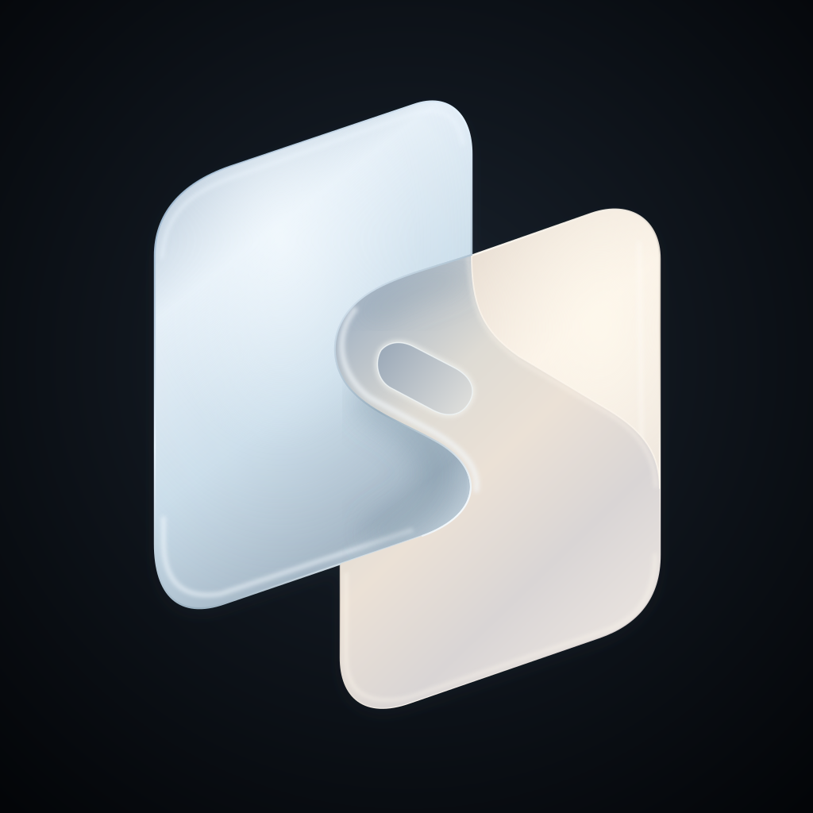

# Development and validation history / 开发与验证历史

这里集中保存历史验证、发行和早期原型记录。各节仅代表其当时状态；当前安装、操作与限制以 README、操作指南及本文件最上方最新记录为准。已删除的旧源文件可从 Git 历史恢复。

## 2026-11-05 · v2 网络与屏保恢复本地候选

- iOS 1.33 /47、Mac 0.29.0 /44：现有内嵌 tsnet 拨号旁加入有界 Disco 探测，不阻塞正常连接或禁用 DERP；两端提供默认地区、近期节点路径、带时间的 UDP／IPv6 网络探测，状态查询合并并移除全局控制锁等待。没有新增 Peer Relay、自建服务器、系统 VPN、未知中继或更改系统防火墙。
- 本机读取官方 DERP 表与旧主机 socket，对应香港 20b；新 UI 默认地区 hkg，实际独立探测 UDP／IPv6 可达、推荐香港。没有活动手机连接，不能据此声称端到端视频直连；官方列表无大陆节点，用户暂不提供服务器。
- 修复 blank／suspended 后未请求重建、息屏／会话恢复未重建原采集，以及取消旧任务清理新任务的恢复路径；显示信息请求超时 4 秒、每轮最多 3 次重试。原控制撤销、权限检查、停止共享与无人观看不采屏边界保留；不自动解锁、不承诺真正睡眠或合盖可用。
- Go 8 项含竞态通过，四平台原生库构建通过；Swift 209 项中 208 通过、日常主机占固定端口跳过 1；最终异步微调后相关 19 项通过。iOS 模拟器及实体架构编译通过，Duo 模拟器 1.33 /47 已启动。Mac 候选用相同 Developer ID 签名／designated requirement 本地更新，未提交公证、GitHub Release、TestFlight 或改变正式 App Store 提交。实体 Duo 不可用，用户暂不方便屏保实测；该验收保持待确认。详见 [v2 计划](V2-REMOTE-ENGINE-PLAN.md)。

## 2026-11-05 · v1 基线与 v2 引擎评估

- 用户将当前已提交版本确定为 v1，要求创建 `v2`。源码检查点 `4b1009c` 保留此前已验收的 build-46 UI、测试及后续语言／政策源码维护；提交作者使用公开 noreply，不带私有历史。当前分发基线为 iOS 1.32 /46、Mac 0.28.0 /43；iOS 已于本日提交正式审核，提交不代表批准。没有改变原发行包。
- 检查点不是上传 IPA 的逐字节复现：源码 developmentRegion 已改为 zh-Hans，上传二进制仍为 en；官网 November 5 政策补充还需同步未来二进制。后续发行须使用新 build 号，不覆盖已提交的 /46。
- 审查 macrdp `8848191`、RFB 与 Tailscale 第一方资料，确认 macrdp 仍主要传输捕获位图／H.264，完整系统光标读取含私有 SkyLight API。现有 Chordesk 存在共用有序流排队、状态查询等待与会话恢复路径的候选问题；尚无本轮现场弱网／动态屏保复现，未将候选原因标成已证实或修复。
- [v2 计划](V2-REMOTE-ENGINE-PLAN.md) 记录 RDP／VNC 比较、本地光标、P0 诊断与恢复、保留交互的引擎接口、验收矩阵及 UU 合作接口边界。本轮未安装第三方引擎、开放系统远控端口、调整权限或发布测试包；文档通过空白／本地链接检查，未因文档变更重复运行全套 App 测试。

## 2026-11-04 · iOS 1.32 /46 TestFlight 外部测试已开放

- 用户真机确认 /46 UI 正常后，明确授权推送 TestFlight 并提交审核。发行归档、导出、严格签名与分发 profile 检查通过；保持原 bundle ID／付费团队、iPhone 与 iPad 支持，确认不含隔离模拟器示例图片。Apple 上传日志明确 Upload succeeded。
- 沿用已批准的内嵌 Tailscale／WireGuard 标准非专有加密分类及不在法国发行的安排，未使用“仅系统加密”答案。本版只更改布局／原生玻璃辨识度，无新增权限、网络功能或加密实现。
- 保存中英文测试重点，选择原有内部验证、Duo 手势体验、iPhone 兼容性三个组，并确认“自动通知测试员”勾选后点击“提交以供审核”。随后构建列表及 Duo 外部组构建页均实查 1.32 (46)“正在测试”；不将其描述为仍在等待审核，也不推断 Apple 新进行了人工审核或每条通知已送达。
- 用户的 iPhone 13 Pro Max 使用 TestFlight，可从 TestFlight 更新 /46，本轮未使用开发者模式对其强行本地部署。Duo 已在此前通过 Xcode 覆盖安装并启动 /46，用户报告无异常。没有新增测试员、变更公开链接／人数上限、修改 Mac 0.28.0 或提交正式 App Store。

## 2026-11-04 · 本地 1.32 /46 直板机布局与玻璃辨识度修正

- 普通 iPhone 竖屏的操作栏置于系统状态区域与独立背面／通信条下方，横屏同样避让；27.1 原生栏保留系统宽度、中轴，垂直范围与公开 safe-area guide 取交集。首按钮为 Apple 原生弹性材质另留半径余量，远程画面仍可边到边显示。
- 顶部操作组改为原生 clear interactive glass，单个按钮按住只提亮图标，取消灰色圆形填充。模式组使用轻灰着色的原生 clear glass，选中项为固定中灰及白色图标，普通图标为固定中灰以兼顾白色／黑色远程内容；未使用自绘玻璃或私有 API，没有独立的衍射强度设置。
- 新增两项垂直裁切逻辑测试，Controls 共 9 项通过；普通 iPhone 27.0、iPad 27.0、Duo 27.1 横竖屏／菜单／模式布局回归通过。明暗内容 fixture 仅在 DEBUG 模拟器下编译，键盘与最终配色预览在隔离源码副本生成；生产 Release 构建成功。没有真实手机安装、Apple 上传或 GitHub 发布。
- 材料包保留先前 iPhone／iPad 截图与概念图，另补原已发布的真机海报（原字节）和 3 帧实拍视频，标注历史 UI；新候选截图单独存放。Duo XCTest 全屏导出为黑图，仅其几何／交互断言计入通过，不将黑图作为展示。已安装的 27.1 runtime 不兼容普通 iPhone 模拟器类型，不声称覆盖该组合。当前上传审核构建仍为 /44，/46 仅为本地候选。

## 2026-11-04 · 美港英文审核材料与 iPhone／iPad 预览

- 用户要准备英文商品页与审核材料、在Device Hub预览iPhone和iPad，并核实当前TestFlight状态。刷新App Store Connect后1.32 /44仍为“正在等待审核”，没有启用未获批构建、撤回审核、新增测试者或修改公开链接／上限；已选择的获批自动通知流程保留。未提交正式App Store、改变实际供应地区或将英文文案当成App已英文本地化。
- 文案、4000字内审核说明、隐私／加密工作表、提交流程、扩大测试简表及截图保留在忽略的本地发行材料目录。初始建议为免费、美国和香港、English。说明界面主要中文、Mac0.28.0签名公证下载／两项权限／相机非摄影用途／帧丢弃／tsnet范围与第三方元数据／音频禁用／合盖限制；不擅自提交年龄／内容权利或新法律协议。旧Apple正式草稿1.29及大陆供应范围仍需最终更新。
- 普通iPhone18Pro／iPadPro13 M5的27.0模拟器发现旧bar回退直接采用全屏，菜单会与系统状态及独立接触条相交。候选45在没有27.1bar API时采用window公开safeAreaLayoutGuide垂直范围，菜单顶部另避让独立接触条；图片仍边到边，不按机型／像素阈值分支，不动Duo27.1的原生bar宽度与中轴。增加UI断言，验证菜单不与状态条／接触条相交。
- 7项Controls逻辑通过；普通iPhone、iPad、Duo三项原生栏横竖屏／模式回归通过；iPhone、iPad两项截图流程通过键盘拟合／触控板检查，生产Release编译成功。首轮逻辑构建被旧产物Finder属性阻止，移至干净临时构建目录后通过，未改系统安全或用户文件。截图测试最初用文字定位无标题原生segment失败，修正locator后通过；应用局部截图旋转裁切异常，最终改XCUIScreen完整屏幕并实查图片，不能将坏附件当可用截图。
- 在Device Hub实际选过两个模拟器，后续系统自动锁屏阻止桌面交互，已请求本人解锁，没有绕过。预览App只在模拟器安装；隔离DEBUG副本加载安全TextEdit样本图，不连接日常主机、启用相机或发送真实输入。生产源不包含该图像fixture。模拟器视觉／布局验证不代表实体iPad网络、后摄触控或全部系统验收。45尚未上传或安装真机，现有44 Beta审核及Mac0.28.0不变；正式提交需使用后续实际上传的匹配构建。

## 2026-11-03 · iOS 1.32 /44 外部 Beta 审核提交

- 用户确认菜单／模式／键盘三组原生玻璃均可拉伸且外框正常后，沿用其 TestFlight 及通知测试员授权。以源码`13108a5`独立归档、导出并上传44；严格签名、App Store profile、稳定bundle ID、1.32 /44、隐私清单及停用麦克风检查通过。上传日志明确Upload succeeded，Apple完成处理后才继续后台配置；不重复上传或选择已被取代的43。
- 按原批准类别登记内嵌tsnet／WireGuard的标准非专有加密，不在法国发行。保存中英测试内容和Mac0.28.0签名公证下载／权限操作指引；保留联系人、隐私政策、无需登录的局域网审核路线，未新增声明、账号或测试者。
- 关联原内部验证、Duo手势体验、iPhone兼容性测试三组；提交时“自动通知测试员”明确为勾选。提交后详情出现“从审核中移除”，构建列表1.32 /44实查“正在等待审核”，三组标识均在。获批后由Apple自动分发／通知，不能把此时状态称为已获批、已外部安装或通知已送达。公开邀请与人数上限不变，1.31 /40继续可用。
- 本轮未提交正式App Store、修改供应地区或重发Mac。44的三项针对性UI与用户真机反馈见下一节；此前完整回归不冒称44重跑。截图仅保存在忽略的本地预览目录，不将账号页面、配对资料或发行包提交Git。


## 2026-11-03 · iOS 1.32 /44 三组原生交互玻璃与 TestFlight 候选

- 用户在43安装后修订交互要求：菜单和模式bubble也要像键盘按钮一样按住／拖动拉伸。按最新要求将菜单组`UIGlassEffect.isInteractive`开启，模式组增加clear类型的原生交互玻璃外层，保留`UISegmentedControl`的系统选中滑动及同步背面状态。不添加自绘拉伸、弹簧transform或竞争pan识别器。
- 滚动viewport按控件尺寸留出半个直径的动画余量，继续裁切远离视口的快捷键；padding不扩张初始触控命中列，不挤占黑边触控板。移除会截断交互玻璃的外层紧贴边界裁切，保持系统bar中轴、原符号比例与原键盘逻辑。
- 三项针对性UI通过：横竖屏／系统bar对齐、模式点击和按住滑动；菜单短按／长按／取消；键盘黑边输入与右栏排除。一次构建进程意外退出后低并发重跑通过，不将失败产物交付。Release严格签名、Duo覆盖安装、启动及设备版本查询均通过，实查1.32 /44。用户真机明确反馈“三组都能拉伸，外框正常”。
- 用户此前已明确要求TestFlight及通知原测试者。43已正式归档／校验／上传成功，但UI修订发生在外部送审前，停止将43作为候选，不撤回或重复修改旧1.31测试。44将按本条验收后继续同一发布目标；公开链接、测试员、隐私、联系人、加密类别及Mac0.28.0保留，正式App Store提交不在范围内。实际Apple状态以之后记录为准，不把上传当作已审核或通知已送达。

## 2026-11-03 · iOS 1.32 /43 侧栏中轴与按压外观修正

- 用户真机指出42仍未对齐Wi-Fi中轴、上组图标偏大，且按住时顶部被裁平。模拟器只读公开布局实测：内容安全区右侧条带中点为909，而 `.bar(onEdge: .trailing, extent: 44)` 实际区域为 `(881,124,44,511)`、中点903。旧代码错误地仅采用该区域的上下边界；现直接使用完整系统 bar 区域确定中轴与宽度，移除安全区／occlusion推算和未使用的旧Reader。不以这些示例坐标写死设备布局，不读取私有Wi-Fi视图。
- 所有侧栏SF Symbols改用相同的动态字体和光学画布，宽图标等比缩小，模式符号仍保留原生分段控件的选中放大。顶部整组玻璃关闭交互缩放，按钮改为原生配置的局部高亮，外层原生胶囊边界保持固定；保留键盘按钮及模式控件的系统交互，未改短按／长按菜单执行逻辑。
- 7项ControlsTests全部通过；3项针对性UI通过，覆盖系统bar中轴与实际按钮一致、横竖屏、模式点击／滑动切换、菜单短按／长按／取消和键盘黑边触控。合成画面录屏抽帧确认顶部按住前后外框仍为完整胶囊，截图中轴对齐；这不是新一轮实体Duo视觉验收。
- Release真机包严格签名通过，沿用原Team／bundle ID，已覆盖安装，真实设备查询确认1.32 /43。自动启动被手机锁屏阻止，需解锁后打开；不称已启动或已完成43真机复测。配对、偏好、Mac0.28.0和TestFlight1.31 /40均保留，没有上传或送审新包。

## 2026-11-03 · iOS 1.32 /42 原生 Liquid Glass 侧栏接入

- 用户批准将独立原生预览接入真实 iOS 工程。新增 UIKit 侧栏：顶部菜单及可隐藏的显示器／总览快捷键、紧接其下的双段操控模式、底部单个圆形键盘按钮；键盘打开后 Ctrl／Option／Cmd 向左展开。所有方向保留在右侧，上方可滚动；透明宿主只拦截侧栏自身，保留键盘上方黑边触控板、原生输入法、组合文字、画面等比适配与自动键盘逻辑。
- 使用系统 `UIGlassEffect`、`UIButton.Configuration.glass()`、`UISegmentedControl` 与 `UITextLoupeSession`。沿用已验证的普通 UIKit 菜单列表、快照与关闭后执行逻辑，不切回导致短按冲突的 context-menu 跟踪。系统放大镜接入原来的长按识别与拖选流程，抬手／取消／多指／禁用／离窗时失效；移除手绘放大镜视图。
- 模式选择器显示背面触发后的有效模式，手动选择时计算其基准模式，释放旧正面手势但不丢弃当前背面接触。触发规则变更、菜单、失去前台和断线等原有取消边界保留。独立顶条增加真实连接路径，移除为顶条预留的整条画面 padding。
- 1.32 /41 已开发签名覆盖安装，设备查询确认成功；自动启动被手机锁屏阻止。用户随后打开实测并反馈“功能没有问题”，同时要求进一步对齐 Wi-Fi 的宽度／中心线与半圆端点。1.32 /42 使用公开 trailing 状态列中心、统一控件宽度、系统胶囊 cornerConfiguration 和圆形修饰键；不读取私有 Wi-Fi 视图，不按机型／设备像素阈值分支。build 42 签名包生成后一度因手机不可用等待；用户再次连接解锁后，严格签名核验、覆盖安装和启动全部成功，设备查询实际为1.32 /42。保留原配对和偏好，不能将41的反馈扩大为42视觉已真机验收。
- SwiftPM 最终203项，202通过、日常主机固定端口占用1项跳过、零失败。五项新增逻辑回归覆盖背面接触保留、拖动释放／抑制、触发规则取消和公开状态列布局。七个针对性 iOS UI 用例分别得到通过记录，包含菜单四类及短按／长按取消、模式隐藏、横竖屏与原生按住拖动选择、键盘两种触控模式／修饰键／黑边和顶条独立定位。补充联跑曾发生键盘可见状态／快照及菜单时序失败；归一测试初始偏好后重查相关用例通过，最后尺寸统一后的两项键盘检查再次通过。这里不以这些测试宣称全部设备、系统版本、极端键盘布局或长时间手势均已覆盖。
- iOS Release 真机包严格签名校验通过。原 bundle ID、Team、配对数据、黑底图标、权限和网络协议不变；没有上传新 TestFlight、提交正式 App Store 或重发 Mac。公开 iOS 仍为1.31 /40，Mac仍为已签名公证0.28.0 /43。操作指南及中英更新记录同步开发版状态。

## 2026-11-03 · 侧栏预览的最新交互约定

- 用户在原生预览后进一步修订：键盘恢复为单一圆形按钮；模式双段 bubble 紧接顶部菜单／自定义快捷键组下方，不再靠近底部键盘；横屏、竖屏、仅外屏全部固定右侧。状态条独立置顶，键盘打开时 Ctrl／Option／Cmd 在键盘按钮左侧展开；模式 bubble 可在快捷键设置隐藏。
- 独立 UIKit 预览使用系统 `UIGlassEffect`、`UIButton.Configuration.glass()`、`UISegmentedControl` 与 `UITextLoupeSession`；只组合公开原生控件，不引入第三方 SDK 或手绘玻璃折射。两种模式复用正式 `GripInputState`，预览背面0／1／2指入口不会启用真实相机或向Mac发送输入。
- 已核对最后的展开横屏截图：菜单组三按钮、紧接其下的双段模式、底部单键盘按钮，远程图像边到边；键盘按钮可进入原生第一响应状态并展开三修饰键。模拟器未显示软件键盘，尚不能据此宣称真实键盘遮挡布局已验证。Mac曾自动锁屏，用户解锁后已补查展开竖屏、正常朝向仅外屏仍为右侧；模拟背面双指切到触控板、恢复0指回到直接触控，手动切换显示同步，菜单隐藏／恢复中间bubble均通过。这里是模拟器共享状态模型验证，不是实体背屏验收；软件键盘遮挡与真机交互仍待验证。正式iOS安装和TestFlight均不变。

## 2026-11-03 · Mac 0.28.0 签名公证发布

- 用户真机确认本地修复“局域网画面、触控都正常”，满足其“测试没问题再签名发布”的明确授权。最终源码`06b21bbb87cbfc1de7b408fa41cee315b022e199`、Release构建，保留原Developer ID、Hardened Runtime与权限命名空间；未新增系统权限或改变代理设置。
- App 公证`6edad4d7-9304-45ef-8838-03f92557a17e`与最终DMG公证`52da88f2-176e-4e45-a971-d0780c668805`均Apple Accepted。严格签名、双票据装订与验证、Gatekeeper、镜像内仅App／Applications两项可见内容通过；安装背景只留DMG内，不写Finder全局设置。
- 公开[mac-v0.28.0](https://github.com/STLAND-admin/Chordesk/releases/tag/mac-v0.28.0)，保留prerelease标识。四附件为DMG、摘要、构建信息、安装说明，逐项核对远端大小／SHA256后发布，匿名重新下载DMG摘要一致；未公开私人网络地址、凭据、测试视频或整套构建目录。源码同步公开main，README和更新记录同步。
- iOS TestFlight仍为1.31 /40，未上传新手机构建或提交正式App Store。新侧栏按用户修订保持独立原生预览，不能把预览交互／模拟背面状态当作手机真机验收。

## 2026-11-03 · Mac 0.28.0 /43 局域网换网重绑

- 定位到原主机切换 Wi-Fi／IP 后仍绑定启动时的旧地址。新增独立局域网监听池，沿用服务心跳每两秒刷新当前地址；只重建已改变或失败的精确 IP 监听，不绑定通配地址、不扩大公网范围，不停止 Tailscale、已认证观看者或采屏生命周期。
- 监听撤销前先使其回调身份失效，旧 ready／failed／接入回调不能恢复过期二维码或停止新服务。失败间隔三秒重试；离线即撤下旧端点，恢复后保留相同配对密钥重新监听。二维码和已认证连接的端点更新同步；手机离线时换网仍需一次 Tailscale 重连或重新扫码获知新地址，不以设备名称替代认证。
- 新增四项地址选择／TLS 监听实测，覆盖同密钥新地址连接、已认证连接跨监听替换继续通信、旧回调隔离及公网／通配地址拒绝。完整回归198项：197通过、生产固定端口占用1项跳过、零失败，没有强停日常服务制造通过。
- Release配置本地测试0.28.0 /43沿用原Developer ID身份部署到Applications；未改用户权限、配对、公网登录或代理。真实界面恢复当前LAN地址、原Tailscale登录和空闲不采屏，用户随后确认“局域网画面、触控都正常”。用户条件式授权因此满足，可继续签名公证和GitHub发布；本条写入时尚未上传本版公证或发布。

## 2026-11-03 · 原生 Liquid Glass 独立预览与显示安全区约定

- 用户要求先预览，不直接替换现有 App。独立 UIKit 模拟器样例使用系统 `UITabBarController`、`UINavigationController` 和工具栏项目，验证按住标签的放大与滑动选择；组合修饰键仍为独立按钮，不把 Ctrl／Command／Option 伪装成互斥导航标签。没有引入第三方玻璃 SDK 或自行绘制水滴动效。
- 显式核对预览 Mach-O 的 SDK 标记为 iOS Simulator 27.1 后，原生容器按系统布局切换：正常展开横屏、仅外屏竖向使用均在右侧 Wi-Fi 区域下方，展开竖屏为底部标签栏。旋转后的具体边缘由系统决定，不读取私有系统视图或按设备像素阈值摆放栏。
- 按用户明确授权修改编码规范：远程画面在横屏、竖屏和仅外屏均可延伸到状态栏下方，不以内容安全区裁切或预留整条黑边；系统图标保留，触控板范围不由内容安全区截断。预览图像锚定容器边缘，已分别截图核对三种正常方向。
- 使用公开 `UITextLoupeSession` 对栅格图像开始／移动／结束放大镜；实际录屏确认镜面出现且放大图像，抬手后消失。它是系统放大镜，不是可任意配置的通用玻璃折射 API。当前验证只覆盖独立样例，尚未替换正式手势识别或证明背屏／远控共存无回归。
- 预览源码与录屏只留本地；正式 iOS／Mac 源码、安装版本、TestFlight 和公证发行包均不变。第一方参考：[UIKit 新设计](https://developer.apple.com/videos/play/wwdc2025/284/)、[Duo 系统栏适配](https://developer.apple.com/videos/play/tech-talks/111462/)、[UITextLoupeSession](https://developer.apple.com/documentation/uikit/uitextloupesession)。

## 2026-11-03 · TestFlight 1.31 开放与 Finder 安装背景修复

- 用户授权审核通过后启用并通知：实时核实 iOS 1.31 /40“已批准”，点击原构建的“通知测试员”，之后重新读取列表确认为“正在测试”，通知按钮消失。原内部验证、Duo 手势体验、iPhone 兼容性测试三组保持关联；未新增测试员、改公开链接或人数上限，未重新上传／送审，正式 App Store 状态不变。通知触发不等于每台测试设备已收到或安装更新。
- 只读检查确认本机 Finder 的普通图标视图默认、最近使用视图均含 Chordesk 安装图片引用。备份这两处设置后，仅清除安装图像引用、恢复普通背景；保留其他 Finder 偏好。一个原受影响文件夹保留了旧视图，单独提供普通背景元数据并切换视图刷新。已实际查看最近使用、普通项目目录和原问题窗口，背景均恢复，未更改其中内容。备份和恢复记录仅留本地，未上传用户文件夹路径或偏好数据。
- 现有 `create-dmg.py` 只向镜像内写背景／布局，没有全局 Finder 偏好写入；不将本机偏好异常表述为所有用户安装后都会发生。只读挂载现有 0.27.1 DMG，核对两项可见内容、镜像独立安装图与严格签名，挂载／卸载前后受影响的 Finder 默认值一致。补充不得对安装图片使用“用作默认”的维护／打包说明。154 处本地文档／图片链接与 diff 检查通过，隐私正文不变；未改 App 代码、重新签名或替换已公证包。

## 2026-11-03 · 文档按用户与开发者归档

- 根目录的操作指南、更新记录、路线图、公网规划和编码规范迁入 `docs/`；工程目录说明也归入开发者文档。根目录保留双语 README、LICENSE、NOTICE、gitignore，以及 SwiftPM 必需的 `Package.swift`；源码和脚本目录保留原位。
- `docs/user/` 提供安装、操作、联网、维护、测试反馈、更新与已采用的隐私政策；`docs/developer/` 提供工程、构建、编码规范、首次使用验收、分发、依赖、开发计划和历史，录制素材也归入此处。`docs/README.md` 按两类索引；两种语言的根 README 提供入口。
- 更新文档间的相对链接、Mac 试用包的安装说明输入路径及官网指向仓库的文档地址；修复历史记录中已有的品牌素材失效链接。产品源码、已发布安装包、应用版本与隐私政策正文不变。

## 2026-11-03 · Apple登录恢复后的TestFlight实查

- 用户完成Edge App Store Connect登录后，重新打开Chordesk构建列表，1.31 /40仍显示“正在等待审核”；详情提供“从审核中移除”，原内部验证、Duo手势体验、iPhone兼容性测试三组均已关联。确认是已提交的Beta审核队列，不是未送审、获批或已外部分发。
- 在既有构建保存中英文测试内容，把旧未公证Mac0.26下载换为已公开的Mac0.27.1签名公证包；均确认“已保存”。Beta审核备注仅替换Mac链接与签名／公证状态，原非摄影相机用途、Tailscale、加密、隐私、联系人与无需登录说明保留，保存后重新读取确认新Mac说明存在。
- 同步英文Beta通用描述的Mac入口，未改法定声明或接受新条款；当前版本未获批，不启用外部更新、不通知测试员、不撤回重送或重复上传。iOS源码对照结果仍是1.31之后无新增手机功能，内部工程更名不为此创建同功能新构建。
- Edge同时被使用并切换页面，界面工具拒绝过期元素／超时后重新观察，未对其他页面执行账号授权或提交。没有保存浏览器凭据、测试者名单或联系人到公开Git。

## 2026-11-03 · Mac 0.27.1 Developer ID／公证发布与 iOS 核对

- 用户要求最新Mac签名公证，并先比较iOS与TestFlight，存在新增功能再上传。原本机公证profile恢复可读，未创建新证书、未提取密码；沿用已授权Developer ID身份和Hardened Runtime。
- 从源码`8ded464ee8a39faddb43f55a3d7d521b27b8f373`构建0.27.1 /42。App公证`409cf838-e7af-4024-a977-d12a74660ae4`、最终DMG公证`33be4a75-98a3-489a-b1c7-7af1ea5deb6d`均获Apple Accepted。票据装订与验证、App／DMG严格签名、Gatekeeper接受及镜像校验通过。
- 发布公开[mac-v0.27.1](https://github.com/STLAND-admin/Chordesk/releases/tag/mac-v0.27.1)，保留beta/prerelease标识。4个附件为DMG、SHA256、BUILD-INFO、INSTALL；创建草稿后逐项验证摘要与大小才发布，匿名重新下载DMG摘要再次匹配。未上传整个构建目录、凭据或审核草稿。GitHub连接器不提供Release附件能力，使用官方API和已有Git凭据完成。
- 本机此前App已被移除；同一公证App重新安装到`/Applications/Chordesk.app`，已安装副本的签名／票据／Gatekeeper均通过，已启动。界面显示录屏与控制均未授权、公网登录关闭，符合完整卸载后的初始状态；未自动重授权限或恢复旧凭据。系统权限需本人按流程允许。
- iOS对照已上传1.31 /40归档和原源码`7866cf2ae5031ca0c97b33fa1cdea181ff7a8dd9`：35个App源码／资源完全一致；入口仅`iPhoneDuoDemoApp`更名`ChordeskApp`，工程／产品内部名相应更新，稳定bundle ID和用户显示名Chordesk不变；网络文件差异限定Mac条件编译，其他修改也为Mac专用。未发现1.31之后新增的iOS功能，不增加版本／构建号或重复上传。
- Apple已打开的旧页面显示1.31 /40等待审核；刷新后转到过期登录页，因此不把缓存视为实时确认。最后确证分发是1.30 /39，1.31此前正式提交；本轮已请求用户自行登录Edge后复核，未撤回、重新提交或启用未经确认状态的构建。iOS既有加密／隐私声明不改，不接受新协议或提交正式App Store。
- README及活动分发说明更新Mac签名包入口；不把Apple公证说成App Store审核，也不把手机已安装开发版当作TestFlight已分发。

## 2026-11-03 · Mac 0.27.1 /42 内嵌卸载修复

- 用户报告0.27.0完整卸载失败，Cocoa3587是应用在未获就绪回执时抛出的笼统错误，不能推断为签名或安装位置问题。增加只读预检／明确拒绝回执后，在实际Mac界面确认helperLocation：运行时返回`/tmp/ChordeskUninstaller.…`，旧路径条件只接受`/private/tmp/…`。
- 两侧先解析系统路径别名，仍要求临时根目录中单层`ChordeskUninstaller.<UUID>/ChordeskUninstaller.app`，拒绝嵌套、相似前缀、其他App和其他根目录。新增真实临时目录的别名回归；不存在路径与已存在别名在Foundation中的行为不同，不用纯字符串测试代替真实目录。
- 打开卸载sheet先无损校验同签名辅助程序；握手为结构化JSON、最多1024字节、8秒超时，失败明确说明未开始清理，不再统称“请从Applications打开”。退出前先完成显示恢复和节点断开，再关闭sheet；生命周期不重复启动同一异步清理，避免准备完成后仍卡在模态窗口。
- Help中真实执行“仅卸载App”：主机正常退出，安装路径实际消失，匹配App进入用户废纸篓；随后同一Developer ID签名的0.27.1 /42重新安装到原路径。未使用完整清理来再次删除用户凭据／授权。辅助程序与后端的完整清理范围由既有7项隔离测试覆盖，不把本次App-only实测称为新GUI完整清理均验收。
- 完整Swift **194项0失败**、隔离卸载 **7项通过**，严格签名通过；只改Mac条件编译代码及构建版本，iOS未安装／上传。公证与GitHub安装包发行状态不变，不把本机Developer ID签名当成新版本已公证。

## 2026-11-03 · 工程整理、真实卸载与 Mac 0.27.0 /41

- 所有应用源码、Xcode 工程、测试、原生网络桥接和图标素材移入 `ProjectFiles/`；iOS project／scheme／App 入口统一 Chordesk，Mac 模块／可执行文件 ChordeskHost。根 `Package.swift`、构建脚本、依赖引用、QA 隔离脚本与文档路径同步。稳定 bundle ID、钥匙串及协议标识保留。独立官网和其他产品未修改。
- 此前 27 份旧验证／发行／原型说明已合入本文件，活动文档保留；新增工程目录说明解释 Tests（不安装的回归检查）、Native（Go/C 公网桥接）、Branding（图标源素材）。不把名称中带 Demo 的现用手机交互模型当死代码删除。
- 0.26.1 /40 的最终 DMG 公证请求 `56fa429f-d372-4d56-8b74-952f5556a9fd` 已 Accepted。App 与 DMG 均完成票据装订、严格签名、Gatekeeper 及镜像验证，分发文件准备完成但未上传 GitHub。
- 按用户授权实际运行0.26.1包内维护工具“完整卸载”，本App系统授权、配对、登录、偏好清理，App／数据移入废纸篓；随后将已公证同版安装到 `/Applications/Chordesk.app`。真实界面确认两项待授权、服务停止、公网未登录。后续用户指出缓存状态误导，不能据此宣称新授权流程已全部验收。
- 系统权限新增三态：未授权、已授权但需重启、已授权可用。启动／回前台／主动检查通过同一签名App新进程做公开只读preflight；两秒日常刷新不循环建进程。当前进程与新进程不一致时明确要求重启；刚请求权限的启动保留重启屏障。核验失败显示不确定及人工路径，不假装读取设置中的私有开关。
- Help → 卸载 Chordesk… 提供保留数据／完整卸载，默认保留；明确确认后停止服务、恢复显示、断开节点，临时同签名辅助副本等待原进程退出，再调用随包固定后端。无 Terminal／导出操作，无 sudo、无全局钥匙串／TCC修改；错误显示未完整清理。设置保留修复权限入口并引导去Help。
- 245 项历史构建／安装／QA输出已可恢复移入废纸篓，保留当前产物、当前网络框架、源码和私有Git备份。自动审批拒绝扩大范围的永久删除，采用可恢复搬移，未清空废纸篓。
- 验证：完整Swift回归 **192项0失败**，含新增错密钥／无明文回退真实TLS回环、三态逻辑、卸载参数作用域与PTY确认传递；另 **7项隔离卸载测试通过**。iOS Release兼容构建通过，UI测试target重命名后的模拟器构建通过；QA准备脚本、脚本语法、项目plist和diff检查通过。Mac0.27已Developer ID签名覆盖唯一日常安装并启动，Help卸载对话框及取消返回已真实验证，权限页显示当前／新进程均可用、服务等待连接且未采屏。未再次完整卸载以验证全部新GUI路径；“已开启但需重启”的真实系统场景仍待用户复测。
- 新版0.27公证工具报原 `Chordesk-notary` profile不存在／不可读，未上传新请求；已告知用户可稍后本人重新保存凭据。0.26.1公证成功不覆盖0.27代码。新Mac未发布，iOS保持1.31/40，本轮不上传或改变Apple审核状态。隐私／安全与法律建议只保留本地，不发布完整审查、不替用户采纳新条款或更换CC许可。

## 2026-11-03 · Mac 0.26.1 Developer ID 签名与公证进行中

- 用户明确恢复此前暂停的 Developer ID Application 证书创建、最新版签名和 Apple 公证；通过 Xcode 为现有 Team 创建证书，私钥留在本机钥匙串，未导出。未替用户完成密码或系统认证；Xcode 二次签名的钥匙串提示由用户确认“已允许”。
- 使用已测试干净提交 `db4933b4bd1e6b5001f47bf65e292719b067eff8` 的 Mac 0.26.1 /40 独立副本，Developer ID + Hardened Runtime + Apple 可信时间戳严格校验通过，保留原 bundle ID、可选 Apple Events entitlement 和黑底图标。不修改运行代码或覆盖日常 App，不重置现有 TCC／配对／公网身份。
- 最初时间戳请求出现时差错误，重新核对时间后请求；Documents 同步服务反复给包添加 FinderInfo 导致签名拒绝，改在 `/private/tmp` 本地暂存后通过。不关闭签名／时间戳验证，不调整用户时钟或禁用文件同步服务。
- Xcode 使用已登录账号提交：北京时间 **01:18:16** 返回 `Uploaded Chordesk` / `EXPORT SUCCEEDED`。Organizer 显示 0.26.1 /40、Notarization **In Progress**；导出工具也明确说明处理中、不可分发。签名与上传成功不等于公证通过。
- 最终 DMG 已采用原拖入 Applications 指引并完成 Developer ID 签名；只读挂载确认两项可见文件、版本／身份、维护工具、背景及严格签名，包内无凭据文件。指定要求为 Xcode 的稳定发行要求，Hardened Runtime 开启、仅 Apple Events entitlement、无 get-task-allow。其命令行公证需用户直接配置应用专用密码／notarytool 钥匙串 profile；用户已批准配置，官方页面与本机安全输入脚本已准备，生成和输入由用户本人完成，工具禁止控制系统 Terminal。不提取 Xcode 登录令牌。当前仅 App 上传完成，最终 DMG 公证尚未提交，未发布 GitHub Release，iOS 送审与现有公开下载不变。
- 随后用户回复“配置完成”，notarytool 已可读取本人配置的本机钥匙串 profile；没有读取或保存密码到脚本／Git。最终 DMG 成功上传，回执 `56fa429f-d372-4d56-8b74-952f5556a9fd`，服务器仍处理中。替换本地十分钟等待后，启动最长 48 小时的收尾进程；仅等待此请求，不重传。只有 Apple Accepted、审计上传 SHA256／App cdhash 匹配、两种票据及 Gatekeeper／镜像校验均通过，才生成 `distribution/` 下的 DMG、App ZIP、校验和与说明；异常写入 STATUS 并停止，不发布 GitHub、不安装／授权。暂存与日志需本机保持运行联网，当前不保证完成时间。
- 正式公证脚本补齐 DMG 严格签名／Gatekeeper 评估，公开校验和只记录文件名、不含本机用户名路径。脚本语法与 help 检查通过，不为了验证此调整重复提交 Apple。App 运行代码及现有 iOS 构建不变。
- 归档暂存位置由 `release-artifacts/mac-0.26.1-build40-arm64-developer-id/STAGING.txt` 记录；本地上传与状态日志留在该忽略入 Git 的目录。后续以 Apple 处理结果、stapler、Gatekeeper 和完整镜像校验为准，不提前宣称免提示安装或同学机升级已验收。

## 2026-11-02 · Mac 0.26.1 升级恢复候选

- 用户确认同学是从旧版升级／重装，Tailscale 报 `Keychain read failed (-25293)`，没有系统认证弹窗。源码确认主机全局禁用可选钥匙串交互，0.26 公开包的指定要求为 cdhash-only ad hoc；这些是已确认因素，仍不能只凭截图排除对方钥匙串锁定、密码或旧 ACL 问题。
- 0.26.1 /40 保留后台静默读取，增加本地按钮启动的同 App 只读授权子进程；只查询固定的 Tailscale 服务／条目，返回 OSStatus，不输出秘密、不启动网络，90 秒有界。用户明确确认才删除本机公网身份，失败保留错误与人工路径，不自动换存储命名或扩大 ACL。iOS 1.31 版本／已上传 IPA 不变。
- 设置增加仅 `dev.iphoneduo.workbench` 的 `tccutil reset All <bundle-id>` 和重启入口，先停止远控、恢复显示模式；不编辑 TCC 数据库、不自动批准权限。可导出项目维护工具：检查、权限修复、公网重新绑定、保留数据卸载、彻底卸载逐项确认。只移动匹配身份的标准 Applications 包，App／本地数据进废纸篓，偏好先备份；凭据删除需重新绑定。保留 First Run、其他产品、全局钥匙串与系统安全设置。
- 187 项 SwiftPM 测试：**186 通过、1 跳过、0 失败**，跳过原固定生产端口测试，未强停日常主机。新增 4 项测试覆盖错误分类、固定作用域、辅助进程参数和非交互拒绝；另 7 项 Python/PTY 测试仅在隔离文件夹和假 App 上运行，TCC／Keychain／defaults 命令全替换为测试桩，验证完整卸载、保留数据、运行中拒绝、符号链接拒绝、钥匙串失败、取消及首次创建废纸篓，不碰真实权限或数据。两端兼容编译、Mac 候选打包与脚本语法通过。
- 候选：`release-artifacts/mac-test-0.26.1-build40-arm64/`，尚未发布或覆盖安装。首次真实钥匙串认证／旧身份迁移与同学机复测仍待进行。当前无 Developer ID Application 证书，先前证书／公证暂停仍有效，已询问用户是否恢复；未创建证书、上传公证或改当前发行状态。
- 日志：`/private/tmp/chordesk-0.26.1-tests.log`、`chordesk-0.26.1-maintenance-fixtures.log`、`chordesk-0.26.1-package-final.log`、`chordesk-0.26.1-ios-compat.log`。当前使用与恢复说明见 [Mac 维护与卸载](../user/MAC-MAINTENANCE.md)。

## 2026-11-02 · Mac 0.26 发布、iOS 1.31 外部送审

- 用户明确要求发布新版 Mac GitHub Release，并提交 TestFlight 审核。没有提交正式 App Store，也没有恢复暂停的 Developer ID／公证工作。
- **Mac 0.26.0 /39** 从干净提交 `7866cf2ae5031ca0c97b33fa1cdea181ff7a8dd9` 重新 Release 构建，ad hoc 签名。DMG 签名完整性、镜像校验、两项可见文件白名单和背景指引资源通过；保留已验收的拖拽样式。北京时间 **18:38:52** 公开为 [mac-v0.26.0-test](https://github.com/STLAND-admin/Chordesk/releases/tag/mac-v0.26.0-test)，含 DMG、SHA256、BUILD-INFO 和安装说明，标为 prerelease／未公证。GitHub 四项附件摘要与本地逐一匹配，匿名下载实际 DMG 再次比对 SHA256 通过：`02cd8f992a9705c58796d62c981ff95fb2287dd3e1f106da79323200e9229e24`。
- **iOS 1.31 /40** 使用现有 Apple Distribution 证书与 App Store profile 归档、导出。实际本地 IPA 解包严格签名、版本／身份、无设备名单、不可调试、隐私资源及无麦克风用途声明检查通过。Xcode 从同一归档于北京时间 **18:39:16** 返回 Upload succeeded / EXPORT SUCCEEDED；Apple 后台处理完成并显示新构建。
- 加密实现与上一版未变，沿用户已确认的“系统外标准加密算法、无自创算法、法国不分发”分类保存本构建问卷，不沿用旧仅系统加密回答。未接受新协议、改变地区或填入新联系人。
- 保存 1.31 中英文测试重点与更新后的英文审核备注，指向 Mac 0.26 公开包；如实说明非摄影 CameraCaptureAccessory 用途、丢弃相机帧、用户私有 Tailscale、音频关闭、未公证与合盖限制。隐私 URL、反馈邮箱和已有联系人保留。未将联系人电话／登录凭据写入 Git。
- **已正式提交 Beta App Review**：提交后详情出现“从审核中移除”，返回构建列表确认 **1.31 /40 正在等待审核**，关联 `Chordesk 内部验证`、`Duo 手势体验`、`iPhone 兼容性测试` 三组；关闭默认勾选的“自动通知测试员”。未新增测试员／公开链接，不把等待审核称为已批准或可下载。1.30 /39 现有外部测试不变，1.31 获批后仍需启用新版分发。
- 发行归档、导出及上传日志位于忽略入 Git 的 `release-artifacts/ios-1.31-build40/`；Mac 附件与回执位于 `release-artifacts/mac-test-0.26.0-build39-arm64-release/`。README、操作指南、分发与测试文档同步状态。未改运行代码、已安装 App、配对或系统权限。

## 1.31 / Mac 0.26.0 · 实现与验收记录

以下是送审前实现状态；当前分发状态以上一节为准。

- **实现**：独立 480p–2160p、15–120 fps 和目标码率；新偏好 720p /15 fps /1.5 Mbps、HEVC，已有选择保留，H.264/JPEG 回退不变。测速在当前认证连接进行，最多 512 KiB 载荷、主机生成上限 2 秒、手机等待 8 秒、两次至少间隔 10 秒；保留带宽余量并参考 RTT／源屏刷新率，由用户应用推荐，不调用外部测速服务器。
- **背面与界面**：双指默认接触即临时切换、抬起恢复，长按仍可选；Tailscale 登录／状态／退出等采用独立按钮，保留 Form 短按隔离；各权限按钮旁说明可能需要逐项重开。
- **按需采屏**：服务开启只准备显示器与监听；认证 hello 后取得观看者租约，再创建 SCStream。断开／停止使租约和捕获版本失效、取消启动／恢复并停止采集、清空旧帧；旧异步任务不能重启采屏。在线查询不启动采屏。保留监听、配对和显示模式恢复，实际远控仍显示系统隐私指示。高优先级运行请求随观看者释放，原防闲置偏好不改；未测得节电比例，不声称合盖问题解决。
- **清理与打包**：删除旧 Mac 双屏 UI、采集／单窗口控制实验及无人引用的初版键盘；保留正在使用的手机本地演示、输入组件和独立官网仓库。27 份旧验证／发行／原型记录合入本文件，活动文档保留并更新链接。DMG 只显示 App 与 Applications，隐藏背景提供中英文拖入箭头。补齐 Finder 必需的颜色／滚动默认值，真实 Finder 已核对背景、位置和箭头；只读挂载校验通过。构建用 Python 依赖不进入 App，仍为 ad hoc 未公证试用包。
- **验证**：最终完整 SwiftPM **183 项通过**；包括未知／过大设置拒绝、旧协议兼容、TLS 数据包、观看者过期租约、测速边界、HEVC 15→60→120 编码会话重建与生成图像解码。三个针对性模拟器 UI 检查通过（独立画质、Tailscale 短按隔离、四类菜单与快捷键）。最初 menu Picker 的中心短按不能打开选项，改用 iOS 系统导航式 Picker 后检查通过。最终清理后的两端 Release 构建、严格签名、项目／脚本语法和文档链接检查通过。这些不证明实体 120 fps、实际弱网推荐精度或节能效果。
- **本机交付**：Mac 0.26.0 /39 已在原 Applications 路径沿用稳定开发签名安装启动，原 Tailscale 就绪，主机界面确认“等待连接／未采集屏幕”。iOS 1.31 /40 起初因实体设备不可用未安装；用户于 2026-11-02 重新连接解锁后，严格签名校验、USB 覆盖安装、实际版本查询确认和启动均成功，保留原数据。主机再次确认等待连接且未采屏。用户随后明确回复“画面、触控正常；断开后停止采屏”，确认本次真机连接后的画面／控制及断开停止采屏流程。新画质档位、弱网推荐精度、反复重连和能耗测量仍待单独验收。未重置权限／配对，未上传 IPA 或发布新 TestFlight／GitHub Release；公开仍为 iOS 1.30 /39、Mac 0.25.0 /38。

本轮日志为临时构建记录：`/private/tmp/chordesk-1.31-final-tests.log`、`chordesk-1.31-ui-settings2.log`、`chordesk-1.31-ui.log`、`chordesk-1.31-device-final.log`、`chordesk-0.26-final-package.log`。打包产物在忽略入 Git 的 `release-artifacts/`。

## 历史索引
- [VALIDATION-0.18.1](#archive-validation-0-18-1)
- [VALIDATION-0.23.1](#archive-validation-0-23-1)
- [VALIDATION-1.15](#archive-validation-1-15)
- [VALIDATION-1.16](#archive-validation-1-16)
- [VALIDATION-1.17](#archive-validation-1-17)
- [VALIDATION-1.18](#archive-validation-1-18)
- [VALIDATION-1.19](#archive-validation-1-19)
- [VALIDATION-1.20](#archive-validation-1-20)
- [VALIDATION-1.21](#archive-validation-1-21)
- [VALIDATION-1.22.1](#archive-validation-1-22-1)
- [VALIDATION-1.22](#archive-validation-1-22)
- [VALIDATION-1.23](#archive-validation-1-23)
- [VALIDATION-1.24](#archive-validation-1-24)
- [VALIDATION-1.25](#archive-validation-1-25)
- [VALIDATION-1.26](#archive-validation-1-26)
- [VALIDATION-1.27](#archive-validation-1-27)
- [VALIDATION-1.28](#archive-validation-1-28)
- [VALIDATION-1.29](#archive-validation-1-29)
- [VALIDATION-1.30](#archive-validation-1-30)
- [VALIDATION-MAC-NAME](#archive-validation-mac-name)
- [VALIDATION-MAC-PEER-TEST](#archive-validation-mac-peer-test)
- [README-1.19-ARCHIVE](#archive-readme-1-19-archive)
- [IOS-RELEASE-1.22](#archive-ios-release-1-22)
- [APP-STORE-1.23-PREPARATION](#archive-app-store-1-23-preparation)
- [MAC-FIRST-RUN-QA](#archive-mac-first-run-qa)
- [GUIDE-RECORDING](#archive-guide-recording)
- [REMOTE-MICROPHONE](#archive-remote-microphone)

<a id="early-prototype"></a>

## 早期原型与原 README 记录

以下保留的“当前”等表述属于历史时间点，不代表现行版本。

# Duo Grip Lab · 双屏远程操作概念原型

这个项目包括 iOS App、Mac 主机 / 调试台和网页握持演示。原始设想是 Monitor、触摸键盘和独立外屏 Touchpad；新版 iOS 提供**全屏直接触控／触控板、独立的 iPhone 键盘，背面只负责切换正面指针模式**。iOS 与 Mac 已加入真实局域网远控和公开相机辅助外屏 API 的实验代码；网页维持原概念的本地模拟。实现与验证状态分别记录如下。

**当前为 iPhone 1.14 / build 18、Mac 0.11.0 / build 18。**已沿用现有 Apple Development 身份覆盖安装，手机版本查询和启动成功；Mac 恢复 MAG 共享、二维码和实时帧，两项控制权限仍有效。1.14 新增系统 Liquid Glass 菜单材料、60／120／144 fps 档位，以及共享期间防睡眠和捕获暂停恢复；操作见 [指南](../user/OPERATION-GUIDE.md)。最终玻璃背景版本已再次覆盖安装并启动。

菜单继续使用 1.13.1 的系统弹出面板、导航栏和 UITableView 普通行，短按选择；展开期间固定快照、暂停正反面输入，关闭后执行。玻璃材料通过公开 UIGlassEffect／UIPresentationController.backgroundEffect 设置，列表背景透明，不恢复 UIMenu 的按压选择路径；降低透明度时使用系统可读背景。旧问题与 Context Menu 按压跟踪、实时更新和跨屏接触之间的关系是排查方向，未隔离出单一系统内部根因。**1.13.1 用户已确认“短按正常”，1.14 外观与触控仍需新一轮真机反馈**，不把材质升级等同于新的硬件验证。

验证：70 项 SwiftPM 逻辑／CGEvent 构造／TLS 回环测试通过，包括旧主机画质协商、低分辨率高帧率限制、临时捕获恢复与防睡眠生命周期。测试不注入真实输入、不改变实体屏排列。早期固定端口用例被正在运行的旧主机占用影响，停止旧主机后完整 70 项通过。最终玻璃背景版本三项菜单模拟器 UI 回归全部通过，测试普通短按、取消与快捷键，并导出截图检查系统列表与导航栏。签名设备构建、两端严格签名校验成功。日志：`build/duo114-final-tests.log`、`build/duo114-glass-ui.log`、`build/duo114-glass-signed-build.log`。尚未测量 Duo 端实际 60／120／144 fps 或长时间外网使用。

新增帧率档位为捕获请求上限：60 fps 采用最长边 1280／JPEG 65%，120 fps 960／55%，144 fps 800／50%。后两档为实验，实际受源屏、编码、网络和手机刷新限制。公开 ProMotion 设置与 scene 关联的显示节奏提示仅在新画面持续到达时启用，静态画面暂停提示；不伪造帧数。主机发送数、手机接收数和屏幕显示刷新是不同指标。当前 MAG 模式为 60 Hz，不会因选择 144 fps 自动变成 144 Hz。仍使用有界 JPEG 队列，默认保留用户画质偏好；新手机连接旧主机只展示旧档位。

### 息屏与 UU 离线排查 · 2026-10-28 至 29

用户明确授权“仅接电时保持系统运行”，并完成系统本人验证。已执行并复查 `pmset -c sleep 0`；AC 显示器息屏仍为 10 分钟，未修改锁屏密码、登录或电池配置。原设置保存在未提交的 `build/power-settings-before-114.txt`。撤销这项修改可把 AC sleep 恢复到原值 1，不重写其他参数。

Duo 原实现在显示器息屏事件中永久关闭控制。新版只释放按住状态；捕获报告 blank／suspended 时暂时停用输入，收到新完整帧后，在同一会话、原许可未撤销且系统权限有效的条件下恢复。用户关闭控制、会话失活或真正系统睡眠后不自动恢复许可。共享期间默认使用公开 ProcessInfo 防空闲系统睡眠请求，停止共享即释放，可在主机关闭；已通过 pmset 确认 Duo 运行时请求有效。它不是自动解锁／远程开机，也不保证捕获被系统终止后自动恢复共享。

UU 的原因仍未确诊：最近 21:24–22:37 息屏区间没有整机睡眠记录，UU 同时持有防空闲睡眠请求；更早一次睡眠明确来自电池 1% 的低电量。UU 当前可见设备列表正常，后台 TCP 存在连接；无障碍树里包含“无法连接服务器”隐藏文案，截图未显示，不据此认定当下离线。UU 设置为开机自启、关闭隐藏菜单栏、网络“不使用代理”，唤醒选项显示“永不”，其文字与实际 assertion 需另行核实，未盲目修改。系统有本地代理，不能由此推断代理是根因。UU xlog 为非明文，未读取账号凭据或解密日志。要确认修复，仍需手机在离开 Mac／锁屏息屏后进行实际连接，保留失败时间以关联网络和服务日志；不能把接电防睡眠设置称为已治愈 UU。

公网方案已按**杭州、双方大陆、个人每日 4 小时**重写：[购买、部署、成本与扩容方案](PUBLIC-NETWORK-PLAN.md)。先测直连，必要时用杭州 ECS 私有中转；不推荐被官方禁止用作流量穿透的阿里云轻量实例。按 10 Mbps 全程中继约 540 GB/月；流量计费和固定带宽应按实测比较。方案仍未部署，也未购买资源或改变现有地址校验。

历史部署：**iPhone 1.12.1 / build 15 与 Mac 0.10.2 / build 15 已于 2026-10-28 安装启动**，实际设备版本查询确认。沿用原 Apple Development 签名和 `~/Applications/DuoWorkbench.app` 入口，当时两项控制权限有效、MAG 屏幕共享已恢复。以下保留该版行为与验证记录，手机当前部署见上文。

本版移除本地输入栏，保留系统／第三方输入法与候选；键盘默认手动唤起，右下玻璃 Dock 提供 Ctrl、Cmd、Option 和键盘菜单。连接后按偏好自动启动相机背面场景，右上显示有效手指数。背面双指切换正面触屏／触控板；背面一指加正面双指上／下滑发送窗口总览指令，菜单也提供回退入口。操作方法见 [操作指南](../user/OPERATION-GUIDE.md)。

用户在 build 14 真机复测确认切回触屏后轻点已恢复左键，但当时窗口总览的手势和菜单均无效。保留两指异步移动识别、旧触摸隔离和修饰键释放修复；build 15 改用独立、限定动作的总览指令，主机通过公开 `NSWorkspace` 启动系统 Mission Control 应用，退出仍发送 Esc，并加入主机能力协商。**2026-10-28 用户在 build 15 真机复测明确确认：总览菜单和背面一指＋正面双指上下滑均正常，可打开／退出总览。**这是用户现场反馈，不能扩展为全部手势、长期稳定性或延迟测量均通过。

验证：58 项逻辑／真实 CGEvent 构造检查／TLS 回环测试全部通过，CGEvent 测试不向真实桌面发送输入；实体设备签名构建与两端严格签名校验通过。模拟器已确认隐藏输入桥接仍能唤出软件键盘，一项 UI 自动测试验证右侧三个修饰键、Cmd 一次性释放及长按键盘菜单；其余 UI runner 启动超时，未记为通过。总览菜单与指定跨屏组合已获用户真机确认；其他组合、第三方输入法及双屏恢复仍需本版回归。

公网仅规划，详见 [公网准备方案](PUBLIC-NETWORK-PLAN.md)：自用可先评估私有 VPN；原生公网产品需要固定域名、设备身份、会话发现与必要中继。Mac 不需要固定公网 IP；当前 App 尚未实现这些功能，也未开放公网端口。

### 动态 IP 与公网连接预案 · 尚未开发

当前“已配对的 Mac”保存当时的 IPv4、49173 端口与配对密钥；名称只用于显示。DHCP 更换地址后，保存的旧地址可能失效；主机没有启动共享、换网、休眠和防火墙也可能导致无法重连，不能仅凭一次失败就认定是 IP 问题。本次只记录以下设计，不修改连接代码或网络设置。

| 数据 | 用途 | 是否可随网络变化 |
| --- | --- | --- |
| 随机 Host ID + 已配对的加密凭据 | 识别并认证同一台 Mac | 不随 IP、名称变化；重置配对可撤销信任 |
| Mac 名称 | 给用户展示、帮助选择 | 可以重名或修改，不作认证依据 |
| 当前地址／端口 | 一次连接所需的路由信息 | 每次发现时更新；旧 IP 仅作缓存 |

局域网阶段：Mac 在实际开始共享后通过 Bonjour 发布服务；手机用 `NWBrowser` 重新发现服务、解析最新地址，再用原有 TLS 配对密钥认证，通过后更新地址缓存。Bonjour 的 Host ID 广告不可信且不含密钥，冒充同名设备不能获得控制。主机切换网络或地址时应重建监听和广告；手机保留手动 IP／扫码回退。Bonjour 的服务发现能力见 [Apple 文档](https://developer.apple.com/bonjour/)，未来需在 iOS 声明所浏览的 `NSBonjourServices`，遵守[本地网络隐私要求](https://developer.apple.com/documentation/technotes/tn3179-understanding-local-network-privacy)。临时不改代码时，可以在自己路由器上做 DHCP 地址保留；本次不操作路由器。

公网阶段预案：使用固定域名访问设备注册／会话发现服务，Mac 主动建立出站连接并报告在线状态，手机按已配对 Host ID 找到 Mac；条件允许时直连，必要时使用经过认证的中继。公网服务器的固定 IP 是服务入口，Mac 可以继续使用动态／私网地址。设备认证、撤销和端到端加密必须与连接地址独立设计；不把 Bonjour 或 Mac 名称扩展成公网身份系统。当前 Demo 仅接受局域网地址，公网传输、账号／邀请机制、NAT 穿透、中继与公网防护需另行实现，不能仅填一个公网 IP 就视为已支持。

未来验收：IP 更新和 Mac 改名后无需重新扫码；同名／伪造服务认证失败；主机离线明确显示离线；重置配对使旧凭据失效；局域网发现不可用时仍能手动回退。

## 1. Mac 双屏交互台

当前安装入口：`~/Applications/DuoWorkbench.app`，主机 **0.11.0 / build 18**、手机 **1.14 / build 18**。两端本轮已更新；此前已确认 MAG 共享、二维码、画面帧数增加及屏幕录制和两项控制权限有效。Demo 新配对项目已保存到钥匙串，不再访问原签名的旧项目。此前 1.10 / build 12 用户真机确认长按拖选、抬手释放及长按空格移动 Mac 光标正常，此结果不能扩展为当前版本全部交互均已通过。

原生 App 源码采用项目根目录的本地 Git 管理；`showcase/` 保持原来的独立 Git 仓库。构建产物、签名文件、Xcode 个人状态和本地 Apple 工单笔记不纳入源码提交。本次不上传仓库。

```sh
zsh scripts/build-workbench.sh
```

在 Finder 打开 `build/DuoWorkbench.app`。构建需要完整 Xcode / Swift 工具链，最低 macOS 14。

如果“文稿”目录由 iCloud 管理，文件服务可能向 App 添加导致签名校验失败的 Finder 元数据。真实窗口实验建议用 `zsh scripts/build-workbench.sh --install` 生成 `~/Applications/DuoWorkbench.app`，随后打开该本机副本并为它授权。更新前先退出正在运行的调试台。

- 内屏是方形；键盘是实际可点击的 QWERTY 按键，不会弹出系统输入框。
- 工具栏可把半屏触控板贴靠到内屏的右侧、下方、左侧或上方。这是显式的调试布局，不是硬件姿态检测。
- 点击 `⌘` 再点击 `A` 全选文稿，然后点击字母输入；支持退格、换行、Shift、方向键及演示内的复制/粘贴/撤销。
- **按 P 或点击“接管触控板”进入，Esc 退出。** 捕获期间直接滑动本机触控板移动 Demo 光标，点击、按下拖拽和双指滚动沿用系统触控板习惯；三指上滑展开文稿，下滑还原。物理键盘普通按键输入演示文稿。
- 切换窗口、关闭窗口或应用退出会释放指针。仅处理本应用事件，不监听其他应用键盘；系统保留手势/快捷键仍交给 macOS。未接管时继续支持原先面板按下滑动方式。
- Monitor 上的窗口标题栏也可直接拖动，Demo 文件图标可重新定位文稿窗口。
- 输入日志、重置按钮位于系统工具栏。默认模拟模式不需要屏幕录制或辅助功能权限。

### 真实单窗口实验（macOS 15.2+）

1. 在工具栏“真实窗口实验”菜单中选择“新建 TextEdit 测试文稿”。这会创建临时文稿并在独立 TextEdit 实例中打开，供输入验证使用。
2. 返回调试台，选择“选择真实窗口”，在 macOS 系统选择器中共享这份文稿窗口。Monitor 显示该窗口的实时画面，不录制文件，不传输到网络。
3. 点“允许控制此窗口”，按系统提示在“隐私与安全性 → 辅助功能”中允许 Duo Workbench，再返回原型。
4. 按 P 接管：移动、点按、拖选、右键、双指滚动和物理键盘事件会定向发送给所选窗口的应用。未接管时可使用面板和屏幕键盘。物理 Esc、切换应用、切换桌面或关闭原型都会释放；Control + 方向键交给宿主 macOS。
5. 菜单“返回本地模拟”停止捕获。关闭目标窗口也会断开。

此模式是兼容性实验：后台应用可能忽略鼠标、快捷键或输入法事件；“已发送”不表示目标已执行。捕获单个窗口不包含该应用的独立弹窗或菜单。首次验证用新建 TextEdit 文稿；保持目标窗口和原型在同一 Space，目标可以被原型遮挡，但不能最小化。目标离开当前桌面时暂停输入，避免自动切换桌面；没有把隐藏“桌面 2”当作独立显示器的能力。

窗口图像通过 ScreenCaptureKit 的系统选择器授权；输入通过辅助功能权限与 `CGEvent.postToPid` 投递到所选应用，不安装全局键盘监听，不转发到全局 HID 事件流。Mac 本地开发构建重新签名后，系统可能要求重新授权辅助功能。

验证状态（2026-10-23）：Mac 实验 App 构建、签名和启动通过；共享键盘的 iOS Simulator 构建通过。系统“设备控制和数据访问”里的 DuoWorkbench 开关已确认开启；授权前运行的 App 仍报告未获权限，已重启 `~/Applications/DuoWorkbench.app`，需在重新共享后确认权限对当前副本生效。已另建 `/private/tmp/Duo Input Test.rtf` 作为可丢弃的输入测试文稿。系统窗口选择器无法被当前自动化工具读取，等待手动选择该窗口；实时画面、TextEdit 后台输入和退出保护尚未完成端到端验证。

## 2. iOS 内屏原型：模拟器与真机

用户于 2026-10-26 选择开始真机调试。已确认一台 iPhone19,4（iOS 27.1）通过 USB 连接并配对，开发者模式已开启；本机 Xcode 为 27.1。用户已明确授权使用已登录的 Personal Team 为本 Demo 自动签名、登记测试设备并生成所需开发证书和配置文件。

在 Xcode 打开 `iPhoneDuoDemo.xcodeproj`，选择 `iPhoneDuoDemo` 和 iOS Simulator，点击 Run。本机已装 Xcode 27.1 与 Duo Simulator。

iOS 主界面在系统分配的空间显示 Monitor，可切换透明触摸键盘覆盖层与无边界全屏触控。顶部相机按钮打开外屏实验设置；只有系统提供相机辅助场景时才会出现真实外屏触控板，不根据设备型号或屏幕尺寸自行推断。1.7 连接新版主机后默认使用原生 iPhone 输入法，原 Mac 全键盘仍可选；本地模拟和旧主机回退保留原触摸键盘。

```sh
xcodebuild -project iPhoneDuoDemo.xcodeproj -scheme iPhoneDuoDemo \
  -sdk iphonesimulator -derivedDataPath build/PhoneDerivedData \
  build CODE_SIGNING_ALLOWED=NO
```

本地模拟的 UI 检查验证原屏幕键盘全选、输入、Shift、退格、换行与文稿回显；真实远控 1.7 的原生键盘验证结果见本版本章节：

```sh
xcodebuild test -project iPhoneDuoDemo.xcodeproj -scheme iPhoneDuoDemo \
  -destination 'platform=iOS Simulator,name=iPhone Duo' \
  -derivedDataPath build/PhoneDerivedData CODE_SIGNING_ALLOWED=NO
```

真机准备流程：

1. 在手机“设置 → 隐私与安全性 → 开发者模式”开启开关，重启并解锁后确认开启；保持 USB 连接。
2. 在 Xcode 的 App Target → Signing & Capabilities 中选择自己的 Personal Team，使用自动签名。首次签名可能向 Apple 登记设备并创建或更新 App ID、开发证书和配置文件。
3. 在运行目标中选择已连接的实体 iPhone（当前名称为“iPhone”），点击 Run；根据手机实际提示完成开发者信任确认。
4. 先检查 Monitor、常驻触摸键盘、旋转与尺寸变化，再检查按键回显。独立外屏功能仍需另行验证公开 API；开发者模式不会提供额外的外屏接口。

旧版 1.0 真机运行状态（2026-10-26）：`iphoneos` / arm64 的开发签名构建、严格签名校验、USB 安装和真机启动已成功；用户已完成钥匙串授权及手机上的开发者信任确认。签名构建日志位于 `build/device-signed-build.log`，已签名产物位于 `/private/tmp/DuoDeviceBuild-20261026/Build/Products/Debug-iphoneos/iPhoneDuoDemo.app`。当前开发配置文件包含这台测试设备并允许调试器附加，有效期至 2026-11-02 15:15（上海时间）；到期后需要重新签名安装。

命令行构建时请把 DerivedData 放到“文稿”目录之外，例如 `/private/tmp/DuoDeviceBuild-20261026`。已实际遇到 iCloud 文件服务添加 Finder 元数据导致 `CodeSign` 失败，改用该本地路径后签名成功。Xcode 已选择实体“iPhone”为运行目标，并已通过 Run 建立真机调试会话，状态显示 `Running iPhoneDuoDemo on iPhone`；后续可通过 Run / `⌘R` 构建并更新手机上的 App。首次安装、启动和调试器连接已验证；触摸操作、开合和旋转效果仍需在手机上逐项检查。

### 新版 1.1：IP / 扫码局域网远控

1. Mac 在工具栏打开“局域网远控”。选择局域网 IPv4 地址，点击“选择显示器并开始共享”，在系统选择器中共享显示器。
2. 手机与 Mac 连接同一局域网，在“连接 Mac”中扫描 Mac 二维码，或手动输入 IP、端口和 32 位配对密钥。首次连接需允许本地网络访问。
3. 连接默认仅查看。在 Mac 窗口开启“允许这台手机控制 Mac”，并按系统提示允许控制权限。输入作用于当前 Mac 会话，屏幕会传输给配对手机；不创建独立的隐藏 Space。
4. 手机常驻键盘发送真实按键；外屏触控板或选项菜单中的“内屏备用触控板”发送移动、点击、右键、拖拽和双指滚动。Mac 的输入统计区显示 `outer` / `inner` 来源，手机显示 Mac 已确认的操作序号。
5. 点击“停止共享”或关闭 Mac 主机窗口会停止捕获、监听及控制，并使密钥失效。手机进入后台即断开；网络异常由心跳超时释放输入。再次连接后仍需 Mac 重新开启控制。

传输使用 Network.framework 的 TLS 1.2 PSK，配对密钥由 128 位系统随机数生成；仅接受规范的私有 / 链路本地 IPv4 地址（回环地址用于测试），不使用云端服务。单连接采用有界数据包，JPEG 画面预算为最长边 1280、最多 12 帧/秒；连接慢时丢帧而非堆积。此版本用于验证控制流程，未做正式视频编解码、音频或公网穿透。

### 相机辅助外屏实验（iOS 27.1+）

手机右上角“外屏实验与连接选项 → 相机外屏控制”会申请相机权限，并用 `sceneAccessory` / `CameraCaptureAccessory(isEnabled:)` 注册外屏触控界面。1.2 起取消正面相机小窗，视频输出直接丢弃，不显示、不保存、不发送给 Mac；扫码时仍显示扫码预览。相机采集仅在明确开启外屏控制后运行，底部保留运行提示；停止或 App 进入后台时停止。

Apple 要求 App 在内屏全屏显示并有活动相机采集会话。底部状态区分别显示接口可用性、外屏场景是否出现以及真实外屏触摸计数；“诊断信息”同时显示接收画面与 Mac 操作确认数量。反转横 / 纵向移动是用户显式选择，便于测试握持时的映射。系统说接口可用不等于已经完成外屏多点触摸验证；场景出现与触摸反馈必须各自观察。

参考：[CameraCaptureAccessory](https://developer.apple.com/documentation/swiftui/cameracaptureaccessory)、[注册相机辅助场景](https://developer.apple.com/documentation/avfoundation/registering-a-camera-capture-accessory-on-iphone-duo)。这个相机用途接口不代表已获得通用外屏能力或 App Store 审核许可。

新版验证状态（2026-10-26）：Mac 构建、临时 App 打包和启动成功；iOS 真机架构、模拟器构建及开发签名成功。新版 1.1 已通过 USB 安装到 iPhone。修复 Mac 授权后，已观察到诊断主机与手机建立真实局域网连接；用户在真机上确认鼠标移动和常驻触摸键盘输入正常。开启相机辅助实验后，真实外屏触控板出现，能控制 Mac；单指轻点、按住拖选、双指滚动、双指轻点右键均由用户逐项确认正常。四项回环网络测试也已通过：正确密钥的大包 / 空包传输、错误密钥无法连接、超长包头拒绝、拒绝公网或歧义地址。日志为 `build/lan-mac-build.log`、`build/lan-ios-build.log`、`build/lan-ios-signed-build.log`、`build/lan-simulator-build.log`、`build/lan-transport-tests.log`。真机手势和键盘结果来自用户现场操作反馈，未录制设备视频；未测量延迟、帧率或长期握持舒适度。

```sh
swift test --scratch-path /private/tmp/DuoMacLANBuild --filter LANTransportTests
```

远控授权排查（2026-10-26）：用户最初反馈完成扫码配对，但无法保持控制开关开启。初次只读排查时，运行中的副本为 `/private/tmp/DuoLANPreview.app`；主机仅有监听端口，没有当前已建立的手机连接。手机进入后台 / 锁屏后主动断开，需保持 App 前台并重新配对，直到 Mac 显示手机名称，再开启控制。该临时副本与 `~/Applications/DuoWorkbench.app` 旧副本使用不同的 ad hoc designated requirement，不能仅凭系统设置里同名条目的开关判断新版已获授权；未直接读取或修改系统权限数据库。后续诊断与修复过程见下文。

Mac 诊断修正版 0.4.1 已构建、使用现有 Apple Development 证书签名并通过签名校验，产物为 `/private/tmp/DuoLANInputDiagnostics.app`。它分别检查辅助功能和 `CGPreflightPostEventAccess`，区分收到 / 已投递计数，输入创建或权限检查失败时不再发送成功确认，并显示当前 App 路径。实际主机界面初始两项权限均为“未允许”（截图 `build/lan-input-permission-before.png`）；同一时刻系统设置中旧的 DuoWorkbench 同名条目处于开启。首次添加新路径仅更新了同名条目显示，重启后仍未获权限。用户明确授权撤销旧记录并重新登记后，已在系统设置移除该 Demo 条目、重新添加诊断副本并重启；主机两项实际检查均变为“已允许”（截图 `build/lan-input-permission-after.png`）。用户重新共享、扫码并手动开启主机控制后，已确认真实输入正常。重复的旧临时副本已通过活动监视器按 PID 正常退出；当前测试使用诊断版。共享后该 App 的界面自动化连接仍异常，真实触摸与键盘测试由用户在设备上完成。日志为 `build/lan-input-diagnostics-build.log` 与 `build/lan-input-diagnostics-bundle.log`。后续需要稳定签名时，可在构建脚本传入 `DUO_SIGNING_IDENTITY`，避免每次 ad hoc 重签后身份改变；签名本身不会授予系统控制权限。

### 新版 1.2：可调键盘、触感与正面拇指控制

- **键盘高度**：拖动 Monitor 与键盘之间的分隔条，或在菜单“键盘高度与触感”调整滑杆。范围为可用内容高度的 20%–45%，默认 25%，自动保存；键盘切换为触控板后沿用同一高度。
- **点击震动反馈**：默认开启，可以在同一设置页关闭。直接模式的点击、右键和拖拽按下/松开，以及新模式的两指按下/松开会发出短促触感，移动不震动。使用系统触感接口，实际感觉受硬件与系统设置影响；不表示 Mac 已执行该操作。
- **保留外屏直接触控**：菜单“相机外屏控制 → 外屏直接触控”，沿用已验证的移动方向、轻点、长按拖拽与双指手势。
- **新增内屏触摸版本**：菜单“相机外屏控制 → 内屏触摸版本”。背面一指接触时，正面键盘呈磨砂效果并变成拇指触控板；背面两指（及以上）接触时立即按住左键，拇指移动可拖选。拇指可以抬起重新定位，背面保持两指就持续按住。背面变回一指立即松开左键、继续移动；背面完全松开后恢复键盘。
- **避免误输入**：若背面先松开、拇指仍在面板上，暂时保留遮罩并停止移动，待拇指抬起再恢复键盘。拖选结束的同一次拇指动作不额外触发点击。模式切换、相机中断、关闭外屏、失焦、断连、尺寸改变都会释放鼠标。

1.2 开发验证：真机签名构建和严格签名检查通过，7 项跨屏状态测试通过（不发送真实输入）；Duo 模拟器两项 UI 测试通过：键盘比例调节与重启保存、常驻触摸键盘编辑文稿。已 USB 安装到 Duo，自动启动因手机锁屏被系统拒绝，需解锁打开；隐藏预览后外屏是否继续可用、实际震动和双屏同时接触效果仍待本版真机反馈。日志：`build/grip-ios-signed-build.log`、`build/grip-state-tests.log`、`build/grip-ui-tests.log`。

```sh
swift test --scratch-path /private/tmp/DuoGripTests --filter GripInputStateTests
```

1.2.1 修复：用户在 Duo 上反馈“相机外屏控制”的二级菜单无法展开或闪退。模式选择改为独立系统设置面板，平铺“外屏直接触控”和“内屏触摸版本”，点选后先关闭面板再启动。工具栏新增相机按钮可直接打开，原选项菜单入口也打开同一面板。此修复不将菜单异常归因于尚未确认的系统问题。开发签名构建、严格签名检查及针对两个入口反复打开/持续显示/关闭的模拟器 UI 检查通过，1.2.1 已 USB 安装并启动。2026-10-26 用户已在真机确认面板可以打开并点选模式；这仅验证入口修复，新模式的跨屏手势、隐藏预览后的外屏可用性与触感仍待单独确认。日志：`build/camera-menu-fix-build.log`、`build/camera-menu-fix-ui-tests.log`。

### 新版 1.3：灵敏度与外屏边缘防误触

从手机选项菜单打开 **“键盘与触控设置”**，各项自动保存：

| 设置 | 默认 | 范围 / 行为 |
| --- | --- | --- |
| 内屏指针灵敏度 | 原速度的 50% | 10%–150%；正面拇指及内屏备用触控板的移动、拖选生效，双指滚动不变 |
| 外屏边缘禁触 | 每边 12.5%（1/8） | 0%–25%；提供 10%（1/10）、12.5% 快捷按钮 |
| 键盘高度 | 可用高度的 25% | 20%–45%；仍可拖动分隔条 |

边缘比例上下按可用高度、左右按可用宽度计算，12.5% 时中央有效区宽高各为原来的 75%。外屏显示深色禁触环与虚线边界，两种控制模式均使用这条边界。握持手指从边缘落下后滑进中央不会触发，必须抬起重新落下；有效手指移出中央后也要抬起重按。外屏直接拖拽越界会取消并释放；正面拇指模式只统计中央有效接触，两指中的一指越界便释放左键。禁触区是应用触摸过滤，不能屏蔽系统保留的边缘手势。

2026-10-26 验证：1.3（build 5）真机签名构建、严格签名校验、USB 安装成功；自动启动遇到手机锁屏，等待解锁打开。13 项纯逻辑测试通过，覆盖移动缩放、边缘起始/越界/重新按下及跨屏按住状态；4 项模拟器界面检查通过，覆盖新增设置与重启保存、键盘高度、相机模式入口、常驻键盘输入。键盘高度检查首次因滚动后系统工具栏收起而找不到“完成”，按实际操作向下滚回后复查通过；未强制修改系统栏。灵敏度手感、边缘误触改善仍需本版真机反馈。

随后再次请求启动时，自动审批引用历史“仅模拟器调试”限制而拒绝执行，未继续重试或绕过；用户可在手机手动打开已安装的版本。日志：`build/touch-tuning-build.log`、`build/touch-tuning-tests.log`、`build/touch-tuning-ui-tests.log`、`build/touch-tuning-keyboard-ui-test.log`（最后一个是键盘回归成功复查）。签名产物：`/private/tmp/DuoDeviceGripBuild/Build/Products/Debug-iphoneos/iPhoneDuoDemo.app`。

### 新版 1.4 / 1.5：无边界触控、模式切换与实体屏缩放

**内屏交互：**桌面使用全部可用区域。触控模式通过透明输入层移动指针，没有键盘边框、下方磨砂面板或高度分隔条；系统栏与安全区保留。唤出键盘时，下方才出现玻璃背景的 QWERTY 键盘和高度调节条，桌面仍完整显示在背景中。键盘高度为 20%–45%，背景透明度可在“键盘与触控设置”调整；系统开启“降低透明度”时使用不透明背景。

顶部键盘 / 手形按钮切换默认内屏模式。在“相机外屏控制 → 内屏触摸版本”中还可配置：

- **按住模式**：背面一指接触期间临时切换内屏模式，抬起恢复；也可设为按住约 0.45 秒后才触发。
- **切换模式**：背面轻点或长按一次切换，再触发一次恢复。
- **两指拖选**：背面两指及以上接触，强制内屏触控并按住左键；减少至一指立即释放。正面拇指可抬起重新定位。
- **抬指保护**：如果恢复键盘时正面拇指仍接触，等待它抬起才显示键盘，避免误输入；保护层没有可见边界。

**直接调整实体屏文字大小：**不再依赖虚拟显示器。Mac 主机默认选择主显示器，显示器列表按名称选择；手机顶部显示器图标打开同一共享目标的列表和 BetterDisplay 档位。应用内选屏使用 ScreenCaptureKit，需要当前主机的屏幕录制权限；系统共享选择器仍作为备用入口保留。

1. 打开已安装的 BetterDisplay，在 Mac 主机选中实体显示器并点击“共享所选显示器”。
2. 手机扫描当前二维码，Mac 开启“允许这台手机控制 Mac”和“允许手机切屏与缩放”。
3. 在 Mac 主机或手机顶部显示器按钮中选择“适合 Duo”“更大文字”或“更多空间”。档位使用该实体屏实际列出的、安全且比例匹配的 HiDPI 模式，界面显示具体尺寸。
4. 结束时点击“恢复原设置”。第一次调整前按显示器 UUID 保存原模式，记录跨主机重启保留；停止共享或退出不会自动恢复。

接入使用 [BetterDisplay 官方本地 CLI](https://betterdisplay.pro/guide/integration/cli-reference/)，通过固定可执行文件和参数数组调用，不启动额外 HTTP 服务，也不接收手机发来的任意命令。本机 BetterDisplay 5.1.1 的内置屏当前为 2056×1329 HiDPI；读取到的三个预设分别为 **1312×848、1168×755、1496×967 HiDPI**。这是降低逻辑桌面分辨率来放大界面，**实体 Mac 的显示也会同步改变**，不是修改 Duo 硬件 DPI。其他显示器的档位以实际查询为准。

切屏 / 缩放期间先释放鼠标、暂停输入，完成后更新捕获尺寸和输入坐标范围；旧画面对应的输入被拒绝。缩放失败时保持控制关闭并显示错误，原模式恢复记录保留。手机缩放同时要求已经配对、允许手机控制、允许切屏与缩放，且目标是当前共享屏。

2026-10-27 验证：iOS 1.5 和 Mac 0.6 构建、开发签名及严格签名校验通过；两端已覆盖安装。Mac 当前版本已启动，实际界面确认两项输入权限允许、内置屏共享成功且帧数持续增加、三个 BetterDisplay 档位读取成功。手机自动启动因锁屏被系统拒绝，需解锁打开。**本次未更改实体屏实际分辨率，缩放 / 恢复、手机菜单和新的全屏触控手感尚未端到端验证；未运行新的自动化测试。** 构建日志为 `build/physical-scale-ios-build.log`、`build/physical-scale-mac-build.log`。此前 1.3 的测试结果不代表这些新增能力已通过。

历史虚拟屏 `Duo Remote Monitor` 曾用于 1024×768 HiDPI 实验，但用户反馈共享和窗口管理不便，现已放弃此默认路线；本次查询时它已断开，未删除 BetterDisplay 中的配置。当前方案同样属于一个 Mac 登录会话，不能提供独立鼠标与键盘焦点。JPEG 传输仍为最长边 1280、最多 12 fps，HiDPI 不表示网络已传输完整 2× Retina 图像。

### 新版 1.6：直接触屏与手机手势

顶部手指图标切换“直接触屏 / 触控板”并进入全屏触控；也可在“键盘与触控设置”选择，设置自动保存。原触控板仍为默认值。直接触屏要求主机 0.7 或更新版本，连接旧主机显示更新提示，不把新事件发给旧主机。

| 操作 | 直接触屏行为 |
| --- | --- |
| 单指轻点 | 按远程画面的对应位置点击，黑边不响应 |
| 双击 | 发送 Mac 双击，具体打开 / 选词行为由目标应用决定 |
| 单指滑动 | 在落指目标上滚动，支持横向和纵向；不会误变成拖拽 |
| 长按约 0.45 秒 | 打开该位置的右键菜单，抬指不追加左键点击 |
| 双指捏合 / 移动 | 手机查看画面放大 1–4 倍 / 平移，不改变 Mac 分辨率或文档缩放 |
| 背面两指 + 正面手指 | 从正面实际落点按住左键拖选；背面先按但正面未落指时不在旧光标处盲按 |
| 键盘按钮 | 唤出原常驻触摸键盘；触控时仍没有键盘边界 |

捏合后的图像绘制与坐标换算使用同一个矩形；“外屏实验与连接选项 → 还原画面缩放”恢复完整画面。背面少于两指、界面取消、模式切换、尺寸变化和断连会释放按住状态。双指查看画面时也会释放拖选，抬起全部正面手指后才恢复单指操作。触控板灵敏度不影响直接触屏的绝对位置。直接触屏目前用于真实局域网桌面，本地模拟维持原触控板交互。

“像手机”指手势规则接近手机；目标仍是 Mac 应用。文件可能需要双击，文字选择不会自动获得 iOS 选区手柄，键盘暂由按钮唤出。当前输入后端把语义动作转换为公开的鼠标 / 滚轮事件，没有宣称接入系统原生多点触摸，也没有给任意 Mac 应用设置 `NSIsTouchNative`。

2026-10-27 验证：15 项纯逻辑测试通过（8 项新增的坐标 / 黑边 / 缩放锚点 / 事件校验 / 拖选释放测试，7 项原跨屏状态测试）；2 项 Duo 模拟器 UI 检查通过（直接触屏选择和重启保存、键盘边界，相机面板入口回归）。iOS 与 Mac 构建、严格开发签名校验、覆盖安装和启动成功；主机实体屏捕获帧数持续增加，已打开手机切屏开关。用户随后针对重新配对、点按目标、单指滚动、长按菜单、双指捏合及背面两指配合正面拖选的检查请求，整体反馈“可以配对，操作正常”。随后用户明确反馈该组合的背面两指拖选失败，因此此前笼统确认不能作为此手势已通过的依据；修复及后续验证见 1.7。其他反馈也不是自动化触摸测量，未量化延迟或长期稳定性。未通过自动化向真实 Mac 注入触摸测试事件。日志为 `build/direct-touch-tests.log`、`build/direct-touch-ui-tests.log`、`build/direct-touch-ios-build.log`、`build/direct-touch-mac-build.log`。

### 新版 1.7：背面辅助拖选、原生输入法和自动键盘

1. **拖选**：选择“直接触屏＋相机内屏触摸版本”，两指放在背面有效区，正面手指从文字选择起点拖到终点；背面少于两指立即松开左键。正面事件直接读取当前背面按住状态，模式切换时刷新事件路由，避免依赖延后的 SwiftUI 视图更新。底部显示“背面有效接触 N 指 · Mac 左键已按住 / 已松开”；直接触屏在正面落指后才按下左键。
2. **手机键盘**：菜单“键盘与触控设置 → 文字输入”默认选择“iPhone 输入法”。通过系统键盘切换键选择已启用的微信输入法；不在 App 内强制指定输入法。拼音留在手机选词，确认后把中文发送至 Mac；上方保留 Esc、Tab、全选、复制、粘贴和左右方向键。密码框使用系统安全键盘。[Apple 第三方键盘说明](https://developer.apple.com/documentation/uikit/configuring-a-custom-keyboard-interface)
3. **自动弹出**：“点击 Mac 输入框自动弹键盘”默认开启。主机仅查询辅助功能焦点的角色、可编辑性与位置；不读取字段文字或密码。字段被识别、前后手指抬起后弹出键盘；无法识别的应用可点顶部键盘按钮。键盘已经显示时点 Monitor 不立即收起，避免布局变化吞掉点击；从背面触控恢复时等正面拇指抬起才显示键盘。
4. **回退**：可切回“Mac 全键盘”，继续调整 20%–45% 高度和玻璃透明度。原生键盘大小、布局和候选栏由 iOS / 输入法管理，旧滑杆不影响它。未连接、旧版主机或本地模拟仍沿用原键盘。

原生文本承接视图只保留手机最近提交的少量文字用于候选 / 自动纠错，不代表整个 Mac 文档。重新点选、方向键、Tab 等会重置本地组合上下文；输入目标变化时主机拒绝发给旧焦点的文字。文字、回车和鼠标操作按接收顺序执行，断连 / 释放 / 关闭控制清空待处理操作。Mac 后端使用公开 `CGEvent` Unicode 事件，个别应用可能采用自己的键盘解释方式，需要单独验证；未添加远程 iOS 选区手柄或读取文档上下文。

2026-10-27 开发验证：完整 32 项逻辑与回环传输测试通过（其中 22 项覆盖本次输入回归），包含中文组合不提前发送、纠错、Emoji 退格、焦点切换、输入长度限制、键盘触摸保护以及跨屏拖选；2 项模拟器 UI 回归通过，覆盖直接触屏设置 / 重启保存 / 键盘边界及相机模式面板。iOS 与 Mac 签名构建、严格签名校验和安装通过，主机权限与实体屏共享通过界面检查。手机自动启动曾因锁屏被拒绝；用户随后明确反馈“拖选正常”和“自动弹出，中文输入与退格正常”，确认本版在“直接触屏＋相机内屏触摸版本”下的真实双屏拖选、自动弹键盘及中文输入 / 退格通过。用户进一步补充，可正常选择文字的是“内屏触摸、外屏切换、临时切换模式”，即外屏“按住临时切换”；当前拖选通过记录限定于此配置，“触发一次切换”仍未确认，并非已知失败。此为用户手动验证，未单独注明实际使用的输入法，不能扩展为所有第三方输入法或 Mac 应用均兼容。日志：`build/native-input-all-tests.log`、`build/native-input-tests.log`、`build/native-input-ui-tests.log`、`build/native-input-ios-fresh.log`、`build/native-input-mac-build.log`。

### 新版 1.8：临时切换协调、扫码即控制、分辨率自动恢复

Mac 主机默认开启 **“配对后自动控制、切屏并适配 Duo”**。开始共享后，手机扫码（或输入同一配对信息）并通过 TLS 密钥认证，主机检查已有系统控制权限，然后自动开启手机控制及切屏 / 缩放，并应用 BetterDisplay 的“适合 Duo”档位。无需每次手动勾选两个开关；可以在 Mac 关闭自动设置，改为下次配对只查看。当前连接的控制开关仍可手动关闭，重复握手不会自动打开它。

“恢复默认分辨率”使用**连接前的实际模式**。连接期间第一次调整前保存会话基准；后续切到“更大文字 / 更多空间”不会覆盖基准。断连、手机退后台导致断连、心跳超时、停止共享及正常退出主机都会恢复。调整中断连先等待调整结束再恢复，快速重连先等旧会话清理完成。恢复失败保留记录，可在主机重试，下次启动也会尝试；强制结束进程 / 掉电后的恢复需等下次启动。关闭共享后在主机手动调整仍沿用原手动恢复方式。

临时切换确实可能唤出键盘：内屏默认触控时，外屏一指按住会临时进入键盘，松手回到触控；选择长按触发时需等约 0.45 秒。两指用于按住左键，正面拖选。1.8 阻止临时切换前或期间的旧输入框通知在松手后重新弹键盘；自动弹出仅影响当前运行模式，不再把“默认内屏触控”永久改成键盘。主动再次点击输入框仍可自动弹出。

开发验证：41 项逻辑与回环测试、2 项模拟器 UI 回归通过。新增 9 项覆盖临时 / 长按切换、迟到焦点通知、连接基准与历史手动设置隔离、调整中断连的执行顺序、恢复失败持久化重试和已处于适合档位的情况；这些测试使用模拟 CLI，不改变真实显示器。两端构建、签名与安装成功，Mac 新版界面确认自动设置开启、系统权限有效、2056×1329 内置屏共享正常。手机锁屏导致自动启动失败，扫码自动控制、1312×848 自动适配和断开后恢复 2056×1329 的实际端到端流程待用户确认，不沿用 1.7 的验证结论。日志：`build/auto-session-tests.log`、`build/auto-session-ui-tests.log`、`build/auto-session-ios-build.log`、`build/auto-session-mac-build.log`。

### 新版 1.9：记住已配对的 Mac

- 首次仍通过 Mac 二维码建立 TLS PSK 配对；iPhone 只在 TLS 握手成功后把 IP、固定端口和 128 位密钥写入本机钥匙串。连接面板提供“连接已配对的 Mac”，无需重复扫码。
- Mac 主机密钥保存在 Mac 钥匙串，监听端口固定为 `49173`，停止并重新开始共享后原配对仍有效。设备名称只用于界面识别，不作为身份验证凭据；控制仍受 Mac 自动配对设置及系统控制权限约束。
- “忘记这台 Mac”只删除 iPhone 本地凭据。Mac 的“重置配对密钥”会废止旧手机密钥；必须先停止共享，随后重新扫码。当前使用已保存 IP，Mac 的局域网地址改变后需要重新扫码。
- 密钥不写入偏好设置或普通日志，不经网络明文发送；持钥者可在同一局域网、主机共享期间通过 PSK 认证。用户应保护 iPhone 和 Mac 账户。初始二维码仍是首次绑定入口。

### 新版 1.10：恢复主机服务、长按拖选与键盘控光标

Mac 0.9.2 / build 12 修复 1.9 的固定端口回归：同时给 `requiredLocalEndpoint` 和 `NWListener` 设置具体端口会导致 `NWError 22 / Invalid argument`，现只由监听器指定端口。实际固定端口 TLS 回环已通过。主机安装脚本默认使用稳定的 Apple Development 签名；从 ad hoc 签名切换后，macOS 可能要求重新登记原有屏幕录制和控制权限。钥匙串读取移出主线程，授权提示不会阻塞选屏界面。iPhone 不再在每次状态回报时重复写入相同配对凭据。

原 ad hoc 项目 `host-pairing-v1` 的访问提示被用户确认要求“登录”钥匙串密码，且当前密码无法通过。本版不读取、修改或删除该旧项目，改用稳定签名的新项目 `host-pairing-v2-signed`。Mac 主机拒绝可选的旧式 Keychain 密码弹窗：需要额外认证时让存储操作失败，不绕过 Keychain 访问控制，也不影响其他进程。若钥匙串不可用，仅保留本次进程的临时配对密钥并明确提示重启后需重新扫码；不把密钥降级存普通文件。本机新项目实际保存已成功，无需重置系统钥匙串。

“直接触屏”中，按住约 0.45 秒后移动会从初始触点开始按住左键拖选，抬手释放；快速滑动仍是滚动。按住后不移动、直接松手才打开右键菜单。原背面两指按住配合正面拖选仍保留。该兼容方式没有 iOS 原生选区手柄，行为仍由受控 Mac App 解释。

原生 iPhone 输入法接入公开 `UITextInput.beginFloatingCursor` / `updateFloatingCursor` / `endFloatingCursor`，把空格控光标手势映射为 Mac 左右字符移动和上下行移动，无需下载远程文字。开始 / 结束移动清理本地已提交上下文；存在未确认候选时交由输入法处理。导航过程不会不断重建输入视图。第三方输入法只有在调用这些系统回调时才能沿用；上方四个方向键作为回退，不宣称所有第三方键盘已验证。

官方 Mac [手势适配](https://developer.apple.com/documentation/technotes/tn3212-adopting-gesture-recognizers-for-sidecar-touch-support)及 [NSTextSelectionManager 介绍](https://developer.apple.com/videos/play/wwdc2026/289/?time=232)用于接收和管理自有 App 的文本选择；未发现可让本项目向任意第三方 Mac App 注入 Sidecar 原生触摸的通用公开入口。本项目继续由公开鼠标 / 方向键事件执行远程动作。iPhone 浮动光标接口见 [UITextInput](https://developer.apple.com/documentation/uikit/uitextinput)。

开发验证：23 项相关测试通过，覆盖生产固定端口真实 TLS 握手、错误密钥拒绝、包大小限制、长按拖选 / 松开 / 取消、原背面按住和输入法组合保护，以及浮动光标横纵移动与跳变限流。两端签名构建、校验、安装和启动通过；Mac 选屏、真实捕获和二维码已由界面确认。2026-10-28 用户在 Duo 真机复测确认：长按后拖动能选中文字，抬手正常释放；长按键盘空格后 Mac 文字光标正常移动。此为用户现场反馈，未注明实际输入法品牌、未量化精度或延迟，不据此声明所有第三方输入法兼容。日志：`build/gesture-fix-tests.log`、`build/gesture-fix-ios-build.log`、`build/gesture-fix-mac-build.log`。

### Sidecar 与未来 Mac 触控适配规划

官方现有能力：Sidecar 可通过有线 / 无线连接将 Mac 桌面镜像或扩展至支持的 iPad，提供键盘、修饰键、撤销、Apple Pencil 等操作入口；macOS 27 与 iPadOS 27 扩大了直接触摸窗口和菜单的支持。接收端官方列表目前为 iPad，未列 iPhone Duo。[Sidecar 官方说明](https://support.apple.com/en-us/102597)

Mac 应用接收 Sidecar 直接触摸要通过 AppKit 手势识别器；触摸不会通过普通事件监视器或 `NSApp.sendEvent`。官方还提供触摸滚动、手势拖放与文本选择适配说明；这些文档描述接收输入，未提供已经确认可供本项目调用的第三方 Sidecar 客户端或通用原生触摸注入接口。[TN3212](https://developer.apple.com/documentation/technotes/tn3212-adopting-gesture-recognizers-for-sidecar-touch-support)、[AppKit 更新](https://developer.apple.com/documentation/updates/appkit)

后续按以下门槛推进，硬件上市时间不作为接口可用的承诺：

1. **当前兼容模式（1.6 已实现基础）**：把点击、菜单、滚动、拖选建模为独立语义事件，由 Mac 鼠标适配层执行；主机声明能力、手机检测后启用。保留触控板、可调键盘、背面辅助与取消保护。后续优先检查真实应用命中、缩放后的选词与滚动方向，再评估惯性滚动和常用编辑操作栏。
2. **Sidecar 对照验证（待做）**：具备受支持的 iPad 时，用同一份测试文稿比较原生 Sidecar 与 Duo 的点按、菜单、滚动、文本选择、拖放。迁移我们自己的 Mac 自定义交互视图到手势识别器；不能据此修改任意被控 App 的触摸行为。明确区分本地查看缩放、Mac 文档缩放、显示器逻辑分辨率。
3. **原生触摸输入后端（待官方能力确认）**：新 SDK 发布后先核实第三方能否创建 / 转发直接多点触摸、权限和分发条件，再新增能力协商与后端；维持同一套前端语义和鼠标回退。若只有 Mac 应用接收触摸的 API，继续兼容模式，不引入私有注入接口。另行评估视频编码与端到端延迟，以实测决定后续清晰度 / 帧率目标。

## 3. 设计说明网页与 3D 握持模型

源文件位于 `showcase/dist`，不需要 npm 安装或构建：

网页独立仓库：[STLAND-admin/duo-grip-lab](https://github.com/STLAND-admin/duo-grip-lab)。按用户最新选择使用 GitHub 保存，不发布到 Sites；GitHub 仓库与在线网页托管是独立步骤。

```sh
python3 -m http.server 8743 --bind 127.0.0.1 --directory showcase/dist
```

访问 `http://127.0.0.1:8743`，不可直接双击 HTML（ES modules 需要 HTTP）。Three.js 0.180.0 与 MIT 许可证均保存在 `vendor/`，运行时不依赖第三方 CDN。

网页包含：

- 可拖动旋转的程序化 3D 设备和关节手指；正面、背面、环绕视角及动画暂停。
- 两种握法：外屏右侧时以右手食指/中指操作为主，外屏下方时双手指尖参与；拇指始终在正面下方。
- 与原生 Mac 版一致的双屏交互布局；P 进入网页 Pointer Lock，Esc 退出。浏览器不支持/拒绝时会显示提示，可用独立 Edge / Chrome 打开。
- Mac 调试台接收 AppKit 三指 swipe：上滑展开模拟文稿，下滑还原；两指 `scrollWheel` 滚动。网页触摸屏模拟三点滑动，桌面浏览器用“展开窗口”按钮；浏览器不直接暴露 Mac 触控板的手指数。
- 内屏集中操作 / 内外屏分工的结构对比，以及待验证的人体工学问题。
- 数据仅保存在当前页面内存，刷新即恢复；不上传输入，不连接用户电脑。托管版本默认仅所有者可见。

模型为概念示意，不宣称精确硬件尺寸、真实手部生物力学或实测效率。右/下两种示意不保证适合每个人的手型；后续应验证长期握持疲劳、误触、指针精度和单手/辅助输入需求。

## 实现边界与后续路线

当前没有验证纯远程桌面 App 不运行相机时，能在展开状态持续使用真实外屏的公开 API。用户已授权单独尝试公开相机辅助接口，结果以实际 SDK 和真机诊断为准，不以虚拟面板替代硬件能力验证。

局域网远控与外屏硬件实验可以分别验证，当前实现 IP / 扫码配对，不需要云服务器或 Bonjour。跨互联网访问暂未实现。

参考：[ScreenCaptureKit](https://developer.apple.com/documentation/screencapturekit)、[本地网络隐私](https://developer.apple.com/documentation/technotes/tn3179-understanding-local-network-privacy)。

发布路线仍为：iOS 经 TestFlight 试用后评估 App Store；GitHub Releases 用于源码与未来 Mac 主机端安装包，不能替代 iOS 签名分发。准备唯一 Bundle ID、Apple Developer 会员、App Store Connect 记录、隐私政策、截图与审核说明；具体账号和分发条件在发布时重新核实。当前 `dev.iphoneduo.remotedemo` 为开发占位 ID。Mac 交互台为本地开发构建，尚未签名公证成公开发行包。

参考：[Apple Developer Program](https://developer.apple.com/programs)、[TestFlight](https://developer.apple.com/testflight/)、[GitHub Releases](https://docs.github.com/en/repositories/releasing-projects-on-github/about-releases)。

## 代码位置

- `DemoSession.swift`：共享的文稿、按键、指针和窗口状态。
- `MonitorView.swift` / `TouchKeyboard.swift`：内屏两部分。
- `TouchpadSurface.swift`：UIKit 和 AppKit 的局部输入转换。
- `WorkbenchApp.swift`：Mac 虚拟内外屏布局。
- `WindowRemoteSession.swift`：Mac 真实窗口捕获、定向输入和生命周期保护。
- `LANWire.swift`：配对格式、TLS 配置、有界数据包和连接生命周期。
- `LANHost.swift` / `LANHostView.swift`：Mac 显示器捕获、局域网主机、控制开关与二维码。
- `BetterDisplayBridge.swift`：官方本地 CLI 档位读取、实体屏缩放与原模式保存 / 恢复。
- `DirectTouch.swift`：直接触屏语义、坐标 / 本地查看缩放、跨屏拖选状态与 UIKit 输入表面。
- `NativeInput.swift`：手机原生输入法、组合文本提交、键盘出现保护及文本协议。
- `MacTextFocus.swift`：只读取辅助功能焦点元数据的检测器。
- `LANClient.swift`：手机连接、实时 Monitor、按键 / 触控板发送及操作确认。
- `CameraAccessory.swift`：相机预览、二维码扫描、公开辅助外屏注册与触摸诊断。
- `Tests/DuoTransportTests`：仅使用回环网络，不捕获屏幕或注入系统输入的传输测试。
- `showcase/dist/grip-scene.js`：Three.js 程序化网格与动画。
- `showcase/dist/app.js`：网页本地交互。
- `docs/developer/AGENTS.md`：九条布局规范与当前用户授权范围。

键盘按 QWERTY 行组织，不采用偶数列网格；Mac 调试设备边框和几何比例用于明确的概念演示。所有实际 App 内容以可用空间布局，不读取 UIScreen/nativeBounds 或真实开合状态。


---

<a id="archive-validation-0-18-1"></a>

## VALIDATION-0.18.1

# Mac 0.18.1 / build 26 · 2026-10-30

iOS 保持 1.21 / build 25，协议兼容，无需重装手机。

## 反馈与修正

用户报告背面一指＋正面双指左右滑不切桌面，并明确：系统快捷键已启用，手机菜单“上一个／下一个桌面”也无效。因此不能将 0.18.0 的 CGEvent 发送计数视为功能通过。

修复改用系统内置 System Events 的公开脚本字典：`prcs/kcod`、`faal`、`Kctl`，通过公开 NSAppleEventDescriptor/AEDeterminePermissionToAutomateTarget 构造固定左右方向键事件。没有 shell、动态脚本、私有 Spaces API、第三方运行依赖。普通远程输入继续用独立 CGEvent 状态，避免 Control 污染左键。

## 授权与边界

- Mac「设置 → 桌面切换」显式请求 System Events 自动化；系统确认仍由用户决定。普通远控的两个权限不变。
- 手机动作只预检，不弹出授权；未授权、会话失效、系统错误或超时会报错，不自动重放/重试。
- 服务准备后再验证会话、捕获版本、队列与控制权限；最终检查和发送之间不悬挂。OS 回复等待最多两秒。
- 本机测试按钮走相同 System Events 构造/发送路径。系统桌面变化通知只作观察，包含本机操作，不冒充成功计数。
- 保留 macOS 的 Control＋方向键设置要求、至少两个桌面、首尾不循环和活动屏幕语义。

## 验证

- 29 项相关检查通过，包含 4 项新测试：固定目标与键码、缺授权不发送、预检期间撤销会话不发送、超时/失败不确认或重试。测试均不投递真实输入。
- 已沿用稳定开发签名安装到本机原路径，版本查询为 0.18.1 / 26；内置屏服务恢复，原有配对保留。用户完成 System Events 系统确认后，主机显示自动化已允许。
- 通过主机“测试下一个桌面”按钮执行一次，System Events 正常返回，随后观察到一次系统桌面变化通知。此为本机观察，不单独作为手机端到端通过的证据。
- **2026-10-30 用户真机复测确认“菜单和手势都能切换”**：在 Mac 0.18.1 / 26 完成 System Events 授权后，Duo 1.21 / 25 的“下一个／上一个桌面”菜单，以及背面一指按住＋正面双指左右滑均可切换桌面。确认本次切桌面问题已修复；不扩展为同学机器、所有多屏组合或长期稳定性均通过。
- 同学试用 DMG 为 arm64、最低 macOS 15.2、ad hoc 签名且未公证。严格签名、DMG 校验、只读挂载十文件逐字节比对通过；未包含用户路径、配对材料或证书。源提交 `8b2335d308671480fc0b28bc1c778f9ee1b4a663`。
- 安装包 SHA-256：`57611c1a2e1f96f493e5d9a7d9c3cfed8bd04de76ce7c5184d64d7b68c561bcb`。[公开试用 Release](https://github.com/STLAND-admin/Chordesk/releases/tag/mac-v0.18.1-test) 已发布，四个附件大小及摘要核验通过；未登录下载 DMG（2,459,378 字节）后 SHA-256 与本机一致。源码已推送公开 main，不含私有历史。


---

<a id="archive-validation-0-23-1"></a>

## VALIDATION-0.23.1

# Mac 0.23.1 / 35–36：分项手动授权与 First Run 整理

2026-11-01。iOS 保持 1.28 / 37，本轮没有修改或重新安装手机 App。新版 Mac 仅本地开发安装，未发布 Release／Apple 构建。

## 根据用户真实反馈调整

用户确认每项权限批准后 macOS 都要求重启；此前“先选稍后、集齐两项才统一重启”与实际系统流程容易冲突。现在主界面与设置页都有两个明确按钮：屏幕录制、控制 Mac。每项由本人点击请求、本人批准，再按系统提示退出并重新打开；无系统提示可点 App 的手动重启。

- 不再自动连续请求下一项、倒计时重启或运行定时子进程权限预检。两秒轮询只读取本进程预检状态并更新界面。
- 允许只有部分权限时手动重启；共享／连接／显示调整或恢复失败时仍禁止主动重启。旧进程先完成清理，再由原有辅助程序等待退出后重开。
- 本进程一旦请求权限，先进入等待用户重启状态，不能因为预检瞬间全通过就开始服务。新的 App 进程重新检查权限，不依赖必须带自定义启动参数，所以兼容 macOS 的退出重开。
- 全部权限生效后才按原自动启动偏好开启内置屏；只完成一项、拒绝或撤销不能开始服务。原自动重启标志不再参与流程。
- 屏幕录制、辅助功能／设备控制仍必须由机主批准；不替用户授权，不重启 Mac，不修改 TCC 数据库。

## Documents 提示审查

用户明确提示为“文稿 / Documents”。旧 First Run 的程序放在项目 Documents 子目录，运行时读取自身包／资源或启动同包权限预检存在触发文件夹保护的可能。当前代码没有为基础远控枚举或读取个人 Documents 的功能；配对和节点密钥在 Keychain，网络辅助数据在 Application Support，资源随 App，临时文件使用系统临时目录。

查看的系统日志确认旧程序运行路径，但没有完整保留该次文稿提示的访问事件，**不能证明唯一根因**。因此修正部署位置并等待首次连接复测：

- QA 默认源码及产物均在临时目录；即使用 `--output` 将源码／清单放在其他位置，Mac App 与构建输出仍在临时目录。
- 本机最新 QA 已移入用户 Applications，重启辅助进程的工作目录也固定为系统临时目录。没有请求文稿或完全磁盘访问，不清理下载隔离属性来规避提示。
- 文稿权限不属于基础远控必需项。若其他被控 App 自己打开文件后发出文件夹提示，需按提示中的具体 App 区分。

[Apple：macOS 中控制 App 对文件的访问](https://support.apple.com/en-ca/guide/security/secddd1d86a6/web)说明 Documents、Desktop、Downloads 属于单独保护范围。

## 测试和部署

- 13 项针对性逻辑回归通过：部分权限可以手动重启、缺一项不能共享、请求后即使全部通过仍需新进程、系统重启无特定参数也能继续、两次手动授权／重启与撤销、退出先清理，以及相关配对／登录边界。
- 日常 Mac 0.23.1 / 35 构建并安装，严格签名通过，稳定 Bundle ID 和签名保持。为了测试 First Run，本轮没有启动日常主机；日常数据未清理。
- 新 QA 相同版本构建并启动。用户报告多个同名副本难以辨认后，将最新副本（沿用同一新 QA 身份）改名为 **Chordesk First Run 0.23.1**，安装到用户 Applications。三个旧包可恢复归档，不再保留可运行的 `.app` 入口；没有删除旧系统权限记录或钥匙串。
- 界面实际确认最新主窗口标题包含 0.23.1；“系统权限”页展开，两个独立授权按钮、手动重启与重新检查均可见。此时两项仍显示待允许，服务停止；没有代点授权。
- 手机 First Run 仍可用于扫码当前 QA 主机。旧 QA 配对不自动等同于这个新主机身份；不要连接原测试记录来验收新流程。
- **尚待用户复测**：两次实际授权／系统重启、新副本首次扫码是否不再出现文稿提示。已授权旧副本、逻辑测试、构建和按钮可见不代替这两项结论。

## build 36：屏幕录制按钮无反馈

用户点击后的 App 文案证明动作触发；系统“录屏与系统录音”中当前 First Run 条目存在且关闭，“设备控制和数据访问”已开启。旧实现丢弃请求返回值，未获授权且系统没有新弹窗时没有后续入口。不能仅凭这一状态判断用户曾主动拒绝，或声称已经查明 macOS 不再弹窗的全部原因。

修正为请求后结合预检：已获允许时提示重启；仍未允许时用 NSWorkspace 打开固定的 Screen Recording 设置导航地址，失败则打开 System Settings App，并始终显示人工路径和本 App 名称。设置面板 URL 只作为尽力导航，不作为稳定授权接口；不读取开关值来替代 Core Graphics 预检，不把打开成功计为授权，不轮询触发弹窗、不自动切换系统开关。

16 项针对性测试通过（包含未弹窗/未授权回退、已授权不跳转、请求期间授权变化、设置导航失败回退）。日常 Mac 和现有 First Run 均以原身份及签名更新到 0.23.1 / 36；旧包可恢复归档，不再创建 QA 身份。界面实测：从“通用”页切回 App，点屏幕录制按钮，系统进入“录屏与系统录音”；当前条目关闭，原控制权限仍开启。用户接下来手动开启并按系统提示重启。未提交新发行包，iOS 不变。


---

<a id="archive-validation-1-15"></a>

## VALIDATION-1.15

# 1.15 / build 19 验证记录

日期：2026-10-29。iOS 1.15 / 19，Mac 0.12.0 / 19，显示名称 ChordRemote。

- 75 项 SwiftPM 测试通过，包含新增手机键盘分页、精确符号输入、Shift 状态、修饰键，以及固定端口 TLS 回环。运行前正常停止旧主机释放 49173。没有向真实桌面注入测试输入，也没有在测试中改变实体屏幕排列。
- 三项 Duo 模拟器 UIKit 回归通过：菜单连续短按打开设置／指南、取消与重新打开及键盘快捷菜单、自定义手机键盘的 ABC／123／#+= 与右侧 Dock 不重叠。覆盖合成触摸短按，不把可访问性触发视为物理触摸验证。
- 本轮修复了贴边控件撞上 Duo 系统保留区域的问题，改用 iOS 27.1 的公开 `UIView.LayoutRegion.bar(onEdge:extent:)`，extent 来自实际 Dock 宽度。仅靠传统 safeAreaInsets／statusBarFrame 不足以安置此右侧栏。玻璃是不可接收触摸的背景，原生按钮和普通列表仍负责交互。
- 系统键盘展开时，弹出菜单会暂收键盘，关闭后恢复；保持输入桥接与菜单宿主，避免菜单重建。未确认组合不发送。自定义键盘保留竖向四键 Dock；原生键盘保留靠右横向 Dock。
- 最终 iOS 真机目标签名构建成功，iOS 包和已安装 Mac 包严格签名校验通过。保留既有 bundle ID 和 Apple Development 身份。
- Mac 0.12.0 / 19 已覆盖安装至原有 `~/Applications/DuoWorkbench.app`。安装后 Mac 锁屏，**尚未重新启动和恢复共享**；不把磁盘安装视为主机联调通过。
- 实体 Duo 当前被 Xcode 标记为 unavailable，**1.15 尚未覆盖安装到手机**。待 USB 连接并解锁后继续安装，不将模拟器通过视为真机手感通过。

最后对深色底图下的键帽增加独立系统材料，以保持文字对比度；手机键盘 UI 用例再次通过，已检查截图。

本地日志（不提交构建产物）：`build/chord115-full-tests.log`、`build/chord115-ui7.log`、`build/chord115-key-contrast.log`、`build/chord115-signed-final.log`、`build/chord115-mac-install.log`。截图来自测试画面，不含真实远程桌面。玻璃背景在白色测试图下观感较浅，实机透明度与拇指触感仍需复测。

未进行非 Duo 测试、App Store／TestFlight 上传、公网部署或外部安装包分发。历史真机确认见开发历史，不扩展为本版全部功能已验证。


---

<a id="archive-validation-1-16"></a>

## VALIDATION-1.16

# 1.16 / build 20 验证记录

日期：2026-10-29。iOS 1.16 / 20、Mac 0.13.0 / 20，显示名称 Chordesk。原 bundle ID、稳定 Apple Development 签名和 Mac 安装路径保留。

## 本轮修复

- 仓库已从 `STLAND-admin/ChordRemote` 更名为 `STLAND-admin/Chordesk`，核对仓库 ID 相同、仍为私有；本地 origin 已更新。
- B 方案增加黑底与透明 SVG／PNG。SVG 无嵌入位图或外部依赖，透明版本无背景矩形；平台图标从矢量稿渲染导出，iOS 使用不透明 1024 图标，Mac 使用 ICNS，关于页使用透明 PNG。
- 用户截图中 Dock 仍位于内容安全区内。悬浮菜单／键盘栏移到 NavigationStack 外层，忽略内容容器安全区，按公开系统 occlusion 区域横向对齐；避免用设备型号、像素阈值或私有 Wi-Fi 子视图。按钮统一图标槽宽度，避免菜单／键盘中心线偏差。背面提示保持独立内容区位置，不受菜单偏移影响。
- 用户确认背面失灵时仍显示 0。代码存在取消后仅靠终止事件清理的缺口：键盘／菜单引起触摸取消时，若结束事件丢失或 UIKit 复用已结束接触对象，旧隔离状态可能拒绝新接触。改用当前活跃接触身份同步清理，取消期间仍禁止旧手指恢复输入。长按回调再次校验输入有效性；输入暂停成为可观察状态，及时同步外屏 UIView 的启用状态。
- 上述代码缺陷已修复并被测试覆盖；用户随后确认下述真机操作路径恢复。尚未将其确认成旧症状的唯一根因。

## 验证

- **2026-10-29 真机确认：用户回复“输入后仍能正常切换”。** 对应复测步骤为连接已配对 Mac、输入文字并收起键盘、抬起背面手指并重新双指长按，直接触控／触控板切换正常。结果来自用户手动验证，未注明具体输入法；不推断其他输入法、菜单按住组合、旋转或长期稳定性均通过。
- 50 项相关 SwiftPM 测试通过：28 项菜单／键盘／触摸边缘和取消恢复，22 项背面模式／直接触控。新增用例覆盖缺失 ended、复用触摸 ID、取消后尚有手指按住，以及栏位对齐。未向真实桌面注入输入或改变显示器配置。
- 四项 Duo 模拟器 UIKit 回归通过：键盘输入后布局与独立提示、连续菜单短按、手机键盘分页及右侧 Dock、菜单取消和快捷键收起恢复。新检查证实菜单／键盘中心线一致，调节菜单位置不移动背面提示。首轮发现约 3 点宽度偏差，修正后四项复测全部通过。
- 已查看最终主显示区截图 `/private/tmp/chordesk116-final-main.png`：菜单与键盘在右侧状态区下方同列，背面提示仍位于其左上方原位置；画面为合成测试桌面，不含用户桌面。
- iOS 模拟器构建、真机目标签名构建和 Mac 构建成功；两端最终包严格签名校验通过。
- 仅针对 Duo 测试。没有外屏硬件自动手势测试；模拟器通过不等于背面触控真机通过。没有上传 TestFlight 或部署公网服务。

## 安装状态与复测

- 用户随后连接并解锁 Duo，**1.16 / build 20 已覆盖安装成功**；实际设备应用列表确认显示名称 Chordesk、bundle ID `dev.iphoneduo.remotedemo`、版本 1.16、构建 20。沿用原签名与应用数据。
- 安装后自动启动曾被设备锁屏拒绝（CoreDevice / FBSOpenApplicationErrorDomain：Locked）。用户随后实际使用 App 并完成上述真机复测；自动启动失败作为历史记录保留。
- Mac 新包位于 `/private/tmp/Chordesk116Mac/Chordesk.app`，本次没有替换或中断正在使用的主机。主机的变化是名称和品牌资源；远控协议保持兼容。
- iOS 签名包：`/private/tmp/Chordesk116Signed/Build/Products/Debug-iphoneos/iPhoneDuoDemo.app`。
- 真机仍未单独确认：分别使用系统／微信输入法的结果、菜单打开时保持背面按住并在关闭后重新落指、旋转后的按钮位置。异常时查看相机运行、输入暂停、菜单暂停和最近外屏触摸记录。

日志仅保存在本机：`/private/tmp/chordesk116-tests.log`、`chordesk116-grip-tests.log`、`chordesk116-ui-final.log`、`chordesk116-signed-final.log`、`chordesk116-mac.log`。UI 结果为 `/private/tmp/Chordesk116UIFinal.xcresult`。XCTest 的自动截图选到未显示内容的另一显示区，因此不能把该附件当作布局视觉证据；主显示区另以 simctl 检查。


---

<a id="archive-validation-1-17"></a>

## VALIDATION-1.17

# Chordesk 1.17 / build 21 验证记录

日期：2026-10-29。iOS 1.17 / 21、Mac 0.14.0 / 21。

## 实现范围

- 用户澄清语音方向是 **Duo 麦克风 → Mac 应用的麦克风输入**。新协议能力可选协商，旧主机不启用，不发送未知包；手机默认关闭，可保存连接后自动开启偏好。Mac 独立接收开关和虚拟音频设备选择，默认没有路由。
- 固定 24 kHz 单声道 Int16 PCM、20 ms 包、随机流 ID 和递增序号；TLS 传输、固定包长校验、积压丢包和有界播放队列。断连／后台／音频中断／路线变化／Mac 会话离开停止，不保存录音。
- Mac 只打开 Chordesk · Mac 主机；删除本地演示 Window 注册，历史原型源码保留。稳定签名、旧 bundle ID、配对协议标识、Keychain 服务名和安装路径继续保留。
- 网站仓库重命名 Chordesk-site，保留 repo ID 1430051224 与历史。原生主仓库继续 Chordesk。网站重写默认交互：全屏触控、按需键盘、一指＋正面双指窗口总览、双指长按临时触控板。保留并更新 3D 握持模型、右／下两种握法；增加自动示范和键盘替身。

## 检查

- iOS 模拟器、iOS 真机目标签名、Mac App 构建成功；两端严格签名校验通过。另已完成 macOS Release 构建及稳定开发签名校验，产物 `/private/tmp/Chordesk117Release/Chordesk.app`；这是开发签名，不是公证分发包。
- iOS Archive 与 Mac Developer ID／公证 DMG 脚本已准备并通过 shell 语法检查、help 与缺凭据拒绝检查。尚未实际执行分发签名、公证或 TestFlight 上传；当前只检测到 Apple Development 身份。
- 完整 **83 项**逻辑／CGEvent 构造／TLS 回环测试通过，包括新增音频包和旧版能力协商。固定端口测试首次被运行中的主机占用阻止；正常退出旧主机后复测通过。初次大帧与音频一并排队触发正确的音频丢包规则，测试改为依次回包后发送，新增音频 TLS 往返成功。
- 两项 Duo 模拟器 UI 检查分别通过：菜单短按与右侧对齐；音频当前开关和自动开启默认关闭、旧主机无法启用。音频测试初轮未找到滚动后的开关，改为滚动 Form 并回看上一行后通过。
- 网页 JavaScript 语法检查通过；浏览器检查默认触控、菜单模式切换、键盘显隐、操作示范完成后恢复。浏览器多点触摸与真实音频尚未端到端验证。
- 下载 BlackHole 2ch 0.7.1 官方安装包，pkgutil 报告 Developer ID Installer: Existential Audio Inc.、有效公证。SHA256 与 Homebrew 官方 cask 一致：57b540f27a3e29c37e310e01bee0fdfab76733087e47f997ef9dccf851400dcf。用户随后明确暂不安装，安装包不捆绑、不分发。

## 部署状态

- iOS 签名包：`/private/tmp/Chordesk117Signed/Build/Products/Debug-iphoneos/iPhoneDuoDemo.app`。首次查询 unavailable、安装失败；用户重插 USB 后已安装，实际设备查询确认为 **Chordesk 1.17 / 21**。自动启动被设备 Locked 拒绝，需要用户解锁后打开，不宣称已启动。
- Mac **0.14.0 / 21 已覆盖安装并启动**：稳定安装路径 `~/Applications/DuoWorkbench.app`，严格签名通过，UI 确认为 Chordesk · Mac 主机。两项系统控制权限有效、配对凭据保留，恢复更新前 MAG 271QPX E2 共享，二维码和帧数正常。麦克风接收仍关闭、音频设备未选。初次合并覆盖发现旧品牌资源使签名失效，已改为干净整包替换并重新验证。
- GitHub Pages 首次返回 422（当前套餐不支持私有 Pages）。用户随后明确授权仅公开网站仓库；已变更可见性、启用 Pages workflow 与发布变量。网站和公开反馈模板已提交，Pages 工作流 [40824003349](https://github.com/STLAND-admin/Chordesk-site/actions/runs/40824003349) 成功；线上 [Chordesk](https://stland-admin.github.io/Chordesk-site/) HTTP 200、最新和弦文案和反馈入口已核对。原生仓库保持私有。Git 上传两次因网络失败，改用 GitHub Git Data API 上传，并验证远端提交与本地 2e6c7ec 完全一致；未改写历史。浏览器本地视觉检查通过，线上浏览器自动化重连超时，不能称为线上截图复验完成。
- 没有上传 TestFlight，没有购买服务或部署公网远控。网站只模拟输入，不连接真实电脑。

## 待真机复测

- BlackHole 配置后：Duo 允许麦克风、目标 Mac 应用本地测试输入电平；开关关闭后归零。未授权不采音。
- 打开相机背面实验并同时录音，检查键盘和背面组合；切后台／断连／来电／蓝牙路线变化后停止。
- 各会议应用、延迟、音质、长期稳定性尚未验证；不能沿用 1.16 背面手势结果证明新音频功能可用。


---

<a id="archive-validation-1-18"></a>

## VALIDATION-1.18

# Chordesk 1.18 / build 22 验证记录

日期：2026-10-29。iOS 1.18 / 22，Mac 0.15.0 / 22。

## 实现

- 新增独立公开 Core Graphics／ColorSync 显示模式后端。默认目标 1600×900 逻辑尺寸；同尺寸优先 HiDPI、保留刷新率，非 16:9 屏保持比例。安全标志、镜像拒绝、稳定 UUID、切换前基准记录、串行变化和失败恢复日志均保留。不生成新模式、不创建虚拟屏、不复制 BetterDisplay 代码。
- Mac 提供“内置／BetterDisplay 兼容回退”选择，活动连接、变化中或原模式待恢复时不可切换。升级不清除旧后端日志。没有可用档位时基本远控继续使用当前分辨率。
- 菜单与键盘按钮改独立圆形 Liquid Glass，尺寸由实际图标和字号计算，不再使用 D 型背景。保留原 UIKit 普通列表短按、模态前后触摸隔离、靠右定位与独立手指数位置。
- 网站循环演示 0／1／2／0 背面接触，指尖落下／抬起和接触环同步。默认环绕展示前后，手动视角／旋转不被覆盖；右侧握法同手食指、中指，下方握法左右食指。增加手动接触数选择，保留暂停和减少动态效果。

## 自动检查

- 完整 **94 项** Swift 逻辑／CGEvent 构造／TLS 回环测试通过；包含 11 项新显示模式测试。显示测试全部注入模拟 API，不修改实体屏幕。
- 初始 93 项通过后，实体实测暴露动态 HiDPI 原模式消失；增加原模式标准列表前置检查及一项无副作用拒绝测试，最终 94 项通过。
- iOS 模拟器构建、真机签名构建、Mac App 构建通过。
- Duo 模拟器 UI 回归 1 项通过：菜单／键盘正方形外框、中心线、普通短按打开设置／指南、取消重开、键盘快捷项。初轮测到 3–4 pt 宽高差，改为明确正方形 representable 尺寸后通过。不能把模拟器检查当作本版真机手感确认。
- 网站两个 JS 模块语法、两仓库 diff whitespace 检查通过；浏览器检查右侧握法 0／1／2 指状态，单指一个接触环、双指两个环，以及下方握法左右食指两个接触环。桌面鼠标演示不证明手机多点触摸均通过。

## 实体 Mac 显示模式实验

原始：内置屏 2056×1329 HiDPI 120 Hz，原点 (0,0)；MAG 2560×1440 HiDPI 60 Hz，原点 (-216,-1440)。保留了上下排列。

1. 公开接口枚举到 MAG 标准像素 1600×900（60／120／240 Hz），未枚举到对应 1600 HiDPI。
2. 初版切到 1600×900 成功，但原自定义 2560 HiDPI 从公开列表消失，无法直接恢复。缩小后系统为维持屏幕接壤把外屏原点调整为 (-216,-900)，拒绝旧尺寸留下的间隙。
3. 立即用保留的 BetterDisplay 官方 CLI 恢复原 2560 HiDPI，再由主机恢复原排列；最终模式与位置核对一致。
4. 修订版只在当前模式也存在于**系统标准列表**时允许首次内置变化。此保守规则可能排除合法非标准缩放，但不会把无法保证恢复的模式当作可用。缩放过程中不强制旧原点，恢复原尺寸后才恢复精确排列。
5. 实测暂用同尺寸的系统标准 2560×1440 作为起点：新内置后端成功切到 1600×900 标准像素 60 Hz，再成功恢复 2560×1440 标准模式及 (-216,-1440) 原点。此过程两次切换由 Chordesk 内置公开 API 执行。
6. 实验结束再次恢复用户原 2560×1440 HiDPI；两屏模式、刷新率、原点与实验前一致。BetterDisplay 在实验时仍已安装／运行，未卸载，内置操作源码路径不调用它；不能据此宣称已在无 BetterDisplay 的干净系统完整验收。

**当前这台 Mac 继续选择 BetterDisplay 兼容方案**，默认目标已实际列出 1600×900 HiDPI 60 Hz。内置后端保留给可恢复的系统标准模式。用户允许失败时保留原方案，不能宣称当前自定义 HiDPI 已完全去依赖。

## 部署

- Duo 已覆盖安装，设备实际查询确认 **Chordesk 1.18 / 22**，启动命令成功。沿用原 bundle ID、Personal Team 和配对存储。
- Mac **0.15.0 / 22** 已在稳定路径 `~/Applications/DuoWorkbench.app` 覆盖安装并启动，旧包保存在安装脚本的临时备份目录；恢复 MAG 共享，二维码与帧数出现，辅助功能与发送输入权限保留，未新增系统权限。麦克风仍关闭、未装 BlackHole。
- 两端严格签名验证通过（需要正常系统信任库访问，受限沙箱的初次检查不作为最终结论）。
- 网站提交 `9c0c319` 的 [Pages 工作流 40828141729](https://github.com/STLAND-admin/Chordesk-site/actions/runs/40828141729) 已成功，地址仍为 https://stland-admin.github.io/Chordesk-site/ 。原生源仍只推私有仓库。没有 TestFlight 上传、公证外发包或公网服务变更。

## 待确认

- Duo 本版真实菜单／键盘圆形外观与背面同时操作。
- 真实配对后自动 1600×900、断连恢复；本次实体显示测试使用主机按钮，不能替代完整网络会话端到端验证。
- 其他显示器／系统档位、多个显示器连续改变、拔插、强制结束后的恢复与长期稳定性。


---

<a id="archive-validation-1-19"></a>

## VALIDATION-1.19

# Chordesk 1.19 / build 23

日期：2026-10-29。iOS 1.19 / 23，Mac 0.16.0 / 23。

## 功能与边界

- Mac 首次使用检查屏幕录制、辅助功能和事件发送权限。默认每两秒复查，全部通过且无共享／连接时三秒倒数自动重启 App，可以取消；系统授权缓存未更新时可手动重启检查。重启前停止并恢复，会话恢复失败时不重启；只打开原路径的新实例，已尝试标记防止循环重启。系统密码／Touch ID 仍由本人完成，不改 TCC 数据库，不自动共享。未在未授权的新 Mac 完成全流程硬件验证。
- 原生显示模式支持安全标准档位，并放宽内置面板扩展列表中的缩放系列；外接自定义 HiDPI 继续保护。新增无可用档位的原因、系统安全模式计数及系统默认分辨率回退说明。默认目标 1600×900，非 16:9 保持比例。无私有显示 API、驱动、虚拟屏或 BetterDisplay 代码捆绑。
- 手机增加圆形直接触控／触控板按钮，与显示器及菜单并排。默认显示，可在全屏触控方式中关闭；切换先释放输入。独立手指数位置不变。无背面能力设备有操作入口，但验证范围仍限定 Duo，不声明非 Duo 已测试。
- 背面有效区域支持归一化矩形，自由移动、四角调整、X／Y／宽／高滑杆与贴边预设；自动保存。关闭后用原边缘比例。最小宽高 15%，仍在系统安全可用范围内。绘制与接触过滤使用同一矩形；区域改变取消旧触摸，区域外起始或离开后需重新落指。
- 网站默认外屏在左侧，以正面视角为准；背面视角左右镜像是正常的。0／1／2 指示范随对应手切换，保留右侧与下方选择。

## 检查

- 100 项 Swift 逻辑／事件构造／TLS 回环测试：初次唯一失败为新增几何测试直接比较浮点数，改为精度容差后该 5 项测试组全部通过；其余 95 项初次通过。没有在测试中投递真实输入或改变实体显示模式。
- Duo 模拟器共 3 项场景通过：原菜单短按与圆形对齐；独立模式按钮双向短按、显示器入口、隐藏设置；区域编辑器移动保持尺寸、右下角缩小实际宽高、贴左半屏数值。测试使用动态合成桌面，不连接真实 Mac。
- 测试脚本曾把已滚出上边界的目标继续向下找，已改成按实际目标位置滚动、点击真实开关端；这些失败不作为 App 已修复的硬件证据。XCTest 附件图像出现全黑，不能据此声称视觉验收完成。
- 两端构建通过；网站 JS 语法及浏览器左侧双指接触环检查通过。

## 本机显示模式实测

原始内置屏 2056×1329 HiDPI 120 Hz，原点 (0,0)；MAG 2560×1440 HiDPI，原点 (-216,-1440)。

在新版主机选“内置”后，内置屏原本被拦截的模式可用；按钮实际切换到 1496×967 HiDPI 120 Hz，再点恢复回 2056×1329 HiDPI 120 Hz。前后公开 API 只读结果完全一致，包含两屏尺寸、模式数量和原点。BetterDisplay 仍安装，但此次选择的是独立原生后端；不能代替无 BetterDisplay 的同学机器复测。外接自定义模式未改动。

用户已反馈上一试用包在同学 Mac 跑通基础远控，但权限需重启、没有显示档位。未提供型号／系统／准确提示，尚不能确定同学的根因。

## Duo 真机反馈

2026-10-29，1.19 / build 23 覆盖安装并启动后，用户对以下复测回复“两项都正常”：

- 重连 Mac 后，右侧独立按钮切换直接触控／触控板。
- 在“相机背面切换 → 可视化调整区域”将有效区移到边缘后，区域内可触发、区域外不触发。

这是用户手动真机确认，不扩展为所有矩形尺寸、所有方向或旋转、隐藏按钮、长期稳定性及非 Duo 均通过；也不代替同学 Mac 首次授权重启和分辨率档位复测。

## 部署

- Mac 0.16.0 / 23 已沿用原 Apple Development 签名覆盖安装并重新启动，严格签名校验通过；辅助功能和事件发送权限保留。已恢复用户本轮最后选择的 Built-in Retina Display 共享，二维码生成、首帧捕获正常，等待手机连接。
- iOS 1.19 / 23 已完成签名构建。首次因 CoreDevice 的设备不可用状态安装受阻；2026-10-29 用户重新连接并解锁后，覆盖安装和启动均成功，实际设备应用查询确认为 Chordesk 1.19 / build 23。沿用 bundle ID 和开发签名，未卸载旧 App。本版模式按钮与背面区域路径已获上述真机反馈；此前 1.18 的验收不作为本版验收。
- Mac Apple Silicon 试用 DMG 已生成：`release-artifacts/mac-test-0.16.0-build23-arm64/Chordesk-Mac-0.16.0-build23-AppleSilicon-test.dmg`，二进制源码为 `ca368b8`。SHA-256：`f80dee597bfec796f7a47e126e5f9058db7cc2add8a7b93cc1e9e4691bf30efc`。DMG 校验、只读挂载的九文件白名单、App 严格签名完整性和最终校验和均通过。该包仅 ad hoc 签名、未公证；Gatekeeper 评估为 rejected，符合试用包预期，不代表通过系统发行验证。未在本机启动此副本、未替换稳定签名主机、未代发给同学。
- 原生源码已发布到私有 `STLAND-admin/Chordesk`。网站提交 `1401dbc` 已发布到公开 `STLAND-admin/Chordesk-site`，GitHub Pages 工作流 [40850885503](https://github.com/STLAND-admin/Chordesk-site/actions/runs/40850885503) 成功。网站本地左侧握法动画已检查；最后线上浏览器读取超时，未取得最终线上截图。


---

<a id="archive-validation-1-20"></a>

## VALIDATION-1.20

# Chordesk 1.20 / build 24

2026-10-29。Mac 0.17.0 / build 24；iOS 1.20 / build 24。

## 修改

- iOS 菜单符号使用自适应灰色；菜单、模式、显示器与键盘沿同一列，保留圆形玻璃和短按列表。背面手指数不跟随移动。
- 多台 Mac 凭据存在 iPhone 钥匙串；从旧单台账户迁移，仅新存储成功后移除旧项。认证主机通过可选 hostID 供去重，旧主机按密钥匹配；名称和 IP 不作为身份。同名不同主机保留，重扫码更新原主机地址，逐台忘记。IP 自动发现仍未实现。
- 二维码编码顺序稳定并缓存图片，五分钟重绘；密钥不自动轮换，不破坏已有配对。
- 主机默认内置屏，无内置屏时选主显示器。启动自动服务可在设置关闭；须实际系统权限就绪、配对密钥读取完成及恢复成功。首次授权重启仍保留，不重启 Mac。
- 主机关闭窗口后继续菜单栏运行。共享期间单独保持后台任务可调度，并按可关闭偏好避免空闲系统睡眠，不持有永久亮屏请求。退出仍先恢复显示模式。
- 已通过 TLS 认证且 hello 完成的连接，才可按偏好通过公开 IOPM 接口请求点亮显示器，每五秒限一次。捕获空白先释放输入和旧帧；捕获服务临时中断／在线显示器暂不可捕获时保留监听，最多三次退避尝试恢复。新的画面、当前连接、原授权 revision 和权限均有效才可恢复控制；新配对自动授权也要等新画面。主动停止、用户/系统停止捕获、权限撤销不重试。
- 主界面保留品牌、状态、二维码和开始／停止；连接后保留控制开关。其他权限、显示模式、日志、网络与麦克风移入设置折叠项。macOS 26+ 用系统玻璃，旧系统材质回退。App 最低标记修正为 macOS 15.2，与实际捕获入口要求一致。
- README 精简并分出开发说明；Mac 提供私有仓库试用 Release，iOS 目前为 Xcode 自编译安装，TestFlight 未发布。

## 检查与实际观察

- 107 项 Swift 逻辑／事件构造／TLS 回环测试通过；随后捕获恢复条件调整的 13 项配对／可用性测试通过。测试不发送真实输入、不修改实体屏模式。新增测试覆盖同名电脑、地址/密钥更新、旧凭据提升、多台编码、单台忘记、稳定二维码、内置屏优先、未认证不唤醒、授权拒绝/用户停止不得自动恢复。
- Duo 模拟器三个场景通过：单列按钮与双向切换、普通菜单短按及键盘对齐、多台已配对列表。使用合成画面与假记录，不操作真实主机。
- 两端构建通过。Mac 稳定安装后自动显示“等待连接 / Built-in Retina Display”，二维码正常；主界面与设置检查完成，后者各详情默认折叠。关闭主窗口后，系统端口查询仍显示同一进程监听原局域网地址的 49173。
- 旧主机界面实际显示“找不到任何要捕捉的显示器或窗口”，且已停止服务；证实旧逻辑会使捕获故障连带停止监听，但未记录当时原始错误码与睡眠事件完整时序，不宣称已确定全部根因。
- `pmset -g custom` 只读复查本机接电 sleep=0、displaysleep=10，未再次修改系统设置。真正睡眠、合盖、退出登录、重启前登录不能靠本 App 保证远控可用；保留锁屏认证。

## Duo 真机反馈

2026-10-29，已安装的 iOS 1.20 / build 24、Mac 0.17.0 / build 24：

- 用户对“右侧按钮是否都为灰色并排在同一列，以及原有电脑能否直接重连”回复“都正常”。
- 用户对“Mac 接电自动息屏（不是系统睡眠）后，从 Duo 已配对列表连接”回复“息屏后可以重连并恢复画面”。

确认上述人工复测路径通过。未量化恢复耗时，未确认长时间反复连接、两台以上真实电脑、息屏后全部输入操作或真正睡眠/合盖唤醒，不据此宣称这些也通过。

## 部署与发布

Mac 0.17.0 / build 24 最终修正版已沿用稳定签名覆盖安装、启动，严格签名和版本复核通过。默认内置屏服务自动恢复；随后界面实际显示手机已连接、控制开关开启。加入 Dock 重开窗口处理。iOS 首次安装因 CoreDevice 4016 设备不可用失败；用户重新连接解锁后安装和启动成功，设备应用查询确认为 Chordesk 1.20 / build 24。

息屏后实际 Duo 重连及画面恢复已获上述反馈；跨两台真实 Mac 的配对迁移、首次安装权限重启，以及同学 Mac 分辨率仍待硬件反馈。音频实现本轮未修改：自研 Audio Server Plug-in 可作为后续集成方案，不安装或捆绑 BlackHole。

- Mac 试用包二进制源码为 `71e5744`。Release 已发布：[mac-v0.17.0-test](https://github.com/STLAND-admin/Chordesk/releases/tag/mac-v0.17.0-test)，保持私有、标记 prerelease。四个附件包括 DMG、SHA256SUMS、BUILD-INFO、安装说明；上传后的大小和 GitHub digest 与本地一致。
- DMG 路径：`release-artifacts/mac-test-0.17.0-build24-arm64/Chordesk-Mac-0.17.0-build24-AppleSilicon-test.dmg`。SHA-256：`bc6cfb7bd49776a957fe88427443788c87f26995eb8f44e5922325af34ad1848`。干净 Release、arm64、ad hoc、未公证；DMG 校验、挂载九文件白名单、版本和签名完整性通过。Gatekeeper rejected 符合测试分发属性，不是通过公证。安装卷已卸载，未运行这个试用副本；本机仍运行稳定开发签名副本。
- README 的下载链接已指向上述实际 Release。私有仓库需要访问权限；可直接转交 DMG。iOS Xcode 方案已写入，TestFlight 无链接、未发布。


---

<a id="archive-validation-1-21"></a>

## VALIDATION-1.21

# Chordesk 1.21 / build 25 · Mac 0.18.0 / build 25

2026-10-29。

## 变更

- 背面一指＋正面双指左右滑切换 Spaces；左滑下一个，右滑上一个。语义动作白名单、新旧主机能力协商；原上下总览手势、取消、单组只触发一次及无背面时缩放保持。
- 手机和 Mac 的分辨率档位明确显示“应用”，可用项高对比；实际禁用与原因保留，不新增不存在的 DPI 档位。
- 首次“开始服务”带入两项权限引导；新增同签名进程的只读权限复查，缓解旧进程权限缓存导致不自动重启。三秒倒计时、空闲保护、仅尝试一次、手动回退保留。
- 操作手册、安装说明和 README 更新；旧 Git 历史保留私有，新公开历史不带原作者私人邮箱。

## 已检查

- Mac 与 iOS 模拟器、开发签名设备构建通过。
- 110 项逻辑/事件构造/TLS 测试中首次 108 项通过，两项 TLS 超时；退出旧主机后，5 项 TLS 回环全通过（包含之前失败的固定端口和错误密钥拒绝）。不把首次失败隐去。
- Mac 稳定开发签名更新到原安装路径；界面确认已有两项权限有效、内置屏服务与二维码恢复。显示模式菜单可用“应用”按钮与禁用“恢复”样式区分已人工查看。

- Duo 已通过原签名覆盖安装并启动 1.21；2 项模拟器 UI 回归通过，覆盖主菜单短按和模式按钮同列布局。

## 待硬件复测

- 本版左右切桌面，需要至少两个桌面及默认 Control＋左右方向键快捷键；投递计数不代表切换已完成。
- 从未授权的新 Mac 上完整执行两项授权、缓存复查、自动重启、服务开启；本机已有授权，不撤销权限来冒充首次用户。
- 用户已确认上一版接电息屏后可重连恢复画面、同学 Mac 能调逻辑分辨率；不能扩展为本版新流程或真正睡眠唤醒已确认。

## 分发与隐私

- Mac 0.18 DMG：Apple Silicon、最低 macOS 15.2、本地 ad hoc 签名、未公证。严格签名、九文件白名单和 DMG 校验通过；Release 源码路径映射不包含本机用户目录。
- 包对应源码 `1f2547249ddfe1201dd3ae37a454fe7f3f36beba`。DMG SHA-256：`36ab139111b7c0fabc9ea5018321464ef1ee6a1d360d36f39508d90b615d06c0`。
- [Mac 0.18 试用包](https://github.com/STLAND-admin/Chordesk/releases/tag/mac-v0.18.0-test)包含 DMG、SHA256SUMS、BUILD-INFO、INSTALL-zh-CN.txt。GitHub 会归一化中文附件文件名，公开附件使用 ASCII 名称；DMG 内仍有中文安装说明。
- 原 Git 历史、旧 Release 和权限保留于私有 `STLAND-admin/Chordesk-private-history`；本地另有私有历史分支和忽略的 Git bundle。公开 `STLAND-admin/Chordesk` 是独立仓库，从经检查的同一代码树创建新根提交，作者/提交者均使用 GitHub noreply 邮箱。不要向公开仓库执行 `push --all`、`--mirror` 或推送私有历史分支。
- 最初新功能版 1.21 安装和启动成功；随后同步最终说明文字时曾遇到 CoreDevice 4016。用户重新连接并解锁后，最终包严格签名校验、覆盖安装及启动均成功；实体设备查询确认 Chordesk **1.21 / build 25**，组合手势设置说明已同步。这不替代左右切桌面或新 Mac 首次授权的实际交互复测。


---

<a id="archive-validation-1-22-1"></a>

## VALIDATION-1.22.1

# Chordesk 1.22.1 验证记录

2026-10-30。iOS 1.22.1 / build 28；Mac 保持 0.18.1 / build 26。

## 修改与依据

- 用户报告轻点“忘记这台 Mac”会触发连接。表单同一行的两个自动样式按钮现显式使用独立 borderless 点击；确认改为含电脑名和取消入口的 alert，删除动作捕获目标记录，不依赖弹窗收起时可能被清空的状态。
- 三盏背面接触灯移到窗口最上方可用位置，以公开系统保留区域避让遮挡。单独预留实测高度的顶部条，远程画面和其输入映射在条下方使用同一容器；不随菜单位置或键盘变化移动。
- 用户报告闲置或使用 Mac 后，背面失效且灯始终全灭。尚未在可观测硬件日志中复现唯一根因。已修复代码中的恢复缺口：系统相机中断不再等同于用户关闭；中断结束、服务重置、前台恢复和辅助界面异常可恢复。只在前台、用户已启用、连接有控制许可、没有模态面板和相机授权有效时检查；最多三次自动修复。不可用／折叠场景不强制重开，不以无手指移动推断故障。
- 前台已授权远控期间防止 iPhone 空闲自动息屏；离开前台、断开或撤销控制后恢复原 idle timer 值。不会阻止手动锁屏或改变系统设置。触摸 UIView 重挂接时重新应用接收状态，旧接触取消后仍须抬起。
- 相机仍丢弃所有视频帧，不预览、存储或传输。诊断新增恢复状态；前后台和断连的输入释放保护保留。

## 验证完成

- 27 项逻辑测试通过：恢复预算、正常闲置不重启、不可用／中断／未授权不重试、接触隔离、模式切换、菜单和顶部布局。
- Duo 模拟器 UI 回归：忘记先取消不连接／不删除，再确认只删除指定电脑；顶部灯不覆盖远程画面，输入键盘和调整 Dock 后位置保持；原有菜单短按多次选择仍正常。
- 首次忘记 UI 测试因 regular 布局的 confirmationDialog 没有取消按钮失败；改为明确 alert 后完整流程通过。首次 SwiftPM 测试因旧生成物的 Finder 扩展属性签名失败；改独立临时目录、native 构建后通过。
- 最终 Release 开发签名构建及严格签名检查通过；USB 安装成功，设备查询确认 **1.22.1 / 28**，启动成功。
- QuickTime USB 预览已显示实体 Duo 的新版界面。此预览仅验证画面和启动，不证明背面闲置问题已解决。

## 待真机确认

- 开启背面后闲置、操作 Mac、重新落指，以及前后台／输入法／菜单／旋转组合的恢复。
- 指示灯在实际远控和不同朝向下不挡内容。
- 真实 Guide 视频：用户已选择配合真机操作，录制稿和两份 TextEdit 文稿已准备；尚未录制或发布成片。见 [录制稿](#archive-guide-recording)。

旧 1.22 在用户解锁后已成功启动，补充此前验证文档中的锁屏状态。本次没有上传 App Store Connect、发布 TestFlight、改 Mac 权限或修改公网监听。


---

<a id="archive-validation-1-22"></a>

## VALIDATION-1.22

# Chordesk 1.22 验证记录

日期：2026-10-30。iOS 1.22 / build 27；Mac 保持 0.18.1 / build 26。

## 改动

- 菜单新增完整 Duo 操作手册，覆盖直接触控、触控板、背面和弦、键盘、Spaces、画质、权限与故障排查；根目录操作指南同步。
- iPhone 输入法仍为默认，自动唤起改为新安装默认值。使用原偏好键，尊重已有用户手动保存的选项。
- 独立背面徽标改为三盏灰色空心／实心灯，依次表示 1／2／3 指及以上；未就绪显示暂停标志。保持原位置、点击设置入口和无障碍描述。第三盏灯不新增三指手势。
- iOS 包含隐私清单：自身 UserDefaults（CA92.1）、用于本地时间间隔的 SystemBootTime（35F9.1），无跟踪或开发者数据收集声明。

## 已完成

- Duo 模拟器 Debug build-for-testing 成功。
- AutomaticSession / NativeInput / MobileKeyboard / DirectTouch 共 41 项逻辑测试通过。
- 菜单短按、三次设置打开、按钮对齐、键盘后打开手册的 UI 回归通过。
- 完整手册入口与滚动到背面说明的 UI 回归通过。第一次断言仍查找旧措辞；随后整窗滑动未滚动 sheet，改为定位实际 collection view 后通过。没有更改手势生产实现来迎合测试。
- Release Archive 成功，版本 1.22 / 27、原 bundle ID 和隐私清单资源已核对，严格签名检查通过。
- Edge Developer 账户确认会员有效；生成 Chordesk App Store profile 后，手动发行签名导出 IPA 成功，解包严格签名／正式 profile／版本／隐私清单检查通过。未上传。
- USB 覆盖安装成功，设备查询确认 Chordesk 1.22 / build 27。启动命令被系统锁屏（`Locked`）拒绝，已通知用户解锁打开复测。
- 官网中文／英文切换、刷新后的语言保留、背面视角与双指状态已用浏览器检查；60 项页面文案有英文对应。JavaScript 语法检查通过，视频区域明确为预留位置。

## 未完成／边界

- 本版已覆盖安装，但尚未逐项真机回归，不能沿用 1.21 的用户反馈宣称本版硬件全通过。
- IPA 已完成本地导出，详见 [发行准备](#archive-ios-release-1-22)。未上传、提交审核、发布 TestFlight 链接。
- 未更换运行中的 Mac 主机，未部署公网、安装音频驱动或新增非 Duo 测试。


---

<a id="archive-validation-1-23"></a>

## VALIDATION-1.23

# 1.23 内嵌公网与首次授权验证

日期：2026-10-31。初始 iOS 1.23 / build 29；最新修正版 iOS 1.23.3 / build 32、Mac 0.19.1 / build 28，部署状态见末节。基于已发布 1.22.1／0.18.1；此次没有上传 App Store Connect、提交审核或发布 Release。1.23.2／0.19.0 的蜂窝跨网画面与触控已获用户真机确认，范围见下文。

## 已完成

- 从官方固定模块 `tailscale.com v1.104.1` 源码编译用户态引擎，Go 1.27.3。Mac arm64、iOS arm64、模拟器 arm64／x86_64 四个 slice 成功生成 XCFramework。构建产物不入 Git。
- Mac Swift 构建成功，124 项 Swift／TLS／手势／权限回归全过。新增 5 项覆盖 LAN 与 Tailscale 地址隔离、旧配对兼容、双地址记忆和密钥轮换、权限顺序、官方登录地址限制。
- Go race 检查通过：私网地址范围、双向字节原样转发、关闭连接／单次监听释放。健康提示的登录链接脱敏检查也通过，共 4 项 Go 测试（含 race 检查）。
- Duo 模拟器两项 UI 检查通过：LAN 不需登录、公网页显示内嵌登录且未登录不能连接；切回 LAN 可用；忘记 Mac 不触发连接，确认只删除目标记录。使用合成 fixture，不读真实凭据或登录账号。
- 两端开发签名通过。Mac 安装到原稳定 `~/Applications/Chordesk.app`，原 bundle ID、签名和配对保留；重新打开后显示内置屏服务等待连接，LAN 二维码正常。
- iOS 开发签名包覆盖安装，实体设备查询确认 **1.23 / 29**，启动成功。没有改变 bundle ID 或新增系统 VPN 权限。
- Mac 内嵌引擎可启动、进入 `NeedsLogin` 并实际取得通过域名检查的官方登录页面；公网默认关闭，只有主动允许并完成节点登录后才建立私人网络入口。此状态不等于已登录或跨网连接成功。
- 两端随包包含固定模块及 Go 的第三方许可，可在“关于 → 第三方组件许可”查看。隐私清单新增可选公网身份服务的账号／节点／连接元数据，尚未向 Apple 提交新的声明。

## 仍待用户／网络实测

- Keychain 跨重启保持、长时间断连后重连；退出账号、撤销节点和错误账号不能连接。两端登录、当前公网配对及蜂窝画面／触控的用户反馈见下文 1.23.2。
- 跨网异常断连的输入释放；直连／中继、不同运营商、掉线重连与能耗。不能把本次手动画面／触控确认当作性能测量或所有网络组合均通过。
- 新 Mac 的完整首次授权和实际下载安装流程。后来新增独立真实权限副本及重启修正，见末节；原版 TCC 未重置。
- 在原屏幕共享、手势、麦克风、分辨率恢复等场景回归实际网络路径；旧版真机反馈不自动覆盖新增路径。

## 发行前

内嵌版包含 WireGuard／Go 加密实现；需要重新核对出口合规，不沿用旧“仅系统加密”问卷答案。同步公开隐私说明、App Store Connect 的隐私类型及第三方服务适用条款，然后再上传发行构建。用户当前倾向直接准备 App Store 送审，不先发另一轮 TestFlight；源代码集成与本地安装不等同于已发行或已获正式审核批准。

操作与实现边界见 [TAILSCALE.md](../user/TAILSCALE.md)。

## 1.23.1 / build 30：iPhone 设备绑定衔接

用户反馈 Mac 端登录没有问题，iPhone 登录后显示下载／安装 Tailscale。尚未取得手机节点状态，不能把下载页面认定为强制依赖外部 App，也不能断言仅由某一个原因导致。

- iOS 普通 Safari 展示改为系统 AuthenticationServices 认证会话；只使用当前引擎提供、经过官方域名检查的链接。网页回调只结束展示，不作为绑定成功证据；节点实际 Running 且获得私人地址才显示已连接并收起认证窗口。
- 增加继续本机绑定和状态检查，区分尚未授权、等待管理员批准和已连接。重新进入时向当前节点请求继续授权，避免直接重开引擎重启前缓存的地址；不复制网址到剪贴板或日志，不要求用户提供登录令牌。
- 认证期间短暂进入后台时，节点最多保留系统允许的 20 秒；到期停止，回前台结束收尾任务并更新状态。正常远控退后台仍立即停止。取消、退出、断开和后续认证会话不会被旧回调覆盖。
- 7 项针对性 Swift 回归通过（含 2 项新增绑定状态及后台收尾资格检查）；iOS 开发签名构建与严格签名验证通过。1 项 Duo 模拟器 UI 回归通过：LAN 可用、公网未登录不能连接、免外部 App 提示及来回切换入口正常。该测试不登录真实账号。
- 已覆盖安装到实体 Duo，设备查询确认 **1.23.1 / 30**，启动成功。用户的官方账号绑定、下载页路径、短暂离开认证窗口及真实跨网画面仍待复测；不把构建／安装成功称为绑定成功。
- Mac 保持当前已安装 0.19.0 / 27，没有重启或替换用户已经登录的主机。此次未上传 TestFlight。

## 1.23.2 / build 31：表单真实触点误触

用户反馈 1.23.1 仍跳到默认浏览器官网，登录后进入下载安装引导。此反馈纠正了上一版的修复预期，不能把此前的入口存在性检查视为登录手势通过。

### 复现与修正

- 使用当前模拟器包，通过辅助功能直接激活登录按钮可以看到系统认证提示和 `Log in to connect a device to your tailnet` 页面，没有登录账号。取消后以实际坐标点击“继续绑定”，观察到退出确认、随后默认浏览器打开 `tailscale.com`。
- 原因：`EmbeddedTailnetControls` 的多个 Button 和 Link 嵌在同一 SwiftUI Form 单元格内，继承 `.automatic` 行为。坐标轻点会触发整行多个动作；直接辅助功能激活不能充分覆盖这个路径。
- 新增仅 Debug 模拟器可启用的动作拦截 fixture，拦截网络、凭据和网页打开，记录实际命中动作。修正前回归明确失败：每次点击记录 `authorize,status,disconnect,logout-prompt,link-pricing,link-privacy-policy`，共 5 个断言失败。
- 控件明确使用 `.borderless`，使各按钮和链接独立命中；保留系统认证、域名校验、节点 Running＋地址判断、后台上限与既有配对。

### 验证与部署

- 修正后 2 项 Duo 模拟器 UI 测试通过：新增真实坐标点击检查覆盖首次登录、继续绑定、状态、断开、退出及官网链接，每次只记录单一目标；原 LAN 免登录及未绑定公网不可连接检查继续通过。7 项 Swift 状态／配对／权限回归通过。
- 非 fixture 模拟器中，以实际坐标点击登录按钮后，显示使用 `login.tailscale.com` 登录的系统认证提示，没有打开默认浏览器官网；测试结束取消并停止测试节点，没有登录账号或批准设备。
- iOS 签名构建和严格签名检查通过，实体 Duo 覆盖安装、设备查询确认 **1.23.2 / 31**。自动启动明确被设备锁屏拒绝，需要用户解锁打开；不能记录为已启动。
- 用户随后解锁打开并明确回复 **“已绑定，显示 100.x 地址”**，确认 iPhone 真实官方账号登录、节点授权成功；Mac 之前也有用户登录可用反馈。这替代此前手机绑定仍失败的状态，不代表所有公网功能已验收。
- 手机蜂窝到 Mac 的画面／触控后来通过下述用户验证；跨重启保持、账号撤销、中继性能仍待验证。Mac 已运行版本不替换，不改账号或用户已登录的节点；未上传 TestFlight。

### 2026-10-31 蜂窝跨网验收

按“Mac 选择 Tailscale 公网并允许连接 → Duo 公网模式扫描配对 → 关闭 Duo Wi-Fi，保留蜂窝数据并重连”的步骤，用户明确回复 **“蜂窝网络下画面、触控都正常”**。

- 版本：Duo 1.23.2 / build 31，Mac 0.19.0 / build 27。
- 确认范围：本次真实蜂窝跨网连接、桌面画面显示和触控操作；不是模拟器或本机回环测试。无需额外 Tailscale App。
- 未采集 direct／relay、RTT、Mbps、fps、测试时长或运营商数据；不推断路径类型与性能数值，不扩展为所有手势、键盘、麦克风、所有网络或长期稳定性均通过。
- 后续仍需换网／掉线／跨重启保持、节点撤销、异地与不同运营商、中继性能、息屏公网恢复及耗能测试。发行合规与隐私申报仍需完成；公开 TestFlight 未更新。

### 2026-10-31 默认省流与 Roadmap 收尾

- 用户要求在带宽受限时默认低清 15 fps。Mac 的未设置／无效画质偏好回退从 `.sharp` 改为 `.efficient`：最长边 1280 像素、JPEG 65%、15 fps 捕获请求上限。有效的已保存偏好继续保留，仍可手动更改；不是固定 Mbps 限速或实际达到 15 fps 的承诺。
- 当前运行的 Mac 主机在「设置 → 画质与传输」已显示“省流 · 15 fps”及对应参数；因此没有重启主机、改账号、替换安装包或再次部署手机。UI 核验不代替实际流量测量。
- `swift test --scratch-path /private/tmp/ChordeskEmbeddedBuild --filter ExperienceTests` 构建通过，8 项现有回归通过，涵盖捕获尺寸、画质能力协商、流量统计及输入行为。未新增模拟实现的测试。
- 第一项 Roadmap 改为“已解决，待发布”，双语 README 与公网／发行说明同步；保留剩余稳定性和发行收尾事项。没有发布新 Mac Release、上传 TestFlight 或提交 App Store。

## 1.23.3 / build 32、Mac 0.19.1 / build 28：网络文案与首次授权

- 手机诊断页不再写死“局域网”，改为显示实际配对的网络模式；连接状态、已保存主机地址及扫码入口也明确区分“局域网”和“Tailscale 公网”。不根据 IP 猜测，不改认证、传输和旧配对数据。
- Mac 手动和自动重启都要求两项权限完整、没有共享或显示调整；主界面显示两项进度及倒计时。系统在第一项后提示退出重开时，引导先选“稍后”。修正退出等待卡住，等旧进程退出后才启动新主机。详见 [首次安装 QA](#archive-mac-first-run-qa)。
- 14 项针对性逻辑测试通过，含权限组合、忙碌阻止、退出等待清理及重复请求合并；2 项 Duo 模拟器 UI 测试通过，覆盖 LAN 无登录入口和公网表单真实坐标单按钮响应。测试未登录真实 Tailscale 账号。
- 真实独立 QA 身份在两项已授权的状态下完成一次自动重启、内置屏共享、二维码及正常退出。修复版从零批准两个弹窗和另一台 Mac 下载体验仍待回归，不将此结果扩展为完整发行验收。
- Mac 0.19.1 / 28 已安装到稳定 Chordesk.app 路径，严格签名验证通过；用户要求原版及测试版关闭，最后均保持关闭。关闭前原版私人网络显示已连接、公网入口就绪，未清除配对或节点。
- iOS 开发签名构建及严格签名通过；首次安装因 Duo 不可用受阻，用户重新连接解锁后覆盖安装成功。设备实际查询确认 **1.23.3 / 32**，随后启动成功。文案尚待用户连接后目视确认，未重复声明蜂窝远控全部通过。
- 本轮未上传构建、提交 App Store 或发布 Mac Release；[商店准备草稿](#archive-app-store-1-23-preparation)已记录配套包、隐私与新增加密的待办。


---

<a id="archive-validation-1-24"></a>

## VALIDATION-1.24

# 1.24 统一滚动惯性

2026-10-31。iOS 1.24 / build 33，Mac 0.20.0 / build 29。本轮为本地开发更新，不发布 TestFlight、App Store 或 Mac Release。

## 使用

“菜单 → 键盘、画质与触控设置 → 统一滚动惯性”，系数范围 0–2，默认 1；0 关闭，数值越大，抬手后减速越慢、滚动越远。设置在手机保存，直接触屏单指和正面触控板双指共用。系数只影响抬手后的惯性，不放大接触时的位移；原有指针灵敏度独立。

快速滑动并抬手会继续减速滚动；停住再抬手不续滚。重新落指、切换输入模式、打开菜单、切屏、断连或失去控制权限会取消原序列。触控板已产生滚动后不再把抬手误认成双指右键。新手册已放入 App。

两端需要更新；连接未声明能力的旧 Mac 时，手机继续发送旧滚动事件，设置页提示更新主机，不会在两端各跑一份惯性。默认 15 fps 画质不变，视觉流畅度仍受视频刷新和网络延迟限制。

## 实现

- iOS 用 UIKit 触摸时间戳估算速度，两种模式共享 `ScrollGestureTracker`。速度不取自网络包到达间隔；停留超过 120 ms 后抬手不启动惯性。
- 新可选能力 `supportsScrollDynamics` 与 `scroll.gesture` 输入携带序列 UUID、开始／移动／结束／取消、归一化位移与速度、定位锚点和惯性系数。保持原 TLS 配对、捕获版本及控制校验，不新增系统权限。
- Mac 是唯一惯性执行端：共同指数减速曲线，以实际经过时间积分、60 Hz 定时投递。系数 1 的时间常数为 0.30 秒；最多续滚 2 秒，速度与单次位移有上限，长时间线程停顿不补发大跳跃。小数位移累计，不逐次丢失。
- 使用公开 CGEvent 像素滚轮、scroll phase 和 momentum phase，事件不继承修饰键。序列取消、权限撤销、旧定时回调和迟到的旧结束事件不能重新启动惯性。
- 保留每种模式原来的位移映射：直接触屏按画面比例，触控板按原固定比例。统一的是速度估算与惯性衰减，不承诺两种不同尺寸输入面滑相同厘米会移动完全相同的桌面像素。

## 验证状态

- 初轮 41 项针对性逻辑／手势回归通过，包括新增 7 项惯性测试：双模式一致、快速／慢速、抬手前停留、关闭与系数、时间步长、微小位移、协议兼容及非法值、阶段序列、重新落指、取消、权限撤销，以及公开 CGEvent 构造。事件测试不向真实桌面投递。
- 完整 Swift 回归 135 项通过，0 失败。iOS 与 Mac 签名构建及严格签名校验通过。
- 惯性设置 UI 回归通过：以模拟器合成远端画面打开设置、调至 0、退出并重启 App 后确认保存，再恢复 1。系统设置栏滚动后隐藏，测试需先向上滚回再点击“完成”；未为此修改生产界面的导航栏布局。
- 附带的既有模式按钮 UI 回归未全部通过：模式切换、同列布局及显示器入口的前序断言通过，但短按“显示独立触控模式按钮”开关后仍为开启，隐藏断言失败。调整点击位置、等待列表稳定后仍复现，原因尚未确定；本轮未改该开关实现，不能宣称全部 UI 回归通过。保留失败记录，未通过放宽断言掩盖。
- Mac 0.20.0 / 29 已安装至原 Chordesk.app 并启动，内置屏共享与原 Tailscale 私人网络状态恢复；iOS 1.24 / 33 已覆盖安装，设备版本查询确认并启动成功。保留原身份、配对与系统权限，不需要重新授权。两端均为本机开发安装，不是公开发行包。
- 后续用户反馈：触控板双指抬手立即停止，固定触控板也没有惯性。此反馈纠正了本版实现预期，不能把 135 项回归通过当成硬件效果通过；1.25 收尾修正见 [后续记录](#archive-validation-1-25)。网页、TextEdit、Codex 等目标应用对滚轮阶段的响应仍需要实际体验。


---

<a id="archive-validation-1-25"></a>

## VALIDATION-1.25

# 1.25 键盘避让与滚动收尾修正

2026-11-01。iOS 1.25 / build 34，Mac 0.20.1 / build 30。本轮本地开发更新；不上传 TestFlight、App Store 或 Mac Release。

## 行为

- 默认开启“设置 → 文字输入 → 键盘弹出时适配远程画面”。系统／第三方输入法或自定义手机布局键盘出现时，远程桌面等比例完整放入键盘上方，底边贴住键盘，空间不足时左右留边。关闭则恢复键盘覆盖方式；收起后恢复完整工作区。不修改 Mac 显示分辨率、不读取远端输入文字。
- 画面和直接触屏输入共用同一布局矩形；键盘边界变化释放旧接触，避免拖选使用旧坐标。系统键盘使用公开键盘通知转换至当前窗口坐标，包含候选区域；自定义键盘测量实际布局。短窗口的上方控制按钮允许滚动，给下方键盘快捷 Dock 保留空间。
- 用户报告 1.24 固定触控板模式仍“抬手立即停止”。本次修正双指分批抬起时，UIKit 的移动回调中活跃手指数先减少，被错误当作区域取消的问题。只有仍然活跃的手指失去有效区资格才取消，正常抬起继续发送带速度的 ended。不能仅据此认定它是该真机问题唯一原因。
- 诊断信息增加最近滚动抬手的模式、速度、惯性系数和协议能力，不记录文字、屏幕或配对密钥。
- Mac 原共享显示器离线不再主动停止整个监听服务；缺少捕获源的对应错误等待原显示器返回，返回时有界重试原显示器，不自动改共享其他屏幕。真实系统睡眠、用户／系统主动停止共享、撤销权限仍保持原边界。此修复不等于已经实现合盖睡眠唤醒，详见[合盖与延迟审计](HOST-WAKE-LATENCY.md)。

## 验证

- 双指抬起逻辑回放在旧判定下产生 5 项失败；修正后 8 项滚动测试通过，包含惯性输出、区域越界取消及重新落指停止。
- 完整 Swift 测试 140 项通过（0 失败），包括键盘几何／输入坐标映射、显示器离线与恢复、权限及显式停止边界。没有向真实桌面注入测试输入。
- 初轮模拟器发现键盘布局坐标受顶部提示条影响；已改用当前窗口的公开坐标转换。另一次测试中软件键盘实际在屏幕外，已通过 Device Hub 的“Toggle Software Keyboard”显示；不能把 AX 的 exists 当作真实键盘可见。
- 展开 Duo 模拟器中已通过 Device Hub 目视确认完整桌面位于中文键盘候选栏上方、保持比例、左右留黑边。最终 1 项 UI 回归通过，检查两种方向请求下的边界／比例、收起恢复，以及关闭开关后的覆盖模式。测试导出的两张 PNG 为黑图，不能作为横竖屏视觉证据；真机旋转仍需复测。开关测试改用可写的 Debug 模拟器偏好种子，避免 NSArgumentDomain 强制值覆盖设置。
- 两端构建、严格开发签名校验通过。Duo 已覆盖安装，设备查询确认 **1.25 / 34** 并成功启动。Mac **0.20.1 / 30** 已安装至原 `Chordesk.app`；安装当时 Mac 锁屏阻止界面启动核对；随后用户解锁，已启动并确认内置屏服务及原 Tailscale 公网入口就绪。没有修改配对、账户、系统权限或电源设置。

## 待真机复测

1. Codex／TextEdit 输入框：分别横竖屏，显示／收起系统和第三方键盘；开启／关闭适配，检查输入结果可见且点按落点准确。
2. 固定触控板模式双指快滑抬起：应续滚减速、重新落指停止。若仍无惯性，查看“诊断信息”的最近滚动抬手记录。
3. 接电与外接显示器条件分别记录，复测合盖、开盖、息屏后的连接、画面、控制及键盘。用户随后明确为锁屏密码无法输入；不宣称已修复，后续检查见 [1.26](#archive-validation-1-26)。


---

<a id="archive-validation-1-26"></a>

## VALIDATION-1.26

# 1.26 主机可达状态与会话输入清理

2026-11-01。iOS **1.26 / build 35**，Mac **0.21.0 / build 31**。仅本地开发部署；未发布 Mac Release、TestFlight 或 App Store。

## 用户报告与本轮范围

用户补充：接电合盖后一般连接超时，偶尔看到锁屏；UU 显示在线。键盘异常明确为锁屏密码无法输入。用户解锁后已启动上一版主机并确认内置屏及原 Tailscale 登录恢复。历史电源日志确有 Clamshell Sleep；当前只读硬件查询仅见内置显示器。不能以其他产品在线或禁止空闲睡眠证明 Chordesk 一定能在合盖系统睡眠时运行。

本轮实现可达状态检查、会话边界输入清理；**没有确认合盖唤醒或锁屏密码输入已修复**，没有装系统 daemon、改电源／安全设置、自动输入密码或重置权限。延迟现状与下一步见 [HOST-WAKE-LATENCY.md](HOST-WAKE-LATENCY.md)。

## 实现

- 手机“连接 Mac”新增每台主机的状态与检查时间。当前连接直接显示已连接；其他新版主机在当前 LAN／Tailscale 通路依次查询，最多每台 12 秒。列表打开检查一次，支持手动刷新；退后台、换模式、离开列表、忘记主机及连接远控时取消。没有持续后台轮询。
- 只读查询使用原配对 TLS PSK、随机 nonce 和已认证 hostID。收到有效回复才显示服务在线，并区分捕获暂不可用、用户会话暂不可用、已被另一设备连接；不能据超时判断关机，不能据本机 Tailscale Ready 判断远端可达，也不将 on-console 属性当成精确锁屏检测。
- 主机 TLS 就绪后先等待首个应用包。presence 连接不变成控制会话、不运行 hello 自动配置，不唤醒／调分辨率／发画面／修改控制，也不会在断开时恢复别人的显示设置。已有手机连接时仍可处理最多三个有界候选查询；同一查询不能升级为控制连接。旧客户端 hello 保持兼容。
- 新能力随正常认证状态保存到手机钥匙串。旧主机不支持这个协议，必须先连接新版一次才自动检查，避免对旧主机产生真实连接副作用；主机降级会清除能力。
- Mac 睡眠、会话失活和恢复时重建自己的 private CGEventSource，先释放本应用拖动／惯性；不向系统补发全局修饰键松开，也不恢复已撤销控制。按键诊断不再保留实际键值。此为状态清理，不是锁屏输入成功证据。
- 保留 1.25 的可关闭键盘避让、触控板抬手修正及原显示器离线时保留监听。

## 验证与部署

- **150 项 Swift 回归通过，0 失败**。新增 10 项包含：旧 hello、忙碌主机、只读连接禁止升级、非法包、旧配对库、超时／取消／晚到路由清理、真实回环 TLS 查询、身份与 nonce 不匹配，以及输入源清理后的事件修饰状态。不向真实桌面注入测试按键。
- 首轮旧 140 项测试中固定端口测试因正在运行的真实主机占用监听端口而失败；正常退出主机后完整 150 项通过，不掩盖此环境冲突。
- **2 项 Duo 模拟器 UI 回归通过**：多 Mac 列表／状态刷新不连接、不关闭列表；忘记只删除确认的记录、不误连接。使用合成 fixture，不等于真实 LAN／蜂窝状态查询已验收。
- iOS 真机 Debug 构建、Mac 构建与两端严格开发签名校验通过。首次 iOS 构建未指定 Team 失败，补入原已授权 Team 后成功。沙盒下签名信任服务不可访问，使用正常系统信任服务后两端验证通过。
- Duo 覆盖安装、实际设备版本查询确认 **1.26 / 35**，自动启动成功。Mac 稳定路径 `~/Applications/Chordesk.app` 已更新，界面确认内置屏服务等待连接、原 Tailscale 私人网络和公网入口就绪。没有改 bundle ID、配对密钥、账号或权限。

## 后续用户反馈

用户确认当前已连接提示和断开后服务在线检查均正常。开盖接电、仅锁屏时，第一次连接能看到且输入有反应，第二次无法连接／唤起键盘；尚不能确认是控制许可变化。用户之后进一步澄清开盖锁屏一直正常，当前失败发生在合盖，以上旧描述不再作为故障定义。后续验证见 [1.27](#archive-validation-1-27)。

## 原验收项目

1. 重连新版一次，再断开并在配对列表刷新：应显示服务在线。分别测试 LAN／Tailscale、服务关闭、息屏、合盖及另一个客户端已连接；不把查询成功当作画面或输入成功。
2. 开盖接电、仅锁定屏幕后重连：记录是否有画面、控制许可开启／关闭、用户自行输入是否有反应。用户密码不写入日志、聊天或公开记录。随后再比较合盖结果。
3. 1.25 的键盘避让和固定触控板双指快滑惯性仍需真机反馈；不沿用之前版本的失败或模拟器成功作为最终结论。


---

<a id="archive-validation-1-27"></a>

## VALIDATION-1.27

# 1.27 自动选路、H.264 与键盘交互

2026-11-01。iOS **1.27 / build 36**，Mac **0.22.0 / build 32**。本地开发签名覆盖更新，不是公开 Mac Release、TestFlight 或 App Store 发行。

## 实现

- 手机默认“自动”，保留“仅局域网／仅 Tailscale”。对同一已配对主机的有效地址并行发送 TLS PSK、nonce、hostID 只读查询，先可达且未被占用的路由连接；其他候选取消。不根据相同名称合并机器、不抢占其他手机，不对旧主机并行发 hello。
- Mac LAN 与已允许的 Tailscale 入口同时运行，移除首页互斥模式选择。新二维码携带可用地址，正常认证连接也同步到钥匙串；旧记录连接新版一次更新路径。局域网免登录；公网首次仍需用户在两端授权官方账号，已有明确关闭的公网偏好保留。
- 前台断连先释放输入，最多三次自动重选；手动断开／后台取消。不是无缝视频迁移，没有新增 Bonjour 或任意公网 IP 访问。
- 新增 VideoToolbox 实时硬件 H.264、无帧重排、低延迟码率控制，失败或旧版本回退 JPEG。流 ID、序号、SPS/PPS 和 IDR 用于重建与缺帧恢复。应用层最多一个未完成视频写入，丢掉依赖帧后等待关键帧，保留包长与像素上限；TCP 缓冲仍可能排队。
- 默认省流 15 fps、最长边 1280、H.264 目标 1.5 Mbps；保留已存画质。其他目标依次为 6／12／4／5／5 Mbps（清晰／超清／60／120／144 fps）。目标不等于保证值，JPEG 沿用原质量。
- 可关闭的左上信息显示实际路径／编码、图像像素、视频包接收 fps／载荷 Mbps 和应用往返 RTT。未知时显示横线；不是屏幕实际刷新 fps，也不是完整触控到显示延迟。
- 键盘 will-change 通知即更新目标矩形，采用系统动画时长／曲线并遵循减少动态效果；画面保持原比例。布局变化释放旧接触，动画完成恢复触控。修复自定义键盘显示时旧条件可能移除触控层的路径；原生键盘也加入两种模式回归，不宣称所有历史键盘失效只有这个根因。
- 右侧栏使用完整窗口坐标，只计算一次键盘上沿距离；键盘可见时不叠加隐藏状态的向上偏移。Ctrl／Cmd／Option／键盘按钮贴在键盘上方，背面灯不随 Dock 移动。
- 针对仅锁屏第二次重连：新认证会话无新画面时有界重建原共享流，等旧会话显示恢复完成再尝试。明确可恢复捕获错误保留监听；人工／系统停止及权限撤销仍停止，不恢复撤销授权、不新增 daemon 或修改电源／安全设置、不输入或记录密码。

## 验证与部署

- **156 项完整 Swift 逻辑／TLS 回归通过，0 失败。**新增 6 项覆盖选路胜出／晚到回调、认证地址与同名不同身份、复合二维码兼容、非法 AVCC 长度／几何、生成画面的实际硬件编解码及缺帧／新流恢复、发送背压下关键帧依赖。没有向真实桌面注入测试按键。
- 最后补齐等待旧模式恢复的重试调用后，**7 项主机恢复及授权边界回归通过**。
- **3 项 Duo 模拟器 UI 回归通过**：横竖屏键盘避让与开关；可见键盘下两种指针模式均产生输入、按钮贴键盘上沿；LAN 免登录与 Tailscale 未登录不连接。使用合成 fixture，UI 测试不等于真实网络、硬件背面或逐帧动画测量。
- 初次 iOS 编译发现硬件编码器属性的系统版本限制；编码器限定只编入实际需要它的 Mac 端，iOS 保留解码器后构建通过。两端构建和开发签名完成，无新增系统权限。
- Mac 稳定路径 `~/Applications/Chordesk.app` 实际版本 **0.22.0 / 32**、严格签名通过；启动后确认内置屏服务及原 Tailscale 公网入口就绪。
- Duo 最终包覆盖安装成功，设备查询确认 **1.27 / 36**，自动启动成功。未重置账号、配对、bundle ID 或签名 Team；未发布外部分发包。

## 用户真机确认

用户按新版验收步骤回复：

- **“三项都正常”**：键盘唤起画面平滑缩小、按钮贴键盘上沿、可见键盘时直接触控及触控板正常。
- **“H.264，蜂窝也能自动重连”**：左上实际显示 H.264，Duo 关闭 Wi-Fi 保留蜂窝、Mac 设置不变后自动恢复画面。

确认限于当前设备组合和操作路径，不扩展为全部键盘、非 Duo 真机、所有网络、长期稳定性或量化时延／耗电改善。用户随后澄清：开盖锁屏一直正常，故障仅在合盖后出现，LAN 和 Tailscale 都是短暂可用随后卡住。此前“仅锁屏第二次失败”的描述不能继续作为当前故障定义；合盖结果另见下文。


## Mac 0.22.1 / build 33 合盖保活试验

只读电源日志确认本轮合盖进入 Clamshell Sleep，短暂唤醒约十秒后再次进入 Dark Wake／睡眠；不是仅显示器息屏。接电 idle sleep=0 已生效，Chordesk 与 UU 当时都持有 PreventUserIdleSystemSleep；此请求不等于支持合盖，不能据另一产品在线推断其具体实现。

macOS SDK 明确：PreventUserIdleSystemSleep 对 Dark Wake 无效。新增公开 NetworkClientActive 请求，仅在现有防睡眠偏好开启、接电、有已认证远控会话时持有；拔电、断连、停止服务及退出释放。已有心跳超时界定会话存活，获取失败限频，不由只读在线查询触发。不修改 pmset、不安装 daemon、不拦截合盖传感器，也不循环模拟键盘／鼠标活动。

此 API 提供 CPU／磁盘／网络活跃请求，系统可因热、电源或用户条件不采纳，并不保证 framebuffer／GPU／原内置屏可采集；保留原已认证连接的公开远程用户活动请求。它是有依据的修正尝试，不是已证明合盖远控成功。

新增两项注入式生命周期／失败限频测试，完整 **158 项回归通过**。稳定签名的 Mac **0.22.1 / 33** 已安装、签名验证和启动，内置屏与原 Tailscale 服务恢复；iOS 保持 **1.27 / 36**。合盖 30 秒的真机结果待用户反馈，无外部发布。


### 合盖复测结果：仍失败（2026-11-01）

用户先报告合盖后输入密码、回车卡在锁屏，画面与 RTT/fps 停止变化；随后不输入任何内容、等待约 20 秒也会卡住／断开。因此回车不是必要触发条件，不能继续将这次故障归为密码键盘输入错误。

只读日志显示 NetworkClientActive 已成功创建，但持有期间系统仍进入 Clamshell Sleep / Dark Wake；多次 Full Wake 约十秒后又进入 Dark Wake，随后会话断开释放 assertion。此证据支持合盖电源转换方向，不证明所有冻结只有一个原因。**0.22.1 未解决此机器的合盖远控**；开盖锁屏已由用户确认正常。不通过关闭 FileVault、全局禁止睡眠、延长心跳或自动输入密码掩盖问题。


---

<a id="archive-validation-1-28"></a>

## VALIDATION-1.28

# 1.28：纯黑背屏、可选 HEVC 与优先 Tailscale

2026-11-01。iOS **1.28 / build 37**、Mac **0.23.0 / build 34**。这是本地开发更新；未发布 Mac Release、TestFlight 或 App Store。

## 本次变化

- 背面正常运行只绘制纯黑，移除常驻文字、灰色遮罩和有效区边框；仅打开“可视化调整区域”时绘制边框，离开即恢复黑色。触摸 UIView、原有效区域、安全区和相机辅助会话保持。没有降低系统亮度、关闭显示硬件或相机，不能据此宣称整机省电幅度；系统隐私指示不变。
- “键盘、画质与触控设置 → 视频编码”提供 H.264、H.265 / HEVC、JPEG，使用系统导航选择列表与短按。保留原偏好；没有偏好时仍 H.264、默认省流 15 fps，不按网络好坏自动换格式。
- VideoToolbox 硬件编码／解码，RealTime、无帧重排；HEVC 使用 Main，H.264 保留 Constrained Baseline 与低延迟码率控制。省流 H.264 目标 1.5 Mbps、HEVC 1.125 Mbps，其他档 HEVC 同为 H.264 预算的 75%。这是初始参数，不是同质量压缩率或严格流量上限。
- 旧 H.264 头兼容，HEVC 增加明确 codec 与 VPS/SPS/PPS。流 ID、序号、关键帧、像素／包长／NAL 边界检查及积压丢帧继续生效。新 hello/status 协商可选格式；不支持或失败逐级回退 HEVC → H.264 → JPEG，显示实际解码格式。AV1 未实现／测试。

## 连接延迟审查与调整

旧自动模式是**并行** LAN／Tailscale 只读查询，并非等待 LAN 超时后才尝试公网；但查询成功后关闭传输，再拨号、TLS 握手并发送 hello，增加一次完整连接过程。Go CRDial 立即创建本地桥接，远端拨号在独立 goroutine 中进行，并不在 Swift 串行调用队列里阻塞等待远端。

本版连接意图明确的候选携带 `wantsSession`，主机经 TLS PSK 认证返回 nonce、hostID、busy 和可加入标志。手机验证后可将胜出传输移交正式会话，沿用同一条 TLS 连接发送 hello。未发送 hello 前不占用桌面、不唤醒、不打开控制、不调整分辨率。主机在收到 hello 时再次检查是否已有其他设备占用。普通在线检查始终只读，不能升级；旧主机没有可加入标志时关闭候选并按原方式重连。

自动模式同时尝试可用地址、优先 Tailscale；LAN 先就绪时给公网最多 **350 ms** 额外机会，然后使用 LAN。公网先明确失败时立即使用已就绪 LAN；晚到结果不能替换胜出路线，失败／取消／旧协议路径均释放桥接。未登录不启动登录页。原有重试、手动仅 LAN／仅 Tailscale、后台断连规则保留。

诊断页新增路线验证时间、是否复用传输、首次解码画面的总耗时。**尚未取得同网络下旧／新版本十多秒建连的对照数据**；节点冷启动、建路／中继、网络拥塞与主机采集准备仍可能影响总耗时，不把重复握手称为已证明的唯一根因。

## 验证

- 完整 **165 项 Swift 逻辑／TLS 测试通过**。最后补齐“不向缺少该能力的客户端发送回退格式”的处理后，针对性 **23 项通过**。
- 本机真实硬件 H.264／HEVC 对生成的 320×180 图像编码、解码、缺帧关键帧恢复、新流以及 H.264→HEVC→H.264 切换通过。没有拍摄／捕获用户桌面作测试素材。此测试不证明 1280 像素真实文字画质、Duo 解码、长时间性能或节能达标。
- TLS 回环确认连接复用只建一次连接；显式连接候选可加入，普通探测／非法输入不能升级，候选等待时被其他设备占用须拒绝；旧主机回退、输掉的候选取消及清理只执行一次均通过。测试不触发真实桌面控制。
- **2 项针对性 Duo 模拟器 UI 回归通过**：编码短按选择且重启后保存；有效区拖动、缩放和贴边。第一次编码测试错误地按 StaticText 查找系统按钮，修正为 Button 后通过；没有通过延长按压时间改变产品行为。使用合成 fixture，不代替真实背面硬件。
- 最终 iOS 开发签名构建成功，Mac 构建及严格签名校验成功。

## 部署与剩余验收

- Mac 0.23.0 / 34 已覆盖安装到 `~/Applications/Chordesk.app` 并执行启动；只读检查确认版本、进程与局域网监听正常。用户解锁后，界面确认 Built-in Retina Display 共享等待连接，原 Tailscale 私人网络已就绪且公网入口开启。不改变账号、配对、bundle ID、权限或电源设置。
- Duo 初次安装因 CoreDevice 4016 不可用受阻；用户连接解锁后，**1.28 / 37 已成功覆盖安装并启动**，实际设备应用查询确认版本。保留原 bundle ID、签名与数据。新功能交互仍待复测，不能将旧版本的真机反馈用于本版。
- 待真机：正常背面纯黑、编辑可见且退出隐藏；有效区内一指／双指仍正常；两种编码左上角真实格式、文字清晰度和手感；同一网络下自动／仅 Tailscale 的诊断时间；蜂窝与 LAN 回退。
- 合盖问题独立存在。用户确认 Mac 0.22.1 不输入密码等待也会卡住／断开，电源日志在网络 assertion 持有时仍进入 Dark Wake／Clamshell Sleep；本轮未宣称修复，见 [上一轮验证](#archive-validation-1-27)。


---

<a id="archive-validation-1-29"></a>

## VALIDATION-1.29

# 1.29：触控范围、四类设置与精简操作手册

2026-11-01。iOS **1.29 / build 38**，Mac **0.24.0 / build 37**。本地开发更新，未发布 Mac Release、TestFlight 或 App Store。

## 变化

- 原问题：相对触控板与图片共用缩放容器，键盘出现后图片黑边不属于接触范围。现将相对输入范围独立为键盘上方的可用空间；按实际测量的右侧栏起点排除整列，黑边可操作。直接触控继续与图片共用坐标。键盘、旋转、模式和范围变化仍释放旧输入；原生键盘及修饰键可正常操作。
- 新增右侧显示器、操控模式、窗口总览的显示偏好。新偏好默认开启，已有操控模式按钮偏好保留。总览轻点发送打开，长按菜单可退出；不假设 Mac 总览状态，避免与其他入口操作后状态失配。栏仍可纵向滚动。
- 主菜单为连接、四类设置和已连接时的断开：快捷键、背屏控制、远程传输画质、辅助功能。沿用普通 UIKit 短按列表、快照与正反面触摸隔离；未恢复 Context Menu 按压选择。
- 操作手册按 0 / 1 / 2 指背面整理为动作与 Mac 效果，保留键盘和画质说明；同步 [公开速查](../user/OPERATION-GUIDE.md)。诊断页内有 HUD 显示开关与四角选择，保留已有显示偏好。
- 用户确认暂时关闭音频功能。移除两端音频入口、手机录音提示与手册麦克风教程；共享产品开关禁止能力协商、手机采音启动、Mac 设备枚举与播放。旧自动开启偏好、旧对端请求都不能重新开启。保留实现供以后恢复，不安装驱动、不改变系统音频设备。
- About 仅保留透明黑白 STLAND 文字标志，去掉彩色与白底品牌图展示，增加用户指定的“最终解释权归开发者本人所有”。SVG 为原黑白图形中文字的几何路径重绘；两端用相同路径原生绘制，可随明暗外观变为黑 / 白，无白底位图。
- Chordesk 图标仍未替换。生成 A 通透 / B 雾面两份 SVG 与 iPhone 主屏幕、Mac Dock 模拟预览，用户选定 **B 雾面玻璃**。后续正式分层图标需使用 Icon Composer 并检查系统实际渲染，不能把本次模拟图称为系统截图。

## 验证

- **170 项 Swift 逻辑 / TLS 回归通过**，包括新增相对输入覆盖黑边、排除键盘与栏、边界钳制、停用麦克风的能力声明。
- **5 项针对性模拟器 UI 检查通过**：黑边拖动发送操作而栏间隙不发送；四类菜单短按、三个快捷键隐藏持久化、HUD 关闭及简化手册；键盘出现后直接触控与触控板仍可发送输入，按钮贴键盘上方；编码短按与持久化；旧录音自动开启偏好下无音频入口。
- 首轮 UI 检查发现诊断子页未保留完成按钮，已补齐并通过复测。黑边测试最初假设模拟器旋转一定产生左右黑边；改用明确的竖向远程画面合成 fixture，验证真实的黑边坐标与事件发送。没有更改产品布局去迎合测试。
- Mac 构建与严格签名通过。iOS 首次手动指定 Xcode 管理的 profile 被 Xcode 拒绝；改用现有自动签名配置成功，无新增证书或权限申请。
- Mac About 实际界面核对透明黑白标志、文案和版本；原日常包严格签名校验成功。

## 部署与真机反馈

- 当前 First Run 已由用户反馈“目前看上去没有问题”。本轮没有重置权限、配对或复制新 QA 身份；结束 QA 进程后恢复日常主机。
- Mac 安装到原 `~/Applications/Chordesk.app`，界面确认内置屏服务运行，Tailscale 公网入口恢复。签名、bundle ID、配对、节点与电源设置保留。
- Duo 安装、启动均成功；设备查询确认 **1.29 / 38**。
- 用户在键盘展开后切触控板测试两侧黑边、右侧窗口总览和四类菜单短按后明确回复：**“黑边可操作，快捷键与菜单正常”**。
- 此反馈不扩展为所有尺寸 / 手机、长时间闲置、全部辅助设置或功耗均验证。合盖睡眠问题仍未解决；公网长期与 HEVC 画质对照仍为独立待测项。


---

<a id="archive-validation-1-30"></a>

## VALIDATION-1.30

# 1.30：IPv6、隐私与试用分发准备

2026-11-02。iOS **1.30 / build 39**、Mac **0.25.0 / build 38**。基于 1.29/0.24.0 本地工作树；iOS 已通过外部 Beta 审核并开启 TestFlight 测试，Mac 试用 Release 已公开。日常 Duo 已 USB 覆盖安装开发签名的 1.30 /39；自动启动受锁屏阻止。未提交正式 App Store。用户明确暂停 Mac Developer ID 与公证，本轮不继续。

## 2026-11-02 日常 Duo 覆盖安装

- 用户要求将本人手机从 1.29 更新至 1.30。CoreDevice 初次沙盒查询初始化超时，沙盒外只读查询确认实体 Duo 已连接；更新前实际安装版本为 1.29 /38。
- 使用 Release 配置、现有 Team 和原 bundle ID 构建开发签名包。Xcode 编译、链接完成后，CodeSign 被生成包中的 Finder 附加元数据阻止；只将本轮生成的 App 复制到 `/private/tmp/chordesk-1.30-device39/`，不复制附加元数据，并用原构建的 entitlements 与现有开发证书完成签名。没有修改已上传的发行 IPA。
- 沙盒外严格签名验证通过；配置文件核对版本 1.30 /39、原 Team、原应用身份、包含现有测试 Duo 且未过期。
- `devicectl device install app` 成功；安装后再次按 bundle ID 查询，设备实际报告 **Chordesk 1.30 / build 39**。沿原身份覆盖，未卸载、清空配对或重置权限；配对和交互仍待用户打开 App 验证。
- 首次自动启动超时；直接启动复试明确返回 `Locked`。安装成功与启动受锁屏阻止分别记录，不能声称已启动或完成本轮硬件交互测试。用户解锁后可直接打开 Chordesk。
- 本次手机安装的是开发签名 Release 构建，不是由 TestFlight 下载；公开 TestFlight 1.30 /39 的“正在测试”状态不变。未替换 Mac 日常主机或恢复 Mac 证书/公证。

## 2026-11-02 14:14（北京时间）外部测试启用确认

- 用户报告同学仍安装旧版。通过 Edge 的 App Store Connect 真实界面核对：1.30 /39 为“已批准”，仍有“通知测试员”按钮；1.22.1 /28 为“正在测试”。因此此前上传和送审并未自动开始新版外部测试。
- 用户明确回复“启用新版并通知测试员”后，点击 1.30 /39 的“通知测试员”。重新进入构建列表后，后台已显示 **正在测试**，关联 `Chordesk 内部验证`、`Duo 手势体验`、`iPhone 兼容性测试` 原三个群组。
- 官网使用的公开链接仍为 https://testflight.apple.com/join/WZDXKgvg （iPhone 兼容性测试）；Duo 手势体验的链接仍为 https://testflight.apple.com/join/f2kMA29t 。没有更换链接、扩大人数上限、添加测试员或停止旧版测试。
- 本次仅确认 Apple 后台已启用新版并提交通知请求；没有代替测试者在 iPhone 上下载或确认通知实际送达。已安装用户应在 TestFlight 中检查更新并核对 1.30 (39)。正式 App Store 审核未提交，Mac Developer ID /公证仍暂停。
- 下方“正在等待审核”保留为早先提交记录，由本节最新状态覆盖。

## 2026-11-02 后续发行确认

- 用户登录 Xcode 并明确确认新版标准加密申报、批准采用和发布隐私政策。
- Xcode 在 01:28（北京时间）返回 Upload succeeded / EXPORT SUCCEEDED。App Store Connect 已处理 1.30/build 39；选择“Apple 操作系统以外/同时使用的标准算法”、法国不分发，保存后不再提示缺少出口合规。没有把无自创算法等同于不使用加密，也不声称已免除所有出口法律义务。
- 已提交外部 TestFlight Beta App Review，构建列表明确显示 **正在等待审核**，详情页出现“从审核中移除”。关联原三个组，未新增测试员，自动通知保持关闭，原公开链接与人数上限未改。等待审核不是已批准，也不是已可安装新版；正式 App Store 没有提交。
- 中英文 Beta 介绍、当前隐私 URL、测试重点及英文审核备注已保存。说明真实披露内嵌 Tailscale、非摄影 CameraCaptureAccessory、相机帧丢弃、音频关闭、Mac 未公证和合盖限制。审核联系人沿用原 Apple 后台记录，未写入仓库。
- [Mac 0.25.0 试用 Release](https://github.com/STLAND-admin/Chordesk/releases/tag/mac-v0.25.0-test) 已公开为 pre-release，附 DMG 和 SHA256SUMS.txt。公开接口确认非 draft、两个附件；GitHub 计算的 DMG SHA256 与本地一致。没有恢复 Developer ID 或公证流程。
- 双端源码已推送公开 main：`52f7d96`；没有推送私有历史或本地安全审查报告。官网隐私版本提交 `c87634a`，已在公开页面核验新日期/Tailscale 说明及旧政策链接；旧 iOS 1.22.1 / Mac 0.18.1 政策保留。
- 用户目前无其他需要完成的登录/授权。若将来会话失效、出现本人认证或新协议，应停在该处，而不是把此次确认当作无限授权。

以下“尚未上传/公开”的描述属于此前本地导出阶段，由以上实际发行状态覆盖。日常安装更新状态以本页顶部的 Duo 部署记录为准；硬件 IPv6 和新包首次安装回归仍待测试。

## 实现

- 接口枚举含 IPv4 与 IPv6；LAN 支持 ULA、链路本地及当前子网的全局 IPv6。地址使用严格 IP 字面量解析，拒绝 IPv4-mapped、任意域名、组播/未指定地址及不合法 scope。链路本地 QR 不带 Mac 接口名，由手机自己的接口添加 scope。保留 PSK、nonce、hostID、会话与权限校验。
- 全局 IPv6 只能对当前活动本地接口的子网拨号；入站也检查所绑定子网，掩码缺失/不连续/短于 /48 时拒绝。其目的是 IPv6 LAN 兼容，不开放普通公网 IPv6 远控。跨网仍走内嵌 Tailscale。
- Mac 保留原 IPv4 入口，在同接口增加最多三个 IPv6 监听；额外监听用自动独立端口并随配对信息通告。本系统同端口双监听曾返回地址占用，未依赖不可靠的端口复用。
- Tailscale Swift 与 Go 桥接一致接受 `100.64.0.0/10` 与 `fd7a:115c:a1e0::/48`；转发使用 `net.JoinHostPort`，仍拒绝普通公网地址/域名与任意脚本。内部 loopback 桥接继续 IPv4，不妨碍外层 IPv6。
- 记住多条已认证的双栈端点，同一主机只按认证身份/密钥归并；密钥轮换不保留旧密钥的候选。明确连接时最多 12 个候选并行只读协商，网络内第一条成功才参与 Tailscale 优先/350ms LAN 回退；某地址失败不提前判定整个网络失败。普通在线查询仍只读；手动固定模式不会切到另一网络。
- 手动 IP 输入改为可输入 IPv6 字符的键盘，地址/端口显示用 IPv6 方括号格式。
- About 加入本地双语隐私全文、支持入口；公网控制区域增加独立短按隐私弹窗及元数据/境外处理说明。没有让隐私按钮变成整行 NavigationLink，以免重现表单误触。
- 移除已关闭音频对应的 iOS 麦克风用途声明；双端禁用音频的 feature gate 保持有效。
- 替换单方“最终解释权”为版权、源码许可和法定权利说明。完整二进制使用许可补充见 `LEGAL-TERMS-DRAFT.md`，仅为推荐稿，未改变仓库 CC BY-NC-SA 4.0 或替用户签署自定义 EULA。隐私候选见 `PRIVACY-POLICY-1.30.md`，尚未发布到官网/ASC。

IPv6 地址族不构成性能保证：Tailscale 原引擎已能自行选择底层网络；内层从 100.x 换成 fd7a 不必然改变 direct/relay 路径。未声称已测得更低延迟。

## 验证与边界

- `/private/tmp/chordesk-1.30-final-tests.log`：176 项，**175 通过、1 跳过、0 失败**。新增 6 项 IPv6 回归覆盖严格范围、scope/子网拒绝、配对持久化与轮换、真实 IPv6 TLS 回环，以及双栈两个监听同时认证收发。
- 原固定端口测试不再只等 10 秒：补充真实 listener 失败回调，本轮明确收到 `EADDRINUSE`，因此跳过占用端口的这一项；没有关闭用户的日常主机，也不能把跳过称为该项已验收。下次无其他主机监听时仍需单独跑生产端口集成测试。其他临时端口 TLS/错误密钥等回归通过。
- `/private/tmp/chordesk-1.30-go-tests.log`：Go 桥接全部通过。`build-tailnet.sh` 重建 macOS、iOS、arm64/x86_64 模拟器静态库及 xcframework，不启动节点。
- 两项合成 fixture UI 通过：局域网免登录/模式入口；公网登录/断开/退出/隐私短按互不误触。前者证据 `chordesk-1.30-ui.log`，后者最终 `chordesk-1.30-ui-verified.log`。中间发现旧测试仍用已废弃的模式名及选中下层完成按钮，修正定位后通过，未为测试更改产品行为。
- iOS Release 编译、手动发行签名 Archive 与 export 成功。`Info.plist`/privacy manifest 格式通过；干净解包的实际 IPA 严格签名通过，1.30/39、正式 profile、`get-task-allow=false`、`beta-reports-active=true`、无设备名单、无麦克风用途声明、包含隐私资源。归档目录曾带 Finder 元数据，不能以其严格检查失败误判实际 ZIP；原 IPA 无 `__MACOSX` 项，独立临时目录解包已通过。
- Mac Release 编译、本地 ad-hoc 完整性与 DMG 校验通过。**没有 Developer ID 签名、没有公证**。用户暂停证书流程后已终止请求，未在 Apple 创建证书或提交公证；只生成公开证书前的页面停留不等于生成证书。没有将私钥写入仓库。
- 没有真机 IPv6-only/DNS64-NAT64 网络、蜂窝双栈或跨运营商延迟实测，不宣称已通过全部 IPv6 审核环境。需用新版双端实际配对一次以保存新端点；旧凭据与 IPv4 回退保留。
- 现有日常 App、TCC、配对、Tailscale 登录、电源/锁屏设置均未替换或重置。旧公开 TestFlight 1.22.1 /28 与公开 Mac 0.18.1 保持不变。

## 产物

- iOS Archive：`release-artifacts/ios-1.30-build39/Chordesk.xcarchive`
- 发行 IPA：`release-artifacts/ios-1.30-build39/export/iPhoneDuoDemo.ipa`
- SHA256：`321f668757fd4787fb77d7ed7b5d49f190431cfed9f4b1ae88dc71716886955d`，同目录有 SHA256SUMS.txt。
- Mac：`release-artifacts/mac-test-0.25.0-build38-arm64-final/Chordesk-Mac-0.25.0-build38-AppleSilicon-test.dmg`，随附安装说明、构建来源标记与校验和。中间候选保留但不用于最终交付。
- 安装包来自本地工作树，有未提交修改，BUILD-INFO 明确标注，不能把旧 HEAD 哈希当作完全复现该包的干净提交。

## 后续发行

大陆备案/隐私填报路线见 `CHINA-FILING-AND-DISTRIBUTION.md`。工信部材料齐备后的办理时限可达 20 个工作日，无法保证一周内大陆正式上架；优先准备新外部 TestFlight，正式港美/大陆材料并行。TestFlight 仍需 Apple Beta Review 和新版外部标准加密申报，不能沿用 build 28 的系统加密分类，也不是法律豁免。

本地导出阶段 Xcode 的 Apple Accounts 尚未登录（后续已由用户登录并上传，见上文）；当时 Edge 已登录 App Store Connect，但网页“构建版本上传”仅显示上传记录，不能直接把 IPA 当网页附件上传。已请用户自行在 Xcode 登录后再上传；未收取密码/验证码。没有创建 App Store Connect API 私钥或绕过登录。正式 App Store 草稿 1.29 保留，最后提交仍由用户执行。


---

<a id="archive-validation-mac-name"></a>

## VALIDATION-MAC-NAME

# Mac 本地应用名修正 · 2026-10-30

## 问题与修正

第一次只给实际 `DuoWorkbench.app` 增加名为 `Chordesk.app` 的符号链接。窗口和菜单已显示 Chordesk，但用户报告 Dock 悬停仍显示 DuoWorkbench，因此 `1be2509` 的处理不完整。

本次正常退出主机，将同一个已签名的实体包重命名为 `~/Applications/Chordesk.app` 并从新路径启动。旧路径只保留隐藏的反向兼容链接。没有复制第二套运行中的主机、重新签名、更换 bundle ID，或读取、修改配对凭据。

安装脚本改为始终安装实体 Chordesk.app；对未迁移旧实体包和 Chordesk 符号链接明确停止，不猜测覆盖。版本仍为 Mac 0.18.1 / build 26，运行代码没有变化。

## 验证

- 改名前后可执行文件、Info.plist、CodeResources 的 SHA-256 相同；整个包通过 `codesign --verify --strict`。
- 新路径启动后，窗口与应用菜单均为 Chordesk，共享内置屏服务已运行。
- 主机设置中的屏幕录制、控制 Mac 两项检查均显示“已允许”。工具单独执行的 CLI probe 得到 screen=true、accessibility=false、input=false，与正常启动的主机界面结果不同；未据此更改或重置系统权限，不宣称该差异原因已确定。
- Dock 自动化读取超时两次，用户随后明确确认悬停名称“已显示 Chordesk”。
- `zsh -n scripts/build-workbench.sh` 与 `git diff --check` 通过。此次未重编译 App，不把脚本语法检查描述为完整安装回归。

重启会断开原远控会话；配对数据保持原样。此处没有改名后的完整远控手势回归结果。


---

<a id="archive-validation-mac-peer-test"></a>

## VALIDATION-MAC-PEER-TEST

# Mac 同学试用包验证

## 0.17.0 / build 24 更新

2026-10-29，源码 `71e5744`。最低运行版本标记修正为实际捕获入口要求的 macOS 15.2。加入默认内置屏服务、关闭窗口保留后台监听、多机配对身份、简洁设置与息屏恢复逻辑；同学机器复测仍待反馈。

- 已发布私有 [Mac 试用 Release](https://github.com/STLAND-admin/Chordesk/releases/tag/mac-v0.17.0-test)，DMG、SHA256SUMS、BUILD-INFO 和中文说明四附件大小/摘要核验通过。
- 本地 DMG：`release-artifacts/mac-test-0.17.0-build24-arm64/Chordesk-Mac-0.17.0-build24-AppleSilicon-test.dmg`。
- SHA-256：`bc6cfb7bd49776a957fe88427443788c87f26995eb8f44e5922325af34ad1848`。
- 干净 arm64 Release、ad hoc 签名、未公证；DMG 校验、只读挂载九文件白名单、严格签名及版本检查通过。Gatekeeper rejected 为预期；未放行或运行测试副本，测试卷已卸载。
- 本机仍使用 Apple Development 稳定签名版；iOS 1.20 / 24 安装启动及实际版本确认。用户随后确认灰色单列按钮、原有配对重连、接电息屏后重连与画面恢复正常，不代替同学机器或多台真实 Mac 验证。范围见 [1.20 验证记录](#archive-validation-1-20)。

## 0.16.0 / build 23 更新

2026-10-29，源码 `ca368b8`。用户已反馈旧包在同学 Mac 跑通基础远控，但首次授权需重启、显示档位不可用。新包加入权限检查与空闲自动重启、原生内置屏缩放系列及诊断提示；尚未获得同学机器的新包反馈。

- 新产物：`release-artifacts/mac-test-0.16.0-build23-arm64/Chordesk-Mac-0.16.0-build23-AppleSilicon-test.dmg`。
- SHA-256：`f80dee597bfec796f7a47e126e5f9058db7cc2add8a7b93cc1e9e4691bf30efc`。
- 干净 Release、arm64、本地 ad hoc 签名、未公证。DMG 校验、只读挂载九文件白名单、严格签名完整性、最终校验和均通过，Gatekeeper 评估 rejected 为预期。
- 更新包内中文安装及授权说明；不含配置、凭据、证书或驱动，未启动试用副本或覆盖本机稳定签名版。测试卷已卸载；未上传安装包或代发他人。
- 两端构建、100 项逻辑／事件／TLS 测试及 3 项 Duo 模拟器场景检查的范围见 [1.19 验证记录](#archive-validation-1-19)。iOS 1.19 / 23 在 Duo 重新连接后已覆盖安装并启动，用户已确认模式按钮及背面边缘有效区两项正常；不代替同学 Mac 新包复测，不混用旧版真机反馈。

## 0.15.0 / build 22 历史记录

2026-10-29。用户明确要求在无付费会员情况下准备同学测试包，确认接收者使用 Apple Silicon。

- App 源码提交：0594c85；版本 Mac 0.15.0 / build 22，对应 Duo 1.18 / 22。
- 独立干净 SwiftPM Release 构建，本地 ad hoc 签名；不使用或导出任何开发证书、私钥，不修改本机已安装主机。
- 最低目标 macOS 14.0，架构检查 arm64；不包含 Intel。仅本机 macOS 27 构建／静态验收，不推断较早系统或另一台 Mac 已通过。
- 产物：`release-artifacts/mac-test-0.15.0-build22-arm64/Chordesk-Mac-0.15.0-build22-AppleSilicon-test.dmg`。
- SHA-256：`2f3387640db253a79f5c92e7c97c895cf1343281a7d773d5bd20749fccd3170e`。
- DMG 内含 Chordesk.app、Applications 链接、中文安装与配对说明。只读挂载核对 App 九个文件的精确白名单（可执行文件、两个 Info.plist、图标／四个品牌资源、CodeResources）；无配置、钥匙串、配对凭据、provisioning profile、证书或其他第三方程序。
- `codesign --verify --deep --strict` 通过；显示 Signature=adhoc、TeamIdentifier=not set。`hdiutil verify`、最终 `shasum -c`、挂载内容与说明比较通过；测试卷已卸载。
- `spctl --assess` 返回 rejected：这是未公证、本地签名包的预期默认行为，**不是 Gatekeeper 通过**。接收者需要在系统提供的单 App 入口手动允许；不关闭系统安全，不提供移除隔离或绕过策略的命令。
- 脚本语法、help 以及重复输出目录拒绝覆盖检查通过；应用源码本次未变更，复用 1.18 已通过的 94 项逻辑／TLS 测试，不重新发送真实输入或改变显示模式。
- 包未在本机启动、未覆盖本机 App，未在同学 Mac 实测、未上传 GitHub Releases／网站、未代发消息。第一次安装、屏幕录制与控制授权、二维码和局域网输入需接收者验证。

本地 ad hoc 身份更新可能触发重新授权／重配；不要把它当作稳定 Developer ID 公证发行方案。配对二维码可长期重连，说明中要求结束借用后停止共享并按需重置密钥。


---

<a id="archive-readme-1-19-archive"></a>

## README-1.19-ARCHIVE

# 1.19 项目说明归档

以下为历史版本说明，不代表当前状态；以根目录 README 为准。

<p align="center"></p>

# Chordesk

**前后协作，像按和弦一样控制。** STLAND present · STLAND 出品

已选定 B「前后双面」作为图标。[黑底 SVG](../../ProjectFiles/Branding/Chordesk-dark.svg) · [透明 SVG](../../ProjectFiles/Branding/Chordesk-transparent.svg) · [品牌素材说明](../../ProjectFiles/Branding/README.md)。仓库现为 [STLAND-admin/Chordesk](https://github.com/STLAND-admin/Chordesk)，历史记录和私有权限保留。

为 iPhone Duo 设计的远程控制实验：背面手指按住或切换控制模式，正面拇指完成直接触控、触控板、文字输入。仓库包含 **iOS 控制端** 和 **macOS 主机端**。

目前只支持同一局域网。首次扫码／IP 配对，凭据保存至钥匙串；后续可点选已配对 Mac。连接地址仍为缓存 IP，DHCP 改变后可能需要重新扫码。Bonjour、公网连接和账号服务均为规划，尚未实现。

## 当前开发版

- 首次使用检查 Mac 屏幕录制与控制权限；全部通过、空闲时三秒后自动重启 App，可取消。系统权限尚未生效时保留手动重启检查入口。
- 手机新增独立直接触控／触控板按钮，与显示器和菜单并排，可在“全屏触控方式”隐藏。
- 背面有效区域可视化编辑：拖动移动、四角缩放、贴边预设和位置／尺寸比例滑杆，自动保存；原四周禁触模式保留。
- 内置显示模式切换，默认目标 **1600×900 逻辑分辨率**，优先同尺寸 HiDPI；非 16:9 屏保持比例。仅使用系统现有安全模式，不生成自定义档位。支持安全标准模式及部分内置屏扩展缩放系列；无法确认恢复的自定义模式仍拒绝修改并显示原因；本机当前自定义 HiDPI 配置继续使用保留的 BetterDisplay 兼容方案。[能力边界](DEPENDENCIES.md)。
- 菜单与键盘按钮恢复为独立圆形 Liquid Glass，保留短按、靠右位置和独立背面手指数提示。
- 网站 3D 模型循环示范背面 **0 → 1 → 2 → 0** 指，显示落指／抬指和接触环；支持手动选择左侧／右侧／下方握法，默认外屏位于左侧（以正面视角为准）。

- 新增可选 **Duo 麦克风 → Mac 应用输入**，默认关闭，可选择连接后自动开启。Mac 需选择虚拟音频设备（如 BlackHole 2ch），会议应用选择同名输入；不保存录音、不更改系统默认音频设备。[配置说明](#archive-remote-microphone)。
- Mac 启动仅打开 **Chordesk · Mac 主机**，不再显示本地双屏交互台。历史原型代码保留，交互展示转到网站。

- iOS **1.19 / build 23**，Mac **0.16.0 / build 23**。
- 右侧玻璃 Dock 移到内容安全区之外，按公开系统区域对齐至右上状态区下方；上下可调。背面手指数提示独立固定，菜单保留普通短按选择。
- 原生／微信输入法保留。新增可调的手机布局键盘：ABC／123／#+=、Shift 单次／锁定大写，Ctrl／Cmd／Option 位于键盘右侧。
- 两端显示名称与图标更新为 Chordesk；App 使用黑底图标，关于页使用透明图形，保留 STLAND 出品署名。
- 背面触摸取消后按实际活跃接触对象恢复，避免键盘／菜单切换丢失结束事件或复用触摸对象时被旧状态拦截。用户已在 1.16 真机确认：输入文字并收起键盘后，重新双指长按仍能正常切换直接触控／触控板。
- 独立模式按钮为无背面能力设备提供切换入口；仍只针对 Duo 测试，未验证其他机型。**这不是已实现的 App Store 机型分发限制**，见[分发准备](DISTRIBUTION.md)。

本轮构建、自动测试和部署写入 [1.19 验证记录](#archive-validation-1-19)。用户已在 1.19 真机确认独立模式按钮切换正常，以及背面有效区移到边缘后区域内触发、区域外不触发。此前背面切换真机反馈见 [1.16 验证记录](#archive-validation-1-16)。真机确认仅覆盖明确复测的操作路径；其他输入法、布局旋转及长期稳定性仍待验证。

## 运行

需要完整 Xcode。相机辅助外屏实验使用 iOS 27.1 SDK 与对应 Duo 设备／模拟器。

```sh
open iPhoneDuoDemo.xcodeproj
# 在 Xcode 选择自己的 Signing Team 和 Duo 目标。
# 保留当前设备的 bundle ID 可覆盖更新并保留配对信息。
```

Mac 主机用 SwiftPM 构建并包装为 App：

```sh
# 使用本机已安装的稳定开发证书；不回退临时 ad hoc 签名。
DUO_SIGNING_IDENTITY="Apple Development" ./scripts/build-workbench.sh
# 默认输出 /private/tmp/DuoWorkbenchBuild/Chordesk.app
# 安装到 ~/Applications/DuoWorkbench.app：
./scripts/build-workbench.sh --install
```

显示名称为 Chordesk；保留历史 executable／bundle ID／安装路径，避免破坏已有钥匙串配对与系统授权。Mac 需要屏幕录制、辅助功能／输入权限；显示模式默认使用内置公开 Core Graphics 后端；当前模式无法确认可恢复时保留原画面，可在主机选 BetterDisplay 兼容方案。两条路径均不创建虚拟显示器。

```sh
# 完整测试前关闭正在监听 49173 的开发主机，避免 TLS 回环端口冲突。
swift test --scratch-path /private/tmp/ChordeskTests
```

## 代码导航

| 部分 | 入口 |
| --- | --- |
| iOS 场景、浮动菜单与设置 | `iPhoneDuoDemo/ContentView.swift`、`StableControls.swift` |
| 相机辅助背面与和弦状态 | `CameraAccessory.swift`、`GripInputState.swift` |
| 直接触控／触控板／手机布局／输入法 | `DirectTouch.swift`、`TouchpadSurface.swift`、`MobileKeyboard.swift`、`NativeInput.swift` |
| 传输、配对、能力协商 | `LANWire.swift`、`LANClient.swift`、`LANHost.swift` |
| 远程麦克风、固定格式音频包、虚拟设备路由 | `RemoteMicrophone.swift` |
| Mac 主机、共享与分辨率 | `WorkbenchApp.swift`、`LANHostView.swift`、`NativeDisplayScaling.swift`、`BetterDisplayBridge.swift`、`HostAvailability.swift` |
| 逻辑、传输与 UIKit 回归 | `Tests/`、`iPhoneDuoDemoUITests/` |
| 图标、个人品牌与提示词 | `Branding/`、`iPhoneDuoDemo/Resources/Brand/` |

## 使用与发布

已准备 Apple Silicon 同学试用包（未公证，接收者需手动允许），使用 `./scripts/package-macos-test.sh` 可在独立目录重建；不会安装或上传。首次安装步骤见 [说明](../user/MAC-PEER-TEST.txt)。正式 Developer ID／公证流程继续使用原 release 脚本。

- [操作指南](../user/OPERATION-GUIDE.md)：手势、窗口总览、键盘、画质与重连。
- [公网部署与成本规划](PUBLIC-NETWORK-PLAN.md)：杭州、每日四小时的直连／中继与扩容方案；未购买或部署。
- [Mac 安装包与 iOS TestFlight 准备](DISTRIBUTION.md)、[小范围试用清单](../user/BETA-TESTING.md)。
- [BetterDisplay 与虚拟音频依赖／许可](DEPENDENCIES.md)。
- [开发历史](DEVELOPMENT-HISTORY.md)与 [AI 编码规范](AGENTS.md)。

相机辅助外屏仍要求活动采集会话，帧不显示、不保存、不传输；不代表已获得通用外屏 API 或上架许可。画面是可变码率 JPEG，60／120／144 fps 为请求上限，不能当作实测帧率。输入通过公开鼠标／键盘事件兼容，不是 macOS 原生多点触摸注入。

公开[概念与操作演示](https://stland-admin.github.io/Chordesk-site/)已上线；网站源码在独立仓库 [Chordesk-site](https://github.com/STLAND-admin/Chordesk-site)，演示默认直接触控、背面一指＋正面双指上下滑、背面双指长按临时触控板。本仓库不包含网页构建产物、签名材料、配对凭据或其他产品。


---

<a id="archive-ios-release-1-22"></a>

## IOS-RELEASE-1.22

# Chordesk iOS 1.22 · 发行准备

## 2026-10-31：Beta 已批准，公开邀请已可用

- App Store Connect 核对 **1.22.1 / build 28 已批准**。用户提供并要求发布的邀请为 [加入 Chordesk TestFlight](https://testflight.apple.com/join/WZDXKgvg)，对应 `iPhone 兼容性测试` 外部组；本次查看时公开链接已启用、上限 100、测试员 0，没有另加邮箱或修改人数上限。
- 初次访问公开页仍提示不接受新测试者；在该组已批准构建处执行“通知测试员”启用后，重新读取公开页已出现 **View Chordesk Beta / View in TestFlight** 与 App 测试说明。核验的是公开邀请入口，不是新设备安装或硬件测试。
- 官网中英文首页、双语 README 与试用说明同步此入口。测试者安装 TestFlight 后打开链接；需使用配套 Mac 主机、同一可互访局域网。设备条件、剩余名额及构建有效期以 Apple 页面为准。
- 普通 iPhone 使用屏幕按钮，Duo 可使用背面和弦；公开 Beta 不等于全部机型已验证，也不是正式 App Store 上架或获得通用背屏 API。
- 本轮未上传新构建、未提交正式 App Store 版本、未部署公网或改 App 采集行为。开发计划新增 P0 跨网络远控和 P1 后台耗能优化，见 [ROADMAP](ROADMAP.md)。

以下保留首次送审过程，历史“等待审核／无公开链接”状态由本节取代。

## 2026-10-30 18:51（北京时间）：1.22.1 / build 28 正在等待审核

- 用户本轮明确授权推进 **外部 TestFlight Beta App Review**，覆盖历史“仅本地导出、不上传／提交”的范围限制；没有提交正式 App Store 发行。
- Xcode 于 18:39 返回 `Upload succeeded`／`EXPORT SUCCEEDED`。Apple 处理后显示 build 28；用户确认系统加密分类后，出口合规问卷已保存，缺少合规证明提示消失。
- 已保存 Beta 描述、反馈邮箱、审核联系人、英文审核备注、中英文测试重点、官网／隐私地址及真实演示视频。审核联系人按用户明确授权沿用其另一 App 的联系人，仅保存在 Apple 后台，不复制到公开仓库。
- 已创建 `Chordesk 内部验证`、`Duo 手势体验`、`iPhone 兼容性测试` 三个组，并关联同一个 build 28。内部组关闭自动分发；送审时取消自动通知测试员。三个组均未邀请测试员，也未创建公开邀请链接。
- 已点击“提交以供审核”，随后构建列表明确显示 **正在等待审核**，详情页出现“从审核中移除”。这表示已送审，**不表示审核通过或已可供外部安装**。
- App Store Connect：[构建与审核状态](https://appstoreconnect.apple.com/apps/6828753865/testflight/ios)（需 App 所有者登录）。首次外部测试审核通过后再按设备分组定向邀请；普通 iPhone 无需背屏，可用屏幕按钮切换。

### 本轮普通 iPhone 验证

- iPhone 18 Pro／iOS 27.0 模拟器，两项针对性 UI 测试通过：`testPointerButtonSwitchesWithShortTapAndCanBeHidden`、`testForgetMacDoesNotConnectAndOnlyDeletesConfirmedHost`。
- 使用 DEBUG 合成画面和配对 fixture，不能视为真实远控链路、普通 iPhone 硬件或全部系统版本已验证。普通 iPhone 真机兼容性、Duo 长时间闲置后的背面恢复继续列为测试重点。
- 结果：`/private/tmp/Chordesk-iPhone-TF-Check.xcresult`；上传日志：`release-artifacts/ios-1.22.1-build28/upload-2026-10-30.log`。日志、IPA 与签名材料均不提交公开 Git。

### 已上传产物

- 已用现有正式发行证书和同一 Bundle ID / Team 归档、导出 **1.22.1 / build 28**。本节取代下文旧 build 27 的产物选择；不改变已部署的开发签名版本。
- Archive：`release-artifacts/ios-1.22.1-build28/Chordesk.xcarchive`。
- IPA：`release-artifacts/ios-1.22.1-build28/AppStoreExport/iPhoneDuoDemo.ipa`，2,369,324 字节；SHA-256：`220779ce9fa38ce19cafad4b1222f367879e26bf9b914ecb4457c8be953f8ffb`。
- 干净解包副本的 `codesign --verify --deep --strict` 通过。正式 profile：`Chordesk App Store 2026`；`get-task-allow=false`、`beta-reports-active=true`、无设备名单，版本、iOS 27.1 SDK、隐私清单均已核对。工作目录解包副本受 Finder 扩展属性污染时不能误判为原 IPA 无效；原 ZIP 无 `__MACOSX` 项，独立临时目录重新解包验证通过。
- 用户指定的 TestFlight 反馈邮箱已在 App Store Connect 保存；审核联系姓名／电话／邮箱本轮也已补齐，不将这些字段写入公开 Git 历史。
- [真实演示视频](https://stland-admin.github.io/Chordesk-site/?lang=en#demo)已发布，展示手机和 Mac 的实际操作。视频无声，保留完整启动／配对过程；不能将其视为背面长期闲置恢复的完整回归结果。
- 已创建并核对 [Chordesk App Store Connect 记录](https://appstoreconnect.apple.com/apps/6828753865/distribution/info)（Apple ID `6828753865`，主要语言简体中文，SKU `chordesk-ios`），使用原 Bundle ID；当前提交状态以上方实时核对记录为准。

### 本轮测试重点（可用于 What to Test）

1. 首次扫码与记住多台 Mac；“忘记”取消不连接，确认只删除所选记录。
2. 直接触控：轻点、滚动、长按拖选与抬手释放；长按后不移动为右键。
3. iPhone 输入法：自动唤出、中文确认与退格、长按空格移动光标、Ctrl / Option / Cmd。
4. 背面一指＋正面双指：上下滑窗口总览、左右滑切换桌面；Mac 桌面切换需 System Events 授权和对应系统快捷键。
5. 背面双指长按：临时触控板；松开恢复直接触控，轻点应仍为左键。
6. 闲置、操作 Mac、输入／菜单、前后台及旋转后，重新落指能否恢复背面接触灯；此项仍需重点验证。

### TestFlight 文案草稿

**Beta App Description (English)**

Chordesk brings your Mac desktop to your iPhone over a local network. Touch, scroll, select, and type with the iPhone keyboard. On iPhone Duo, simple holds on the rear surface change the meaning of front gestures, like playing a chord: one rear finger qualifies window and desktop gestures; holding two rear fingers temporarily turns the front into a trackpad. A companion Apple Silicon Mac running macOS 15.2 or later is required. This beta includes Duo gesture testing and initial regular-iPhone hardware compatibility testing using the on-screen mode switch. Internet access is not included.

**What to Test (English)**

Test QR pairing and saved-Mac reconnect, forgetting a Mac without connecting, direct-touch selection and release, Chinese text entry and keyboard cursor movement, and rear 0/1/2-finger gestures. Please especially test whether rear contacts recover after idle time, keyboard or menu use, rotation, and returning to the foreground. Report the iOS/Mac versions and the exact gesture combination. Do not attach private desktop content or pairing credentials to public feedback.

**Reviewer setup and disclosure**

Use the [Mac 0.18.1 Apple Silicon host](https://github.com/STLAND-admin/Chordesk/releases/tag/mac-v0.18.1-test). This host is a test build and is not notarized. The [installation instructions](https://github.com/STLAND-admin/Chordesk/blob/main/docs/user/MAC-PEER-TEST.txt) explain its setup. Put the Mac and iPhone on the same local network. On Mac, click “开始服务” and complete screen recording and control permission setup, then scan its current QR code from the iPhone. No cloud account or reviewer login is required. Use a disposable TextEdit document to test text entry and selection. The right-side menu contains the complete Duo operation manual and diagnostics. A right-side interaction-mode button offers a manual alternative to rear gestures.

The optional experimental Duo rear interface uses the public CameraCaptureAccessory API while a foreground camera capture session remains active. Camera frames are immediately discarded: no preview, recording, or camera-frame transmission. The rear interface is used to qualify gestures and switch the front interaction mode, rather than for photographic controls. This intended-use distinction must be disclosed to App Review; public API availability does not establish that Apple will accept this use. The camera also scans pairing QR codes. Optional microphone forwarding is off by default and requires a separately configured virtual audio input device on the Mac; basic remote control does not require that driver.

### 送审时的后续清单（历史；当前状态见页首）

- Wait for Apple's Beta App Review decision and respond to any request for setup details or changes. The optional CameraCaptureAccessory use is explicitly disclosed; do not assume approval merely because the API is public.
- After approval, invite the user's selected testers to the appropriate external group. No public TestFlight link exists yet; do not substitute an App Store distribution IPA as a directly installable download.
- Export classification was saved with the user's confirmation based on Apple Network/Security TLS and no custom encryption implementation. Reassess if encryption changes; this is not a statement that the app uses no encryption.
- Continue the hardware cases above. The two regular-iPhone simulator checks do not establish physical-device compatibility or long-idle rear recovery.
- Formal App Store distribution remains separate and unsubmitted; screenshots, App Privacy, age rating and other store metadata still need completion for that route.

Sources: [Test information](https://developer.apple.com/help/app-store-connect/test-a-beta-version/provide-test-information/), [external testing](https://developer.apple.com/help/app-store-connect/test-a-beta-version/invite-external-testers), [export compliance](https://developer.apple.com/help/app-store-connect/manage-app-information/overview-of-export-compliance/), [App Privacy](https://developer.apple.com/app-store/app-privacy-details/).

---

以下为历史准备记录，已被上方 build 28 送审状态取代。2026-10-30；iOS 1.22 / build 27，配套 Mac 0.18.1 / build 26。

## 分发路线

Apple Developer Program 已通过。可以直接准备 App Store 提交，**TestFlight 不是前置要求**；也可先用 TestFlight 收集小范围反馈。两者均经过 App Store Connect，但外部 TestFlight 和 App Store 是各自的审核流程。[Apple 分发说明](https://help.apple.com/xcode/mac/current/en.lproj/dev442d7f2ca.html)

本次只准备本地发行产物，不上传构建、不提交审核、不邀请测试者。App Store 导出的 IPA 不能像 Mac DMG 一样直接发给朋友安装。

## 当前产物

- Release Archive 构建成功，版本、bundle ID 与内含隐私清单已核对，严格签名校验通过。
- 已在用户明确授权后创建 Apple Distribution 证书；不导出或提交证书私钥。
- 本地路径：`release-artifacts/ios-1.22-build27/Chordesk.xcarchive`。产物、签名日志和配置文件被 Git 忽略。
- **App Store IPA 已导出**：`release-artifacts/ios-1.22-build27/AppStoreExport/iPhoneDuoDemo.ipa`，2,326,381 字节。SHA-256：`5220645cb22e70dad53310aa673bb4aabe44c77283c8902dcd849320d8eaf836`；同目录提供 `SHA256SUMS.txt`。
- 经 Edge 已登录账户确认原 Team 会员有效，为原 App ID 生成 `Chordesk App Store 2026` profile，使用现有 Apple Distribution 证书手动导出成功。此前 `No Accounts` 和 Personal Team 提示属于本次自动签名／旧配置识别路径的问题，不代表会员未生效；未修改 Bundle ID 或撤销旧证书。
- IPA 解包后严格签名检查通过；版本 1.22 / 27、正式 App Store profile、`get-task-allow=false`、无设备名单和隐私清单均已核对。尚未经过 App Store Connect 服务端验证、上传或审核。
- Duo 已覆盖安装 **开发签名**版本并查询确认为 1.22 / 27。自动启动被系统 `Locked` 拒绝，等待用户解锁后交互复测；发行 IPA 与本次 USB 开发安装分开。

可复用脚本为 `scripts/archive-ios-release.sh` 和 `scripts/export-ios-release.sh`。导出固定使用 `destination=export`；设置 `CHORDESK_DISTRIBUTION_PROFILE` 可选择已安装的 profile 进行手动签名，`CHORDESK_DISTRIBUTION_CERTIFICATE` 可指定证书 SHA-1（不含私钥）。账户侧自动配置仅在明确设置 `CHORDESK_ALLOW_PROVISIONING_UPDATES=1` 时允许。

## 上传／提交前待办

- [ ] App Store Connect 创建或核对 Chordesk App 记录，使用现有 `dev.iphoneduo.remotedemo`；确认 Team、版本及构建号。
- [x] 完成本地 App Store 发行 IPA 导出与签名／profile 校验。
- [ ] App Store Connect 服务端验证与单独上传；不要选择仅限 TestFlight 内部测试的构建方式，否则不能用于 App Store 提交。
- [ ] 准备真实 App 截图、支持 URL、隐私政策 URL、年龄分级、产品描述和审核联系方式。概念网页的 3D 不能冒充 App 实际截图；尚未提供的演示视频不填假链接。
- [ ] 核对 App Privacy 和加密出口合规问卷。当前使用系统 TLS 的局域网配对，未替账户填写法律声明；`PrivacyInfo.xcprivacy` 不替代问卷或隐私政策。
- [ ] 提供 Mac 主机下载、同网连接／扫码步骤、必要设备要求，以及可复现的测试流程。没有云账号登录；不要公开真实配对密钥或私人桌面。
- [ ] 明确披露 `CameraCaptureAccessory` 实验：为背面交互保持相机采集活动，帧立即丢弃，不显示、保存或传输。该接口面向相机辅助场景，此用途的审核可接受性未确认，不能用“公开 API”推断自动合规。[审核指南](https://developer.apple.com/app-store/review/guidelines/)
- [ ] 完成 1.22 真机回归：自动唤起、中文输入、菜单与后背隔离、0/1/2/3+ 接触灯、旋转和中断。已有偏好保留，测试新默认值时使用新安装或明确恢复偏好。
- [ ] 对可下载机型核实适配范围；目前没有确认“仅 Duo”的公开分发限制键，非 Duo 尚未完成测试。

## 审核备注草稿

Chordesk is a local-network remote desktop client for its companion Mac host. Install the linked Mac test build, grant screen recording and control permissions, start the service, then scan its pairing QR code from Chordesk on the same network. No cloud account is required. Touch and trackpad controls, keyboard entry, display selection and an in-app Duo operation manual are available from the right-side controls.

On Duo, an experimental rear interaction mode uses CameraCaptureAccessory while a foreground camera capture session remains active. Camera frames are immediately discarded; they are not displayed, recorded or transmitted. The rear surface only changes front interaction modes and qualifies front gestures. The app does not claim a general-purpose rear-screen API. Microphone forwarding is optional, off by default, and requires a separately configured virtual audio device on the Mac.

填写最终主机链接、支持／隐私地址和联系信息后再提交本草稿；不包含任何私人二维码。


---

<a id="archive-app-store-1-23-preparation"></a>

## APP-STORE-1.23-PREPARATION

# Chordesk 1.23 App Store 准备

2026-10-31。用户希望先完成 Mac 首次使用体验，再跳过新一轮 TestFlight，准备正式 App Store 审核。当前仅准备材料；尚未上传新版、保存新版合规声明或提交正式审核。

## 交付与门槛

- iOS 开发版 1.23.2 / build 31，Mac 0.19.0 / 27：用户已确认内嵌 Tailscale 账号绑定及蜂窝画面、触控正常。公开下载仍为旧局域网版本。
- 后续修正版为 iOS 1.23.3 / 32、Mac 0.19.1 / 28，修正手机网络标签及 Mac 权限完整后统一重启；部署状态见 [验证记录](#archive-validation-1-23)。
- 本轮先按 [Mac 首次安装检查](#archive-mac-first-run-qa) 完成真实授权、一次重启、内置屏服务、手机配对。独立本机副本不能替代下载包的 Gatekeeper 验证。
- 审核人员需要下载配套的、含公网功能的 Mac 主机。应准备 Developer ID 签名、公证并装订的安装包和安装说明；本机稳定开发签名保持不变。
- 当前本机未找到 Developer ID Application 身份，只有已有的开发／iOS 发行签名；本轮没有创建该证书、提交公证或发布新版 Mac 包。
- iOS 正式 Archive／IPA、服务端处理、版本资料、设备截图、隐私信息和出口合规须逐项确认。不要把旧 build 28 的 Beta 审核视为新版的正式审核批准。
- 另一轮 TestFlight 是可选步骤；准备完毕可直接选发行构建提交 App Review。[Apple 提交流程](https://developer.apple.com/help/app-store-connect/manage-submissions-to-app-review/submit-an-app)

## 商店文字草稿（未提交）

名称：**Chordesk**

中文副标题：**指间和弦，掌控 Mac 桌面**

英文副标题：**Play chords. Control your Mac.**

中文简介：

在 iPhone 上触控、输入并操作你的 Mac。Chordesk 支持直接触控与触控板两种方式；iPhone Duo 的背面接触可像按和弦一样切换模式，拇指继续在正面操作。

- 点击、滚动、长按拖选和触控板指针移动。
- 使用 iPhone 系统或已启用的第三方输入法，配合 Ctrl、Option 和 Command 快捷键。
- Duo 背面双指长按临时切换触控板；背面一指配合正面双指滑动控制窗口总览及桌面。
- 同一局域网免登录连接；可选内嵌 Tailscale 公网模式，用自己的私人网络跨网连接，无需另装 Tailscale。
- 普通 iPhone 通过屏幕按钮切换模式。需要运行配套 Chordesk 主机的 Mac，并由机主允许屏幕录制和控制。部分能力受设备和系统限制。

英文简介：

Touch, type and control your Mac from iPhone. Chordesk combines direct touch and trackpad modes. On iPhone Duo, rear contacts switch interaction modes like holding a chord while your thumbs keep working on the front.

- Tap, scroll, hold and drag to select, or move the pointer in trackpad mode.
- Use the iPhone keyboard or an enabled third-party keyboard with Control, Option and Command shortcuts.
- Hold two fingers on Duo's rear surface to temporarily switch to the trackpad. Hold one rear finger and swipe two front fingers for Mission Control or desktop switching.
- Connect on a local network without signing in. Optional embedded Tailscale connects through your private network without installing another Tailscale app.
- Other iPhones use on-screen mode controls. A Mac running the companion Chordesk host is required, with screen-recording and control permissions granted by its owner. Availability depends on the device and operating system.

## 审核备注草稿

The app controls an owner-authorized Mac running the companion Chordesk host. It does not provide an unattended public desktop. Reviewers can use their own test Mac and a disposable TextEdit document. The final submission will include the exact downloadable Mac version and matching setup steps; do not submit with a missing companion download.

LAN mode does not require an account. Start the Mac service, grant macOS screen-recording and control permissions, wait for the host to restart once if needed, then scan its QR code from iPhone. The host pairs using a random secret and TLS. For cross-network testing, sign into the same reviewer-owned Tailscale private network from both apps and approve each app's embedded node. No external Tailscale app or system VPN installation is required; the userspace engine carries only Chordesk's own remote connection. No developer account or private pairing QR code is supplied.

On iPhone Duo, the optional rear interaction experiment uses CameraCaptureAccessory while a camera capture session is active. This is a non-photography interaction use case: camera frames are discarded, not displayed, stored or transmitted. It should be disclosed for review, not described as a general rear-display API. On other iPhones, use the on-screen mode switch. Optional microphone forwarding is off by default and requires a user-selected virtual audio destination on the Mac.

System Events automation is a separate optional Mac permission for switching Spaces. Basic remote control does not require it. Lock screen security is not bypassed; the Mac must remain running and reachable.

## 隐私与加密待核对

公开隐私页当前仍明确适用于局域网 build 28，需补充新版的可选 Tailscale：账号／节点／网络元数据、第三方处理、节点状态的 Keychain 保存、退出账号、桌面端到端加密及 SDK 日志上传关闭。同步 App Store Connect 数据类型；不能继续用“没有第三方账号／中继”的旧版描述。

新版包含 tsnet／WireGuard／Go 的加密实现，不能继续申报“仅使用 Apple 系统加密”。应依据实际依赖与拟分发地区重新回答 Apple 问卷；如需法国材料或其他文件，先准备并由用户确认，不代替作出合规声明。[Apple 加密说明](https://developer.apple.com/help/app-store-connect/reference/app-information/export-compliance-documentation-for-encryption)

正式提交前记录：构建版本与校验值、Mac 首装结果、配套下载地址、普通机型验证范围、截图、审核备注、隐私与加密回答、App Store Connect 最终状态。联系人沿用此前用户授权的后台记录，不复制到公开仓库。


---

<a id="archive-mac-first-run-qa"></a>

## MAC-FIRST-RUN-QA

# Mac 首次安装体验检查

目的：在已使用 Chordesk 的开发 Mac 上，检查新用户真实的权限、重启、服务开启与配对流程，不删除原版 App 的权限、设置、钥匙串或配对。

新版支持 Mac 与 iOS 一起准备，逐项验收和当前部署状态见 [Mac + iOS First Run Check](FIRST-RUN-CHECKLIST.md)。下面保留 Mac 隔离机制和早期授权问题记录。

## 独立测试副本

运行 `python3 scripts/build-first-run-qa.py`（需要完整 Xcode、Apple Development 签名身份与 Go 1.27.1+；Go 不在 PATH 时设置 `CHORDESK_GO`）。脚本只构建，不自动启动、授权或上传。

- 每次生成一个新 bundle ID 和带版本号的真实 `Chordesk First Run <version>.app`，默认输出于系统临时目录。可用 `--output` 指定源码／清单目录，运行 App 仍在临时目录，已有目录不会覆盖。
- 基于当前源码的隔离副本构建：独立 UserDefaults、配对钥匙串服务、Tailscale 节点钥匙串与辅助目录。原应用包、身份及数据不变；不运行 `tccutil reset`，不读取 TCC 数据库，不清空钥匙串。
- QA 的局域网监听使用系统分配的端口，避免占用原主机的 49173；二维码带真实端口。私网节点也独立，不能继承原版 Tailscale 登录。
- 标题及手机中的主机名称含“首次安装测试”。原权限请求、预检、重启和服务逻辑保持一致；这不是假权限或模拟弹窗。
- `isolation.json` 记录隔离身份。不能把该测试副本发布给用户，或用它替代正式 bundle ID／签名的发行包。

重新体验从零开始时再生成一个新副本即可；旧测试副本和其系统权限不会自动删除。退出测试副本会停止它的服务，原版继续保留。测试节点如实际登录过 Tailscale，可在测试副本中退出账号；不要退出原版账号。

## 自己体验的步骤

1. 打开 **Chordesk First Run**，确认标题含“首次安装测试”，初始服务停止、网络为“自动”，Tailscale 未登录。
2. 手动点“1 · 允许屏幕录制”，在系统中批准，再按系统提示退出重开；无提示时可点 App 的“重启 Chordesk”。只完成一项也可以重启，但还不能共享。
3. 重开后手动点“2 · 允许控制 Mac”，批准后再按提示重开；两项均生效后默认开启内置屏共享。没有自动下一项或倒计时重启，失败时记录具体步骤。
4. 用手机扫描**测试版**二维码，检查画面、鼠标、输入以及断连后释放。原来保存的主机应仍在，测试版是另一台已配对身份。
5. 关闭测试窗口，检查菜单栏仍能打开窗口；真正退出后重开，确认不再次要求已授予的权限。
6. 可选：拒绝一次权限或暂停设置后继续；检查下一步提示、手动处理入口、手动重启与恢复。左右切桌面的 System Events 权限是独立可选项，不应阻止普通远控。

## 覆盖边界

- 真实 app 身份启动后的界面是权限验收依据。从终端直接执行预检可能继承启动者的权限归属，不能用其屏幕权限结果证明这个副本已获得授权。
- 独立 bundle ID 能测本机真实的首次 TCC 授权，但不等同于另一台干净 Mac：系统版本、账号、输入法、已安装组件仍相同。
- 本地构建不模拟浏览器下载的隔离标记、DMG 拖拽和 Gatekeeper。正式 **Developer ID 签名＋公证＋装订**的包仍需从实际下载路径在干净 macOS 账号／虚拟机或同学 Mac 验收。公证能改善发行身份验证，不会替用户批准屏幕录制或控制权限。
- 不通过关闭 Gatekeeper／SIP、清除隔离属性或修改 TCC 数据库来让验收“通过”。

## 历史记录 · 2026-10-31（0.23.1 已改为上文的手动流程）

以 Mac 0.19.0 / 27 源码创建独立签名测试副本，隔离构建与严格签名校验通过。真实应用首次显示未授权、服务停止。用户报告授权流程不清晰、每完成一项就重启，同时反馈最终“自动重启后出现二维码”。另一次采样观察到测试副本停在“正在释放控制并恢复显示设置”；调用栈来自权限面板的手动重启入口，并卡在 AppKit 退出流程。

0.19.1 / 28 的修正与验证：

- 自动检查原已要求所有权限通过；补齐手动重启入口的相同检查，并在重启前再次核对。主界面明确显示两项进度及一次重启倒计时，说明系统“退出并重新打开”应先选“稍后”。不能把用户观察的所有重启都归因为同一个原因。
- 退出改为先取消本次退出、异步释放输入／屏幕和网络节点，再退出；重启辅助进程等待旧进程真正退出后才打开新实例，避免两台主机争用服务。
- 保持测试副本已有的真实授权，仅将它自己的首次设置状态恢复为“待重启”，验证两项均允许 → 倒计时 → 一个新主机进程 → 自动共享内置屏、出现二维码。随后正常退出成功。这不等同于用修复版重新从零批准两个系统弹窗。
- 14 项权限／退出／区域／网络状态逻辑测试和 2 项 iOS 网络入口 UI 回归通过；两端签名构建通过。原版主机已更新为 0.19.1 / 28，严格签名通过。按用户要求，原版和 First Run 副本最后均关闭。
- 关闭原版前，界面确认其原 Tailscale 私人网络已连接、公网入口就绪，偏好保持；未删除原版配对、节点或权限。不把这一状态当作新版手机跨网端到端复测。
- 新 Mac／实际下载包的完整首次授权、手机连接和 Gatekeeper 流程仍需回归。当前没有 Developer ID Application 签名身份，尚未生成新版公证发行包。

参考：[Apple Mac 发行](https://developer.apple.com/developer-id/)、[公证流程](https://developer.apple.com/documentation/security/notarizing-macos-software-before-distribution)。


---

<a id="archive-guide-recording"></a>

## GUIDE-RECORDING

# Chordesk 自主录制 Guide

适用于 iOS 1.22.1 / build 28 与 Mac 0.18.1 / build 26。

## 录制方式

用户改为用另一部手机实拍，让远程显示器、Duo 和手指同时入镜。录完提供动作 ID 与起止时间，再据此剪辑、添加操作说明字幕。QuickTime 屏幕采集可作为可选辅助素材，但无法拍到实体手指。**不再逐段等待聊天提示或在文稿中输入完成口令。**

主演示桌面并排放 TextEdit 练习文稿和独立 Edge 官网窗口。另准备一个显示“Chordesk · 第二空间”的全屏 TextEdit Space，作为左右切换目标；它是 macOS 的全屏空间，不是虚拟显示器。若自行改用普通 Desktop 2，动作与编号不变。

- 完整三段文稿：[03-Self-Recording.txt](guide-assets/03-Self-Recording.txt)。包含练习文字、动作 ID、手势和预期效果。
- 时间表模板：[recording-timestamps.csv](guide-assets/recording-timestamps.csv)。可填写 CSV，也可直接发文本。
- 网页：<https://stland-admin.github.io/Chordesk-site/?lang=zh>，用于点按、滚动和窗口总览展示；其中 3D 为概念示意，不作为真机手势证据。

若另录 QuickTime 辅助素材，采集来源选 **Duo 的屏幕**，不要选 Duo 的相机。开始／停止由操作者控制。默认直接触控，背面设为“双指长按、按住临时切换”。每个动作前后停两秒，便于剪辑。总览前收起无关窗口。公开前检查私人内容；本次作者明确要求保留其录像中的二维码及完整配对过程。

## 三段与动作编号

| 段落 | ID | 内容 |
| --- | --- | --- |
| A · 背面 0 指 | A01–A07 | 主屏幕打开 App 与重连、输入与退格、空格控光标、长按拖选、右键、网页滚动与查看缩放、Cmd+A |
| B · 背面 1 指 | B01–B04 | 正面双指上滑打开总览、下滑退出、左滑下一空间、右滑返回 |
| C · 背面 2 指 | C01–C06 | 长按临时触控板、移动与左键、按住拖选、双指滚动、双指右键、松开恢复直接触控 |

背面一指组合只在直接触控模式下演示；每次滑动结束抬起正面双指。两指切换前后也先抬起正面手指。键盘与背面模式独立，自动弹出需要抬起背面手指。

## 录完如何交接

给出视频文件及类似下列的时间表（仅为格式示例，不是真实时间）：

```text
A01 00:03–00:14
A02 00:16–00:29
B01 01:20–01:27
C01 02:10–02:18
C03-take2 02:40–02:52
A07 跳过
```

后续按实际录像核对动作与效果，按 ID 加中文字幕，必要时输出 SRT 和带字幕 MP4。重录可标记 take2，未录到写“跳过”。不伪造手指触点或补造未成功的效果；屏幕录像中的背面动作通过实际接触灯与字幕说明，不能冒充手部实拍。

## 当前状态

2026-10-30 用户提供 `IMG_1022.MOV` 实拍。官网已发布完整 2 分 10 秒的无声压缩版：1080p、30 fps、约 2.805 Mbps、45.8 MB，含用户确认保留的打开 App 和二维码配对过程。两条原音轨均移除；原始 MOV 不入库。页面支持中英文，点击后才加载播放，提供下载入口。

[观看真机演示](https://stland-admin.github.io/Chordesk-site/?lang=zh#demo)。当前为未加逐动作字幕的实拍版；尚未收到最终动作时间轴，因此未编造动作 ID 对应时间。两份早期试录仍只保留本地。


---

<a id="archive-remote-microphone"></a>

## REMOTE-MICROPHONE

# Duo 远程麦克风

> 当前开发版 iOS 1.29 / Mac 0.24.0 按用户要求暂时停用音频入口、采集、传输与路由；旧自动开启偏好也不生效。以下为历史实现说明，不是当前版本的启用步骤。

Chordesk 1.17 / Mac 0.14.0 新增 **Duo 麦克风 → Mac 应用输入**。不是 Mac 声音回传，也不会把语音转成文字。

用户暂不安装 BlackHole，当前链路保持关闭。许可与替代方案见 [DEPENDENCIES.md](DEPENDENCIES.md)。以下为后续选择驱动并完成许可确认后的配置步骤，尚未进行目标会议应用验证。

## 初次配置

1. 在 Mac 安装虚拟音频设备，例如 [BlackHole 2ch 官方版](https://existential.audio/blackhole/)。按安装器提示安排重启。它独立安装，不捆绑到 Chordesk；未来发布前须单独考虑驱动分发和许可。
2. 在 **Chordesk · Mac 主机 → Duo 远程麦克风** 刷新音频设备，选择 BlackHole 2ch，打开“允许已配对 Duo 传入麦克风”。只接受有输入和输出的虚拟音频设备，不回退到扬声器，不改变系统默认音频输入／输出。
3. 在微信／会议／录音应用的输入设备中选择 **BlackHole 2ch**。该应用自身可能要求麦克风权限。输出设备仍选你的耳机或原有输出，避免回声。
4. Duo 与 Mac 正常配对后，从菜单开启“Duo 麦克风”，或在“键盘、画质与触控设置 → Duo 麦克风 → Mac”开启。首次由 iOS 请求麦克风权限。
5. 在 Mac 目标应用的本地设备测试里观察输入电平并试听。关闭 Duo 麦克风后输入应停止，不要通过对外通话验证来代替本地检查。

如果希望每次连接自动开启，打开 Duo 的“连接后自动开启”。出厂为关闭；它不绕过 iOS 麦克风权限、Mac 接收开关和有效虚拟音频设备。开启偏好不会立即开始录音，只影响下一次可用连接。中断后不会自动恢复采音，需手动重开。

## 状态与停止

Duo 采音时显示“麦克风传输中 · 关闭”，主机显示接收状态和目的设备。开关关闭、手机后台、断连、Mac 退出／会话离开、音频路线变化或数据超时都会停止。系统权限弹窗导致的短暂非活动不被当作持续后台录音；正式开始前仍检查 App 前台状态。

切换目标音频设备会停止旧流，需要在 Duo 重新开启。没有虚拟设备时按钮保持不可用，并提示主机配置。旧主机不支持此能力，新手机不发送未知音频包。

## 技术边界

- 24 kHz、单声道、16 位 PCM，20 ms 一包。纯音频载荷 **384 kbps / 0.384 Mbps**，加包头和 TLS 后略高。适合语音，未实现降噪、回声抵消、AAC／Opus 压缩或公网弱网优化。
- 沿用当前配对 TLS 连接。随机流 ID 与递增序列隔离旧流；验证固定包长。网络积压丢弃音频包；Mac 播放队列最多 6 包，避免无限累积。当前并非按视频时间戳同步的影音链路。
- 不录制文件，不读取 Mac 麦克风，不向云端发送声音。虚拟设备把声音提供给使用它作为输入的 Mac 应用，哪些应用监听由用户和系统权限决定。
- 系统／蓝牙输入路线改变、来电、相机辅助采集共存和会议软件兼容性需要真机验证，不能用协议测试替代。

参考：[BlackHole 虚拟麦克风说明](https://github.com/ExistentialAudio/BlackHole/wiki/Use-BlackHole-as-a-Virtual-Microphone)。

## 后续减少第三方依赖（仅规划，2026-10-29）

Duo 采集和网络传输已经在 Chordesk 内。要让任意 Mac 会议应用把收到的音频选作麦克风，还需系统可枚举的虚拟输入设备。可以自研 Audio Server Driver Plug-in，随 Chordesk 安装包提供“Chordesk 麦克风”，无需要求用户另外下载安装 BlackHole；这仍是独立系统音频组件，不是普通 App 里播放数据就能替代。

Apple 的 [Creating an Audio Server Driver Plug-in](https://developer.apple.com/documentation/CoreAudio/creating-an-audio-server-driver-plug-in) 示例展示虚拟音频设备及 HAL 安装位置。后续需独立规划安装授权、签名公证、升级卸载、音频格式与队列、设备失联和音频服务恢复；本轮未实现、未安装任何驱动，现有第三方路由保持不变。
